# Putaway SOP

[中文](../sop/上架SOP.md) | [English](../sop-en/Putaway-SOP.md) | [Español](../sop-es/Ubicacion-SOP.md)

[Back to SOP index](README.md) | [Multilingual reading guide](Language-Guide.md)

Translation/index review: 2026-11-09. Workflow status is unchanged; unresolved rules remain pending confirmation.

Status: being documented. Starts after manual/automatic matching, when locating the unit using its work order.

The 2026-10-21 completeness review confirms coverage from inspection/refurbishment to delivery of a prepared pallet to the putaway area **awaiting confirmation**. This is **not a complete putaway workflow**. Approver, upload timing, final placement and handover remain undefined. See the [completeness review — Chinese](../上架SOP完备性检查.md). Finishing section 11 must not be recorded as formal putaway completion.

For preliminary verification, original receiving condition, SKU conversions and labeling, also see the [return-for-repair SOP](退回返修SOP-en.md). Follow the inspection/refurbishment branches below for putaway units.

## 1. Locate the unit using the work order

After manual or automatic matching, find the physical unit. Its box should resemble the example below.

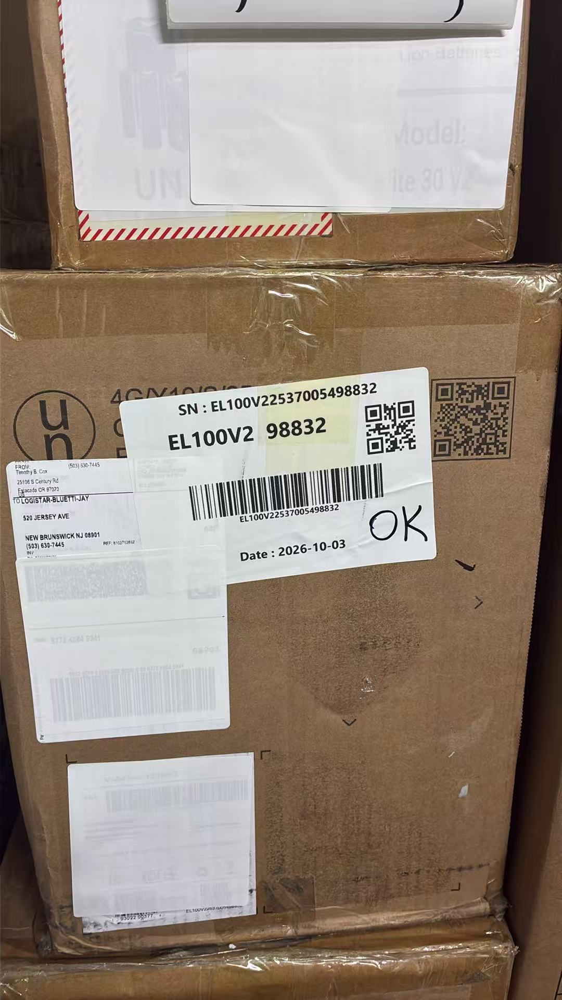

The label shows the full SN, model, SN suffix, QR code, barcode and date, with a handwritten **OK**. Other old labels are covered with white labels. Match work-order SN/model to the box. All photographed identifiers and dates are examples; use the current unit's records.

## 2. Scan the SN in after-sales receiving inspection

Open BLUETTI after-sales **入库检测** (receiving inspection) and scan the SN.

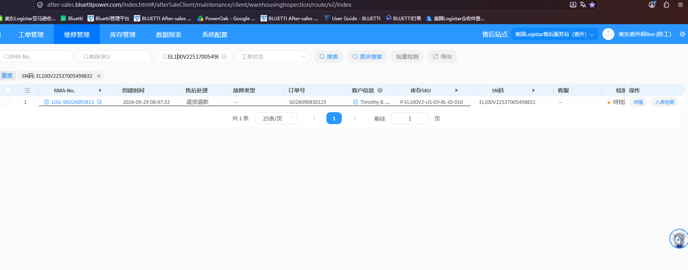

The list includes RMA, creation time, after-sales handling, fault, order, customer, inventory SKU, SN and inspection status. Verify the SN. The example shows one “退货退款” (return/refund), “待检测” (awaiting inspection) record with “详情” (details) and “入库检测”; actual results govern.

## 3. OK branch: inspect and complete

### 3.1 Verify what OK means

If the label only says OK, find the after-sales work order by SN. Explain the specific reported fault to the technician; confirm the technician's identity, whether the fault was reproduced, whether repairs occurred and what was done. Record the answers in the work-order remarks. **OK alone is not a pass.**

Use this branch only after confirming normal operation for the reported issue and no repair/replacement requiring registration. Box-only refurbishment follows section 4; actual repair or other replacement requires its actual processing records.

### 3.2 Record the original receiving condition

Open 入库检测. Package type, included accessories and appearance must describe **the customer's return as received**, using receiving records or physical confirmation. Record later box changes/accessory additions separately; do not overwrite the original condition.

| Field | Example selection only |
| --- | --- |
| 包装类型 / Package type | 原包装 / Original package |
| 包含配件 / Included Accessories | 标配齐全 / Completed accessories |
| 裸机外观检查 / Powerstation appearance inspection | 有轻微划痕 / Slightly scratches |

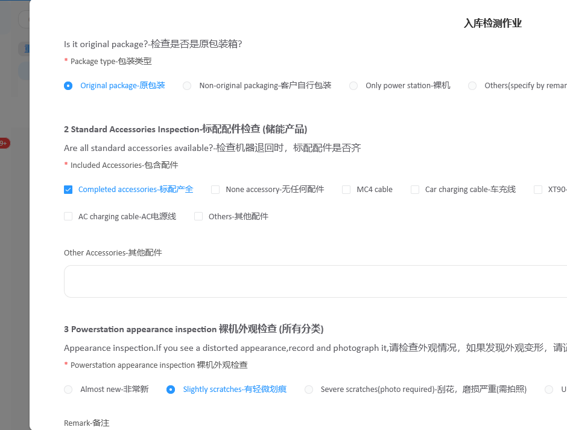

Under **入库判定** (receiving decision), select **检测通过** (inspection passed), then **完成检测** (complete inspection).

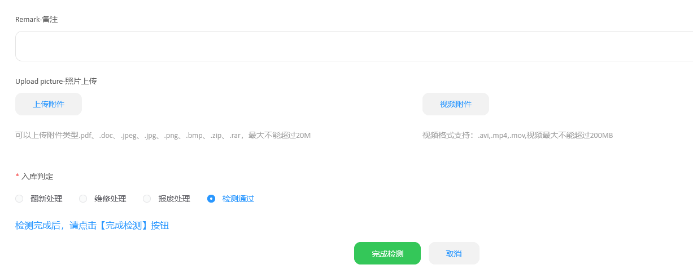

In the confirmation dialog:

1. Set **货品成色** (condition grade) to **8.5新**.
2. Check **作业时间** (operation date) against the actual inspection date. For late entry, use the original date, not today's default. The pictured 2026-10-14 is an example.
3. Select **确定** (confirm) to submit.

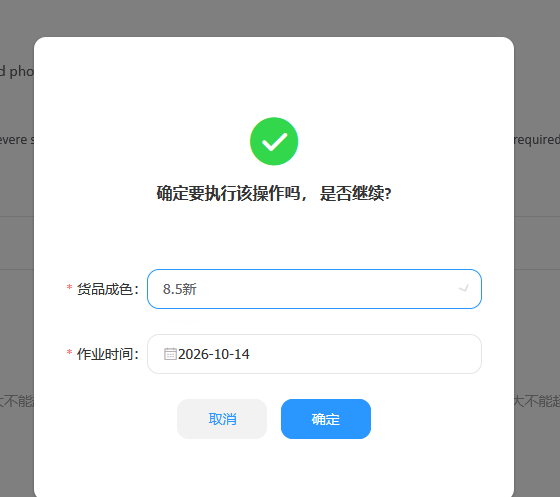

## 4. Box-only refurbishment

If **only the box was refurbished**, select **翻新处理** (refurbishment) under 入库判定, then 完成检测.

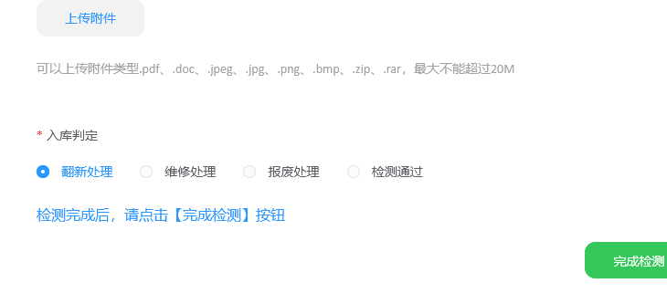

Open **产品翻新表** (product refurbishment list), search by SN and select the refurbishment entry, shown as **待翻新** (awaiting refurbishment), to enter 产品翻新作业.

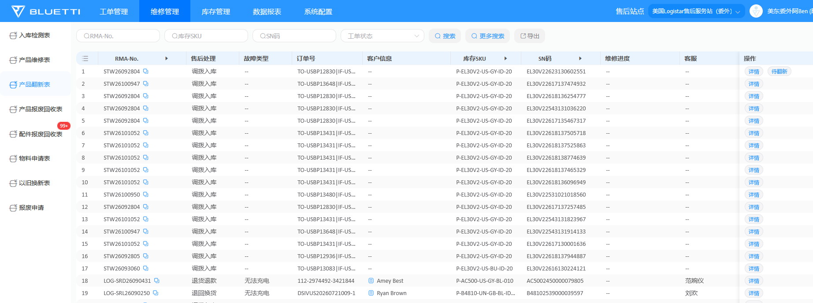

### 4.1 Request actual packaging materials

Verify the SN, select **申领物料** (request materials), search the actual packaging, select the inventory SKU, enter the actual quantity and **保存** (save).

**INB** means inner box; **UNB** means outer box. The example searches `UNB-EB3A`, selects `A-UNB-EB3A-6C06A0`, quantity 1. Use the current model and actual materials, not the example SKU.

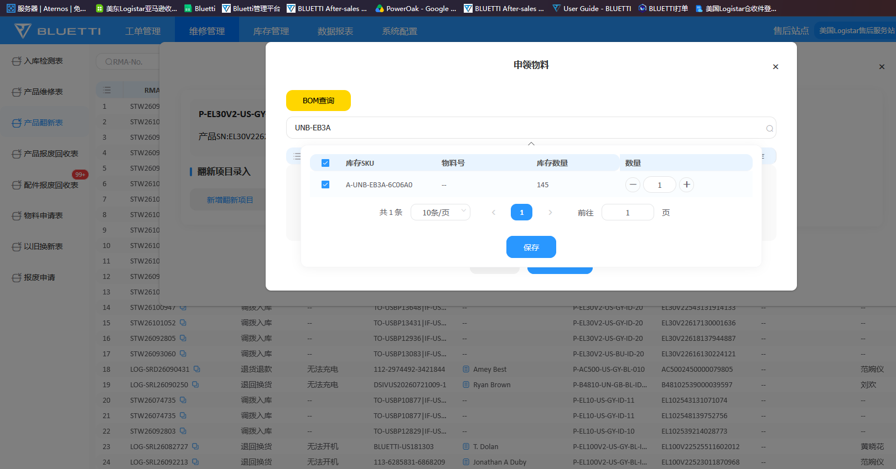

### 4.2 Register refurbishment and receive into stock

Select **新增翻新项目** (add refurbishment item) and record the materials and actual work. Example selections must agree with actual work and requested materials:

| Field | Example |
| --- | --- |
| 是否领料 / Materials requested | 是 / Yes |
| 翻新类别 / Category | 包装材料（外箱、内箱、珍珠棉） / packaging (outer/inner boxes, EPE foam); 辅材配件（说明书、保修卡、塑料袋） / supporting items (manual, warranty card, plastic bag) |
| 功能配件（适配器、线材） / Functional accessories (adapters, cables) | Not selected |
| 其他（备注说明） / Other (remarks) | Not selected |

Remarks are blank in the screenshot. Verify materials and entries, then select **完成翻新入库** (complete refurbishment receiving).

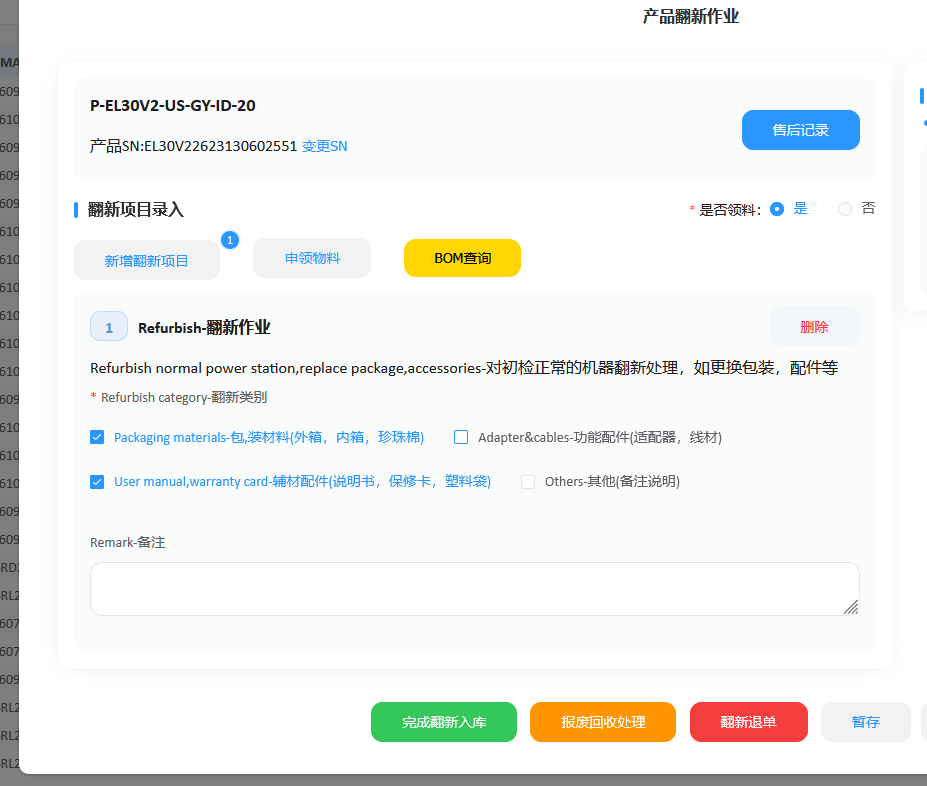

### 4.3 Confirm completion and condition grade

In **是否确认翻新成功** (confirm successful refurbishment), set 货品成色:

| Actual situation | Grade |
| --- | --- |
| Box replaced during refurbishment | 9.0新 |
| Box not replaced | 8.2新 |
| Very poor condition | 8.5新 or 8.0新 according to actual condition |

For very poor condition, do not automatically use the usual box-replaced/unchanged value. Criteria distinguishing 8.5新 from 8.0新 remain to be specified.

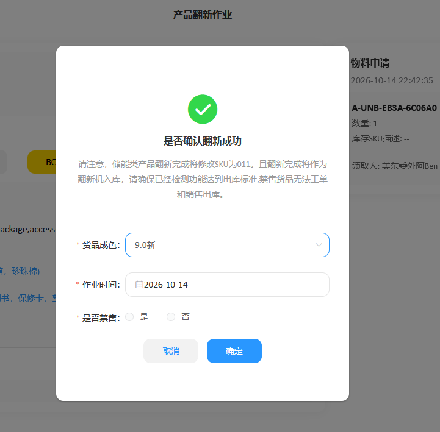

Use the actual refurbishment completion date; for late entry verify the original date with the operator/records. Set **是否禁售** (sale prohibited) according to actual circumstances; detailed criteria remain pending. Select 确定. The pictured date is an example.

The post-refurbishment label-printing procedure remains to be documented.

## 5. OK branch: print the dual-QR label from details

After inspection, open the record's **详情**, select **打印** (print) and review the dual-QR preview.

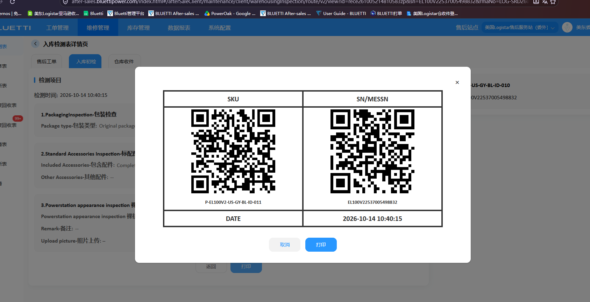

The left QR is **SKU**, the right QR is **SN/MESSN**, with date/time below. Match SKU and SN against the current unit, then select 打印 at the bottom. The screenshot's identifiers/date are examples.

### 5.1 Verify the processed SKU

`-10` identifies factory-new units and becomes `-11` after passing inspection, refurbishment or repair. `-20` identifies bulk-procurement-channel units, normally handled through putaway, and becomes `-21` after refurbishment. The system may display `-010`, `-011`, `-020`, `-021`.

Use the current system's **complete SKU**, not the pre-processing SKU. Normal suffix conversion does not change the SN; still verify the unit's SN.

### 5.2 Attach labels

Position the unit **“up to top” (front facing up)**. Of the box's front/back/left/right faces, attach the dual-QR label to the **smallest, narrowest face**, covering the original receiving label.

**Cover other old labels too.** Inspect all faces and completely cover obsolete work/shipping labels, addresses, barcodes and QR codes with blank white labels. Keep the current dual-QR label fully visible and readable.

## 6. Build the pallet

Sections 6–11 end at **pallet prepared and delivered to the putaway area awaiting confirmation**.

Sequence: stack neatly with labels outward → scan left SKU/right SN on each box → save TXT/import WPF → enter pallet number, print summary and two detail lists → verify/sign → wrap → attach list/summary → move to putaway area and wait.

When a pallet has **more than 10 and fewer than 30 units (11–29)**, stack neatly with **labels outward**. Count actual units and check each current dual-QR label is accessible/scannable; obsolete work/shipping labels must be covered. Original product, orientation and dangerous-goods markings are not old work/shipping labels and must not be covered as such.

Physical units, scan file, detail lists and summary must always represent the same batch. If units are added, removed or exchanged after scanning, update scans, recheck and reprint lists/summary.

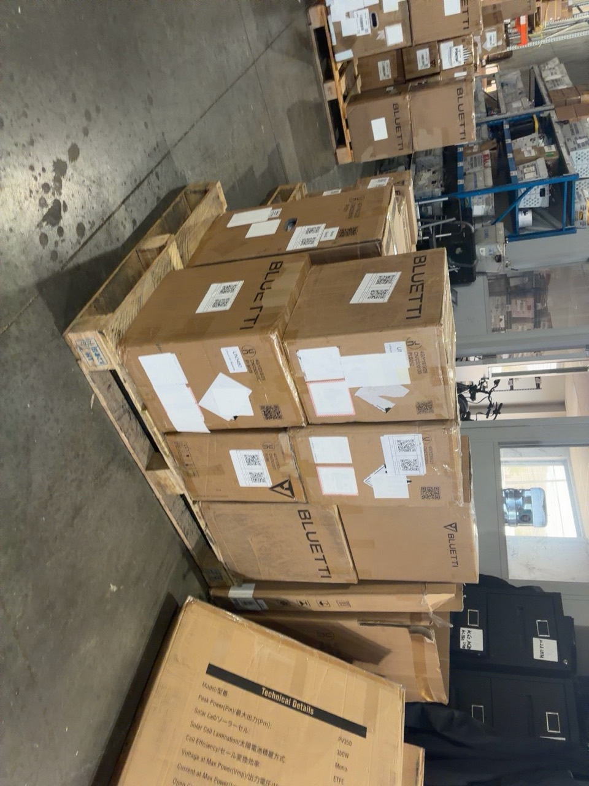

The photo illustrates stacking/labels only, not the required count.

## 7. Scan SKU and SN box by box

1. Scan the **left QR: SKU**.
2. Scan the **right QR on the same box: SN**.
3. Only then continue to the next box, until every box is scanned.

Each box produces two consecutive lines: SKU then its SN. Do not scan all SKUs first and all SNs afterwards.

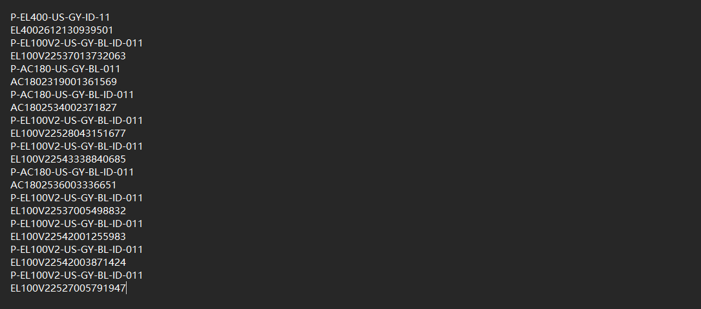

Verify pairing, pair count against the physical count, missing scans, duplicate SNs and shifted order. SKU may repeat across units; every SN must identify its unit. Preserve full current data; screenshot values are examples.

Save a **separate TXT file for this pallet** without mixing other pallets. Reconcile and correct missing/duplicate/misordered entries physically before import; matching totals alone do not prove accuracy.

## 8. WPF good-stock putaway: import TXT, enter pallet and print

### 8.1 Import the checked scan file

In WPF's **上架** (putaway) area, select **良品上架** (good-stock putaway).

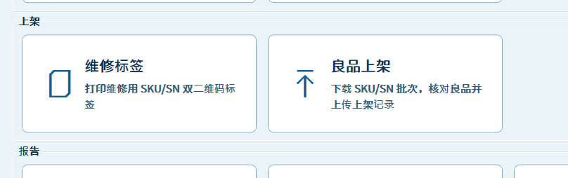

Select **选择 TXT** (choose TXT) and import this pallet's verified alternating SKU/SN file. Check filename/details, total units, SKU count and base-sheet matching results.

The screenshot shows **11 units, 4 SKUs, 11 matched and 0 unmatched**; these are examples. Resolve unmatched scans/base-sheet discrepancies before printing. A successful match only means a record was found; verify the imported SKU/SN against actual units.

**导入基础表** (import base sheet) loads WPF's shared cache; source, refresh frequency and owner remain undefined. **下载批次** (download batch) replaces the current list with a PDA-uploaded SKU/SN batch and rematches it; it does not update the base sheet. This TXT procedure does not require a second batch download.

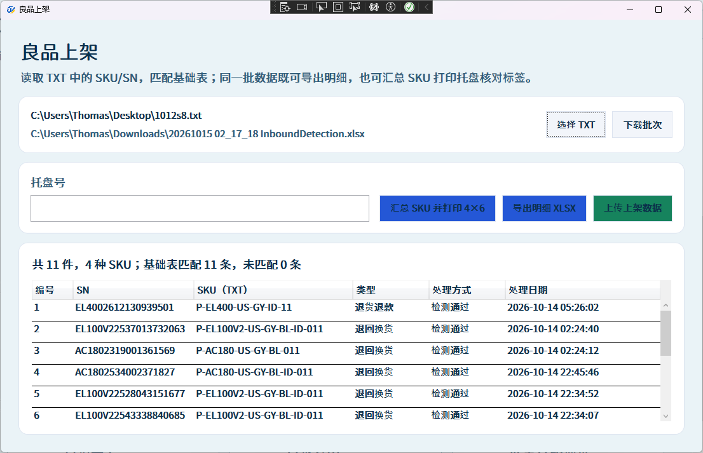

### 8.2 Enter pallet number and print summary

Enter the actual **托盘号** (pallet number), verify it and select **汇总 SKU 并打印 4×6** (summarize SKU and print 4×6). The screenshot's pallet field is blank; actual work requires it before printing.

### 8.3 Print two detail lists and sign

Select **导出明细 XLSX** (export details XLSX). Open the exported file; match SKU, SN and count to the pallet and print **two copies**.

On **both copies**, enter actual **库位** (location), personal **签字** (signature) and actual signing **日期** (date), with identical content. Before signing, reconcile physical count, WPF count, detail rows and summary total, plus each SKU subtotal. Correct and reprint errors before signing.

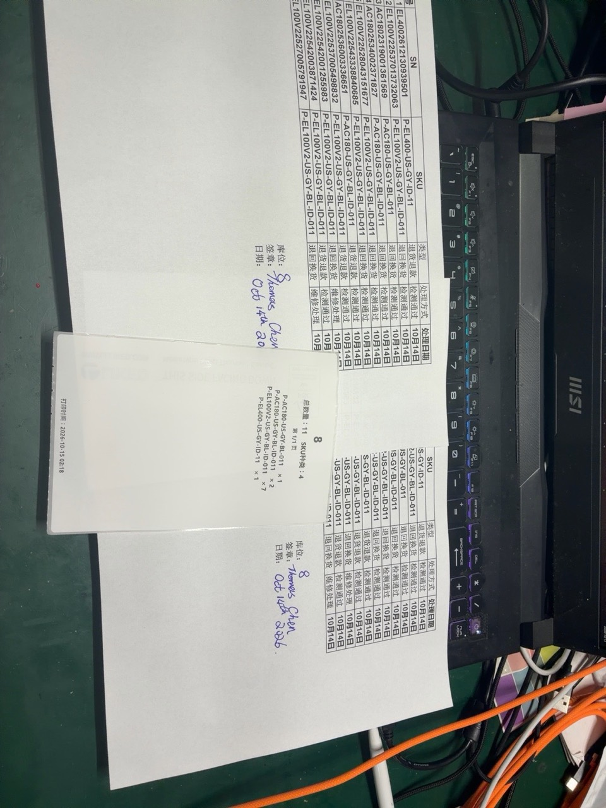

All photographed locations, identifiers, names and dates are examples.

## 9. Wrap the whole pallet

After printing/signing, secure the entire pallet with clear stretch wrap. Check stability; dual-QR labels must remain outward and readable. Avoid creases/glare over codes. Old labels must remain covered.

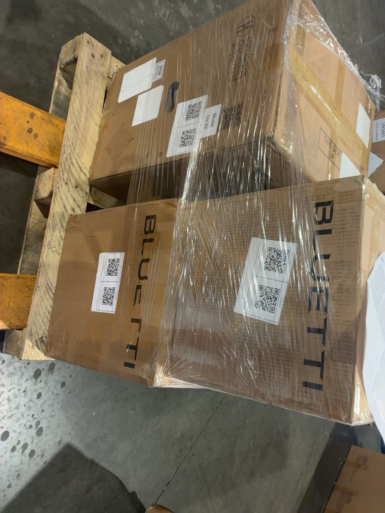

## 10. Attach the detail list and summary

Place one signed/dated/location-completed detail list outside the load, facing outward, and secure it with clear wrap. Attach the **4×6 SKU summary** prominently on the same side, below the list as in the example. Verify pallet number, total and SKU subtotals against the list and goods; keep both readable without covering device QR labels.

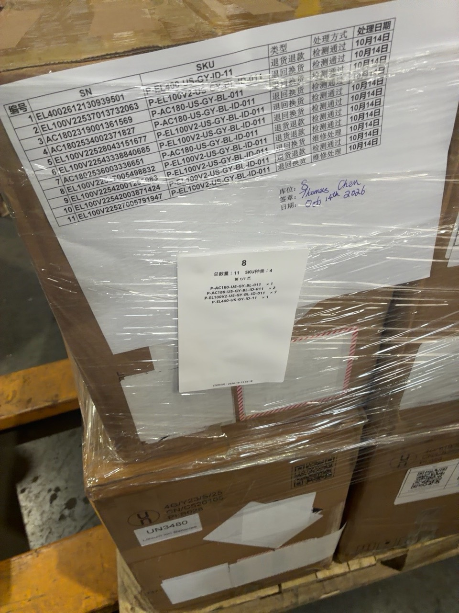

Pallet 8, total 11 and SKU subtotals in the photo are examples only.

## 11. Move to the putaway area and await confirmation

Move the wrapped, documented pallet to the **putaway area**, align pallets neatly in a row and **wait for confirmation**. Face device labels, list and summary toward reviewers. This status is awaiting confirmation.

Check that movement has not loosened goods/wrap, the documents remain attached to the correct pallet and its number is visible. Subsequent confirmation and formal putaway require a follow-on procedure.

The timing for WPF **上传上架数据** (upload putaway data) is not yet defined. Printing and delivery here do not prove an upload or formal system putaway.

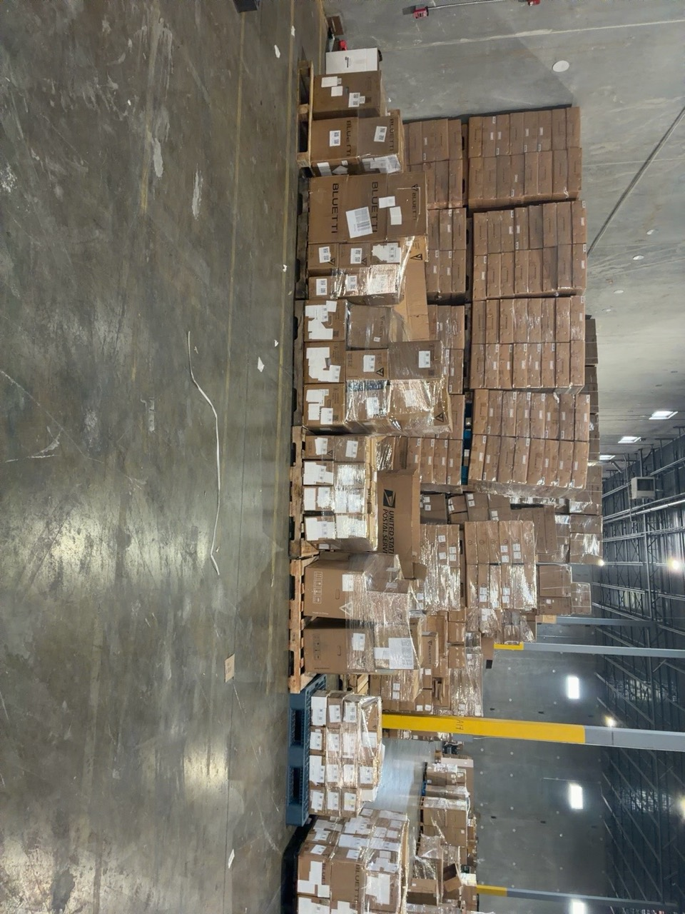

## 12. Unresolved questions

| Topic | Required clarification |
| --- | --- |
| Pallet vs location number | Both are 8 in the example; clarify whether identical, separate entries if different, allocation and duplicate prevention. |
| Second detail copy | Who retains it, recipient and retention method. |
| Confirmation | Reviewer, checks, evidence and discrepancy handling. |
| Upload timing | Before delivery, after confirmation or at formal placement; operator and success verification. |
| Base-sheet refresh | When to download batches, base-sheet source and owner of unmatched records. |
| Counts/stacking | Handling outside 11–29, model weights, stacking and capacity. Count range does not replace load/stack limits. |

Further gaps: 8.5新 vs 8.0新 for poor condition, sale-prohibition criteria, post-refurbishment print entry, other non-OK branches, extra label markings, and confirmation/formal putaway after section 11. Unconfirmed assumptions are not approved rules.
