# BLUETTI: procedimiento de retorno por reparación

[中文](../sop/退回返修SOP.md) | [English](../sop-en/退回返修SOP-en.md) | [Español](../sop-es/Retorno-Reparacion-SOP.md)

[Volver al índice](README.md) | [Guía multilingüe](Language-Guide.md)

Revisión de traducción/índice: 2026-11-09. Se conserva el estado del proceso; las reglas pendientes siguen sin confirmar.

## 1. Información del documento

| Concepto | Contenido |
| --- | --- |
| Productos | Baterías y productos de alimentación BLUETTI |
| Usuarios | Responsables del proceso: gerentes y asistentes |
| Alcance | Verificar órdenes de reparación, registrar trabajos, imprimir etiquetas, crear guías, tramitar salida y registrar carga |
| Etapas previas | Identificación al recibir, reparación y embalaje; se incluyen para enlazar el proceso |
| Fecha de la fuente | 2026-10-15 |

### 1.1 Sistemas y términos

| Sistema/término | Uso |
| --- | --- |
| WPF | Identificar recepciones e imprimir etiquetas de trabajo |
| BLUETTI after-sales | Órdenes posventa, inspección de recepción, reparación y salida |
| OMS | Crear guías FedEx y consultar importe y número del transportista |
| 钉钉出库返修记录表 | Registro DingTalk de salida por reparación y número del vehículo |
| label / etiqueta | Etiqueta de recepción o reparación; tras reparar se usa la de dos QR |
| SN | Número de serie del equipo |
| RMA | Número de devolución posventa, escrito a mano en la guía |
| FedEx 服务商单号 | Número de seguimiento FedEx, usado en DingTalk y after-sales |

### 1.2 Resumen del proceso

Verificar reparación → registrar inspección y reparación en el sistema → imprimir/pegar dos QR → crear guía FedEx → escribir datos y fotografiar juntos guía/etiqueta → primer registro en DingTalk → salida en after-sales → cargar y completar número del vehículo.

**Uso de ejemplos:** capturas, fotos y cifras sirven para explicar. Las imágenes censuradas son solo para documentación; en registros, impresión y carga usar datos completos del equipo y fotos originales del trabajo.

### 1.3 Sufijos SKU y conversiones

| Sufijo | Significado/conversión |
| --- | --- |
| `-10` | Nuevo de fábrica; pasa a `-11` después de inspección aprobada, reacondicionamiento o reparación |
| `-11` | Estado del SKU de la serie `-10` tras esos procesos |
| `-20` | Canal de compras por volumen, recibido por canje u otras vías; normalmente sigue el flujo de ubicación |
| `-21` | Estado de la serie `-20` tras reacondicionamiento |

El sistema puede mostrar `-010`, `-011`, `-020`, `-021`, respectivamente. Registrar, imprimir y despachar con el **SKU completo actual** de la pantalla. Una conversión normal del sufijo no cambia el SN ni prueba que sea otro producto.

## 2. Etapa previa: identificar retornos al recibir

En el sistema de preavisos WPF, usar **工单导入** (importar órdenes) para identificar retornos por reparación. La etiqueta lleva **维修** (reparación) y se pega tanto en el equipo como en la caja.

Mantenimiento: la importación de órdenes de preaviso WPF tiene un problema conocido pendiente de resolver; podría integrarse una interfaz en el futuro.

## 3. Verificar reparación y decidir tratamiento

### 3.1 Piezas y embalaje

Después de reparar, el técnico debe anotar el trabajo/reacondicionamiento o códigos de piezas, por ejemplo U2, M2, en la etiqueta. Registrar las piezas realmente sustituidas y sus códigos. Las placas incluyen U, M, BMS y A, numeradas 1–8; otras piezas: Fuse (fusible), Screen (pantalla), Wire (cable), Box (caja). Usar nombres/códigos del registro de piezas.

**Requisito actual: cambio obligatorio de fusible en las series EB3A y EL100.** EL100 es la serie; la mayoría son EL100V2, donde V2 significa segunda versión. Registrar el modelo de la etiqueta real. El requisito no prueba que el cambio ya se haya realizado: confirmar el trabajo real.

Durante el embalaje posterior, reparación/embalaje sustituyen las cajas necesarias y lo anotan. Gerente/asistente registran según la etiqueta: **INB = caja interior; UNB = caja exterior**.

### 3.2 Ejemplo de reparación normal

La etiqueta del ejemplo dice OK y **Fuse, Box, Wire**: hay trabajo concreto de reparación. Solicitar el material usado, registrar operaciones e imprimir los dos QR desde los detalles de reparación; después continuar la salida. Distinguir INB/UNB según el cambio real, no deducirlo de la foto.

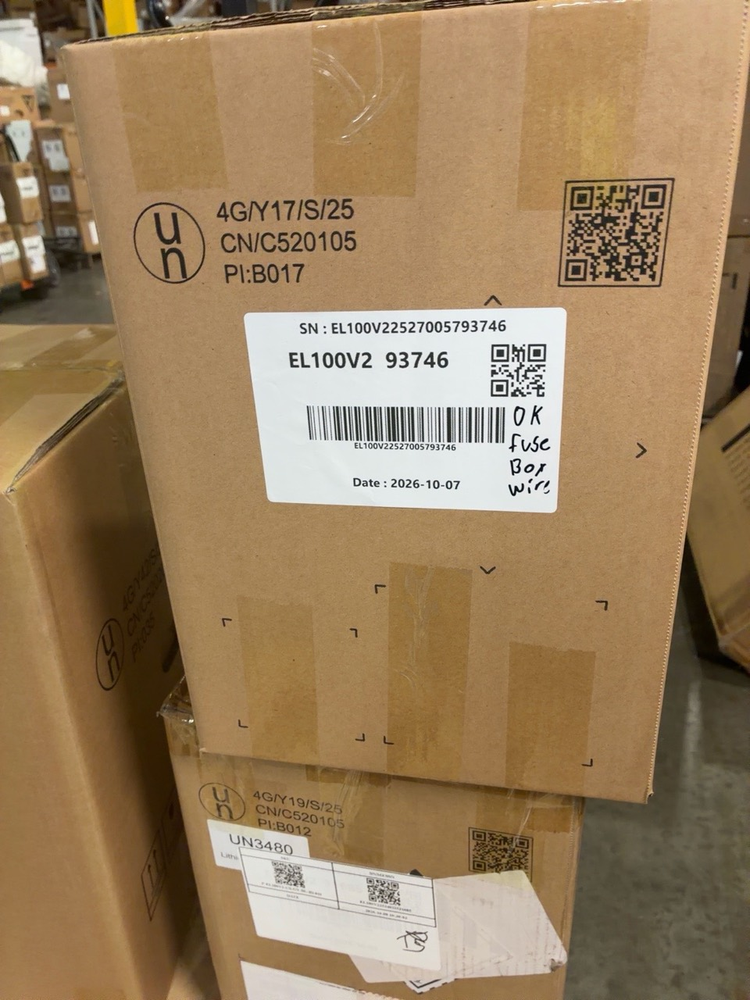

Buscar por SN en after-sales y comprobar **售后处理 = 退回维修** (retorno para reparación) y **故障类型 = 无法开机** (no enciende). En este ejemplo, Fuse concuerda con el fallo y se registran los trabajos reales de Fuse, Box y Wire. Es un ejemplo de verificación, no una solución universal para “no enciende” ni sustituto de la prueba posterior.

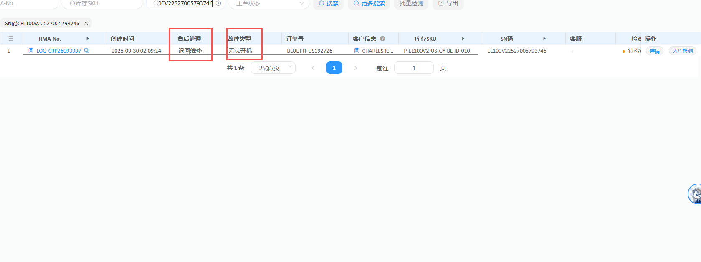

### 3.3 Etiqueta que solo dice OK

Confirmar con el técnico:

- Quién reparó el equipo.
- Si se reprodujo el fallo descrito en after-sales.
- Si hubo reparación y qué se hizo.

Registrar técnico, reproducción del fallo y reparación en las observaciones de la orden. **No aprobar solo por OK.** Primero consultar por SN y explicar el fallo concreto. Si la orden dice “fallo de conexión Bluetooth”, comprobar si se reprodujo/reparó y si Bluetooth funciona ahora.

### 3.4 Ejemplo de comunicación

El gerente explica: **“La orden de este equipo es de retorno por reparación; el cliente reportó un fallo de conexión Bluetooth.”**

La pegatina trilingüe de la foto representa esta comunicación: **no es un paso obligatorio del SOP ni un resultado de reparación/prueba**. Aún se debe preguntar y registrar la respuesta del técnico.

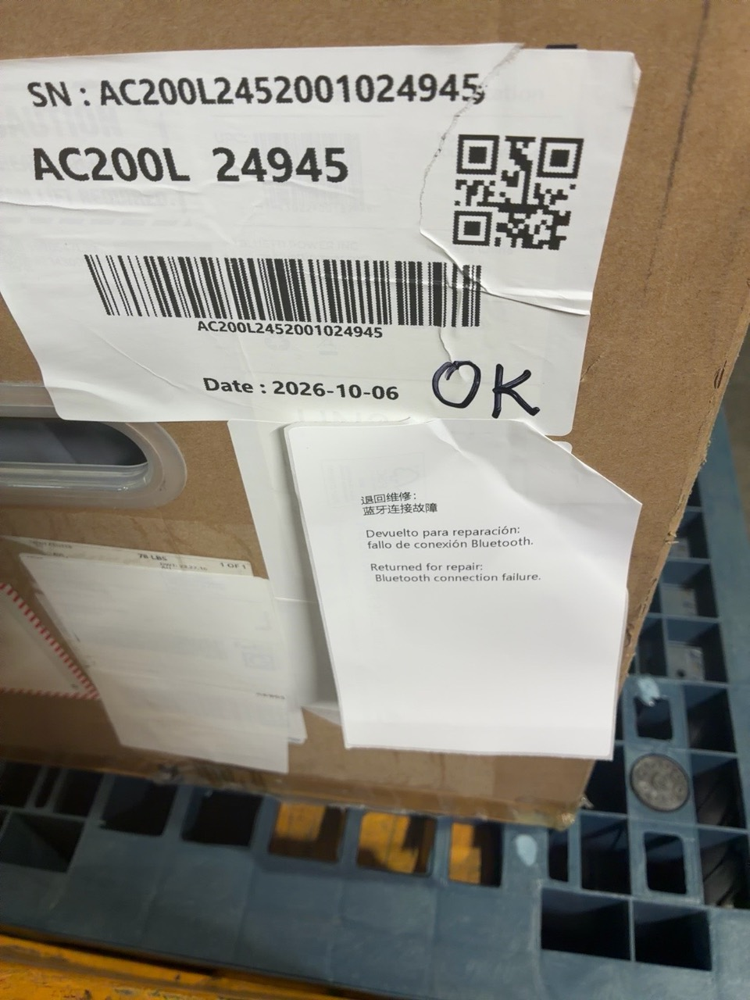

### 3.5 Decisión y permisos

- **检测通过** (inspección aprobada): funcionamiento normal respecto al fallo y sin reparación ni sustituciones que registrar; imprimir desde detalles de inspección.
- **维修处理** (tratamiento de reparación): hubo reparación, cambio de piezas o adición de embalaje/accesorios que registrar; completar registro e ingreso de reparación e imprimir desde detalles de la orden de reparación. Seguir esta rama aunque diga OK.

Si solo dice OK y falta verificar, completar preguntas y observaciones antes de decidir.

En la decisión de recepción, gerente/asistente solo usan 维修处理 y 检测通过. **工单退单** (devolver orden) corresponde a atención al cliente/operaciones; **报废处理** (descarte) a técnicos. La recuperación tras interrupción de salida se explica en la sección 9.

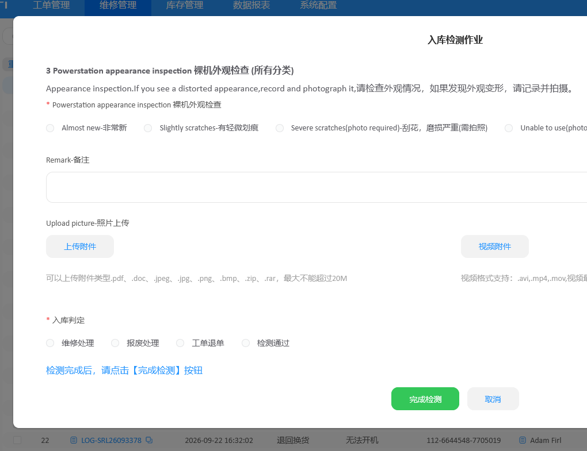

### 3.6 Registrar y confirmar inspección

Abrir 入库检测 de la orden. Embalaje, accesorios y aspecto describen **el estado original recibido del cliente**, según recepción o confirmación física. Registrar caja/cables/manual/relleno añadidos después en reparación, sin sobrescribir la recepción original.

Ejemplo de este equipo: **客户自行包装** (embalaje del cliente), **标配齐全** (accesorios completos), **有轻微划痕** (arañazos leves). Otros equipos se registran según su estado real.

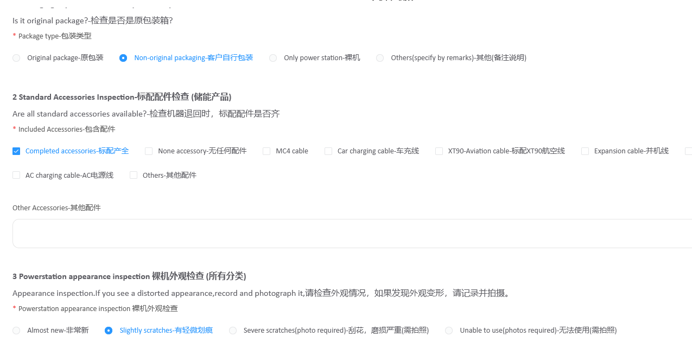

Elegir 维修处理 en **入库判定** y pulsar **完成检测** (completar inspección).

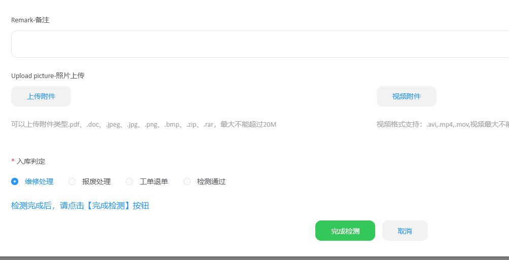

Revisar **作业时间** y pulsar **确定**. Usar la fecha real de inspección; en registros tardíos, la fecha original, no la predeterminada de hoy. La captura es un ejemplo.

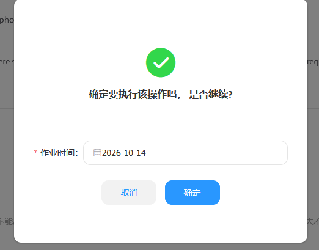

## 4. Registrar reparación y etiqueta de dos QR

### 4.1 Impresión después de inspección aprobada

Para 检测通过, abrir **详情** (detalles) del registro y **打印** (imprimir) para generar los dos QR.

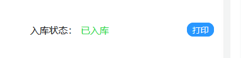

### 4.2 Reparación y solicitud de materiales

En **维修管理 → 产品维修表** (gestión de reparación → lista de reparaciones), localizar el SN y pulsar **待维修** (pendiente de reparación). Dentro, pulsar **申领材料** (solicitar materiales), también mostrado como **申领物料**.

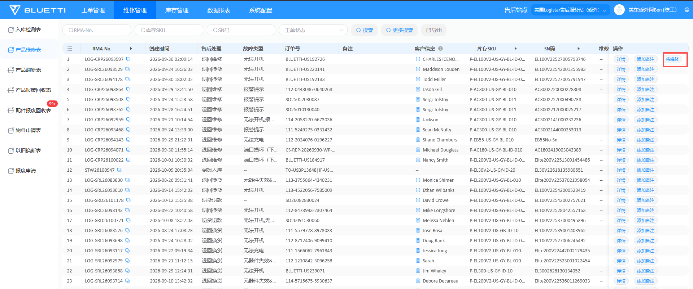

Seleccionar piezas/embalajes realmente usados, introducir cantidades y **保存** (guardar).

| Código | Material |
| --- | --- |
| UNB | Caja exterior |
| T (TEPE en el SKU de ejemplo) | Relleno superior de espuma |
| B (BEPE en el SKU de ejemplo) | Relleno inferior de espuma |
| UMN | Manual |

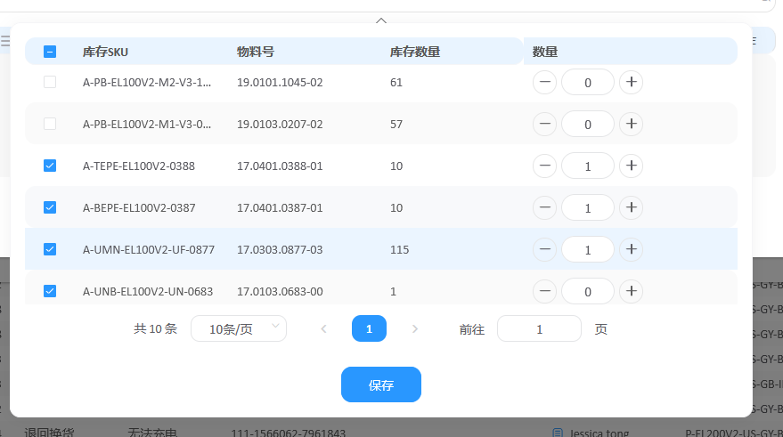

La captura muestra cantidades 1 para ambas espumas y manual; UNB está marcado pero aún con 0: es un registro en curso. Completar cantidades reales antes de guardar; marcar no completa la solicitud. Registrar/solicitar también Fuse, Wire y cualquier material realmente usado, aunque no aparezca aquí.

Consultar el registro de piezas; para cables, el anexo [cables habituales](../sop/attachments/常用线材.xlsx). Registrar piezas y operaciones reales.

### 4.3 Registrar trabajos

Añadir un trabajo de reparación y describir fallo/tratamiento reales. Ejemplo: **故障类别 = 开关机故障** (fallo de encendido/apagado), **故障现象 = 无法开机** (no enciende), **维修动作 = 更换** (sustituir).

Ejemplo de **维修说明** (descripción):

> La orden reporta que no enciende. Se sustituyeron el fusible (Fuse) y la caja exterior (UNB); se añadieron cable (Wire) y manual (UMN), y se sustituyeron los rellenos superior e inferior (T, B).

La descripción debe coincidir con trabajo, piezas añadidas y materiales solicitados. Elegir **责任归属** (responsabilidad) según resultados confirmados; “no enciende” o cambio de fusible no prueban mal uso del cliente. No registrar causas ni resultados de prueba sin confirmar.

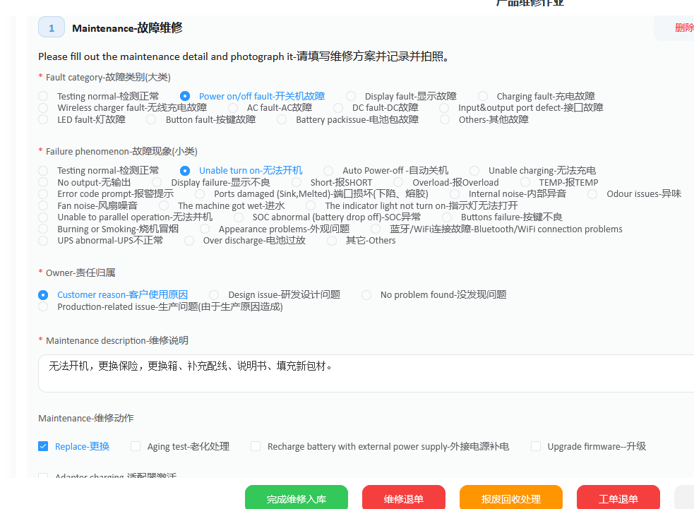

### 4.4 Completar ingreso de reparación e imprimir

1. Pulsar **完成维修入库** (completar ingreso de reparación).
2. En **是否确认维修完成** (confirmar reparación terminada), usar la fecha real de finalización y 确定. Si el gerente registra después, confirmar fecha con técnico/registros; no usar la de transcripción.
3. Volver a 产品维修表 y abrir 详情 del equipo.
4. Elegir **维修工单** (orden de reparación), comprobar **完成维修翻新** (reparación/reacondicionamiento completados) y estado **已入库** (ingresado), y pulsar 打印 en esa fila.

Verificar SKU posterior: `-10` pasa a `-11` tras inspección aprobada, reacondicionamiento o reparación; `-20` pasa a `-21` tras reacondicionamiento y normalmente sigue el flujo de ubicación. Imprimir el SKU actual.

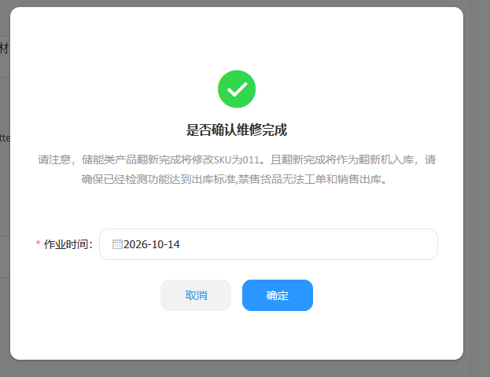

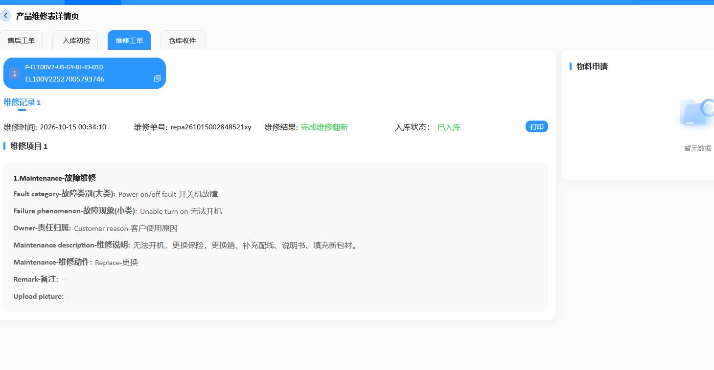

**Entrada obligatoria de impresión:** después de reparación, imprimir desde detalles de la orden de reparación. Volver a la inspección original genera un documento incorrecto. after-sales lo proporciona el cliente y no podemos modificar esta función.

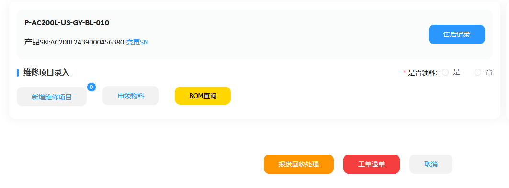

### 4.5 Marcar y pegar etiquetas

Escribir a mano una marca de reparación debajo de la etiqueta; el ejemplo usa **REPAIRED**. Podría usarse sello en el futuro; actualmente sigue siendo manuscrito.

Colocar el equipo **“up to top” (parte frontal hacia arriba)** y pegar la etiqueta de dos QR en la cara más pequeña/estrecha entre delantera, trasera, izquierda y derecha, cubriendo la etiqueta de recepción.

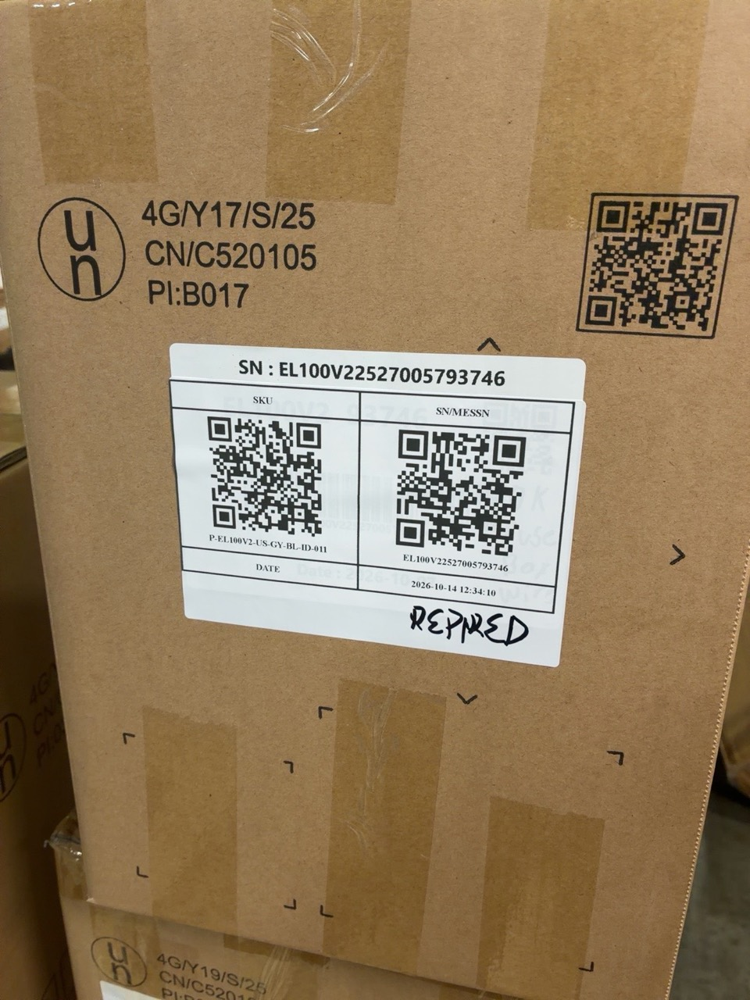

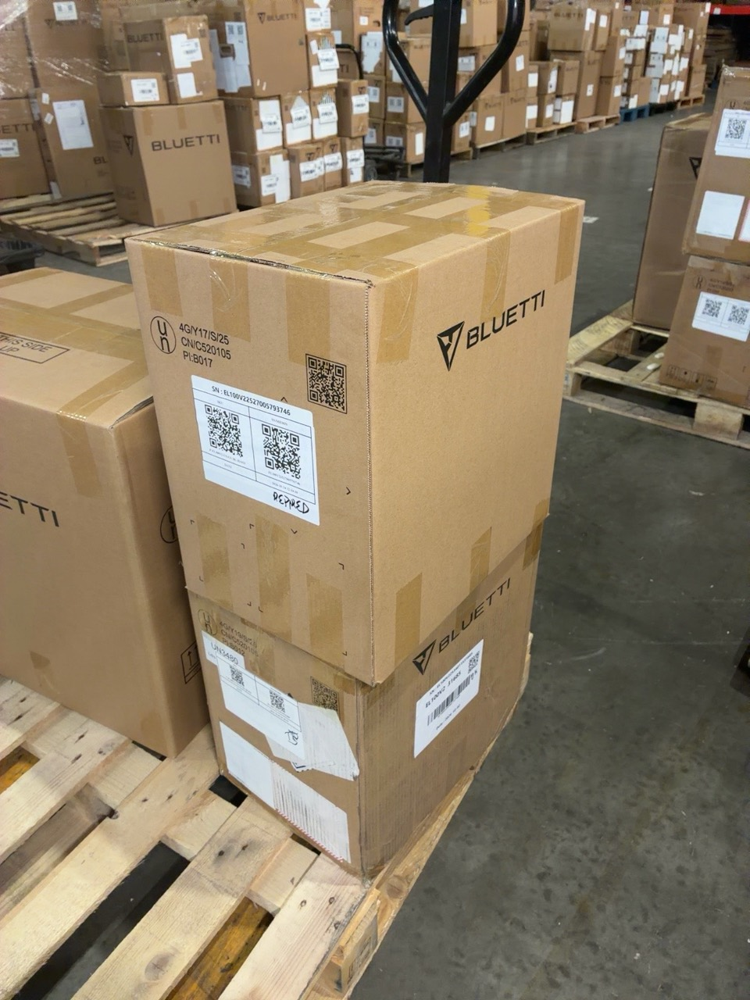

Cubrir con etiquetas blancas las guías antiguas, direcciones, códigos de barras y QR para evitar entregas erróneas. Mantener legibles QR, SKU y SN actuales.

## 5. Embalaje y datos de devolución

Si la caja original sigue siendo utilizable, devolver con ella. Las no utilizables se sustituyen al embalar después de reparar; registrar cambios por INB/UNB de la etiqueta.

En after-sales, abrir **库存管理 → 出库作业执行 → 出库工单需求池** (inventario → ejecución de salida → bolsa de órdenes de salida), buscar por SN y abrir **面单信息** (datos de guía).

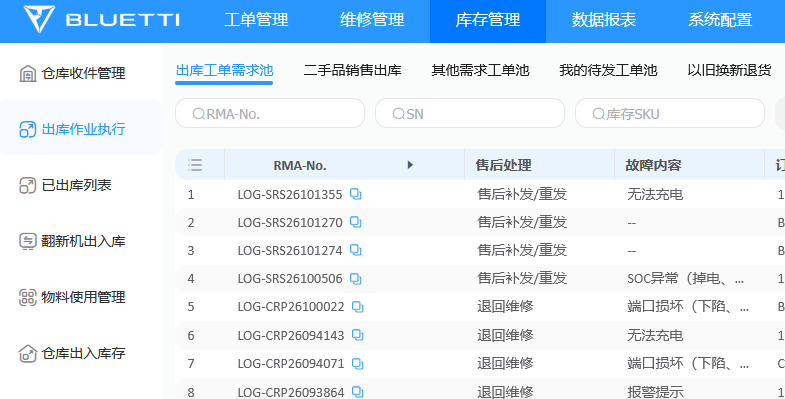

Obtener número de cliente, destinatario y dirección de la orden correspondiente. Atención al cliente introduce los datos y after-sales los valida.

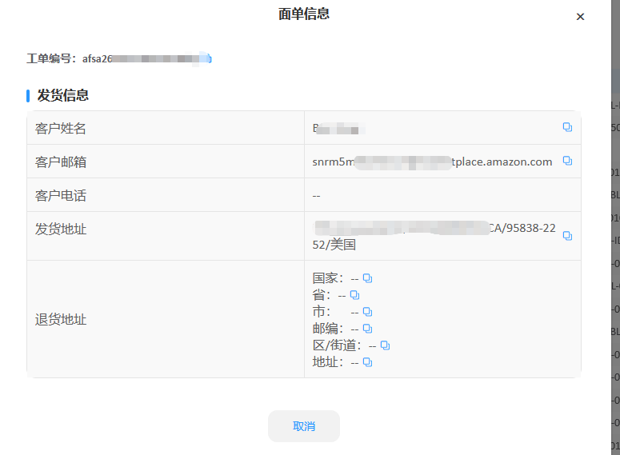

### 5.1 Ejemplo de consulta

Buscar el equipo por SN y abrir 面单信息. Los datos/identificadores están parcialmente censurados en las capturas; copiar información completa del sistema, nunca rellenar con datos parciales de estas imágenes.

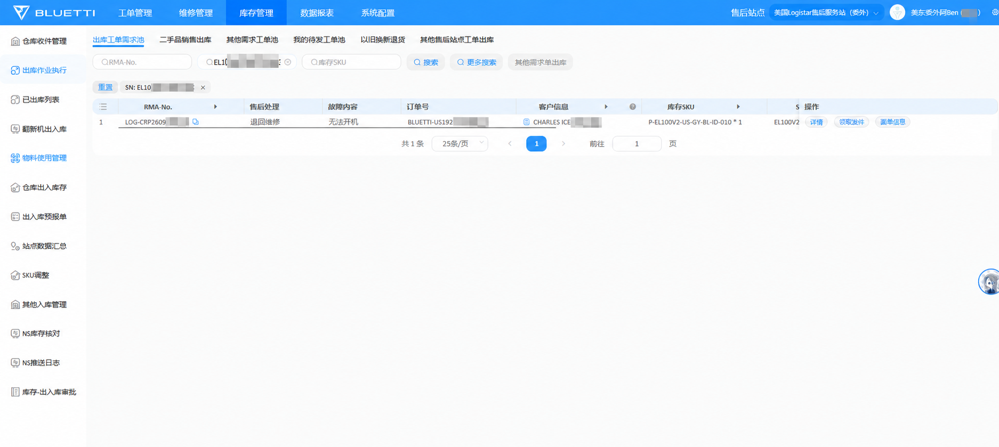

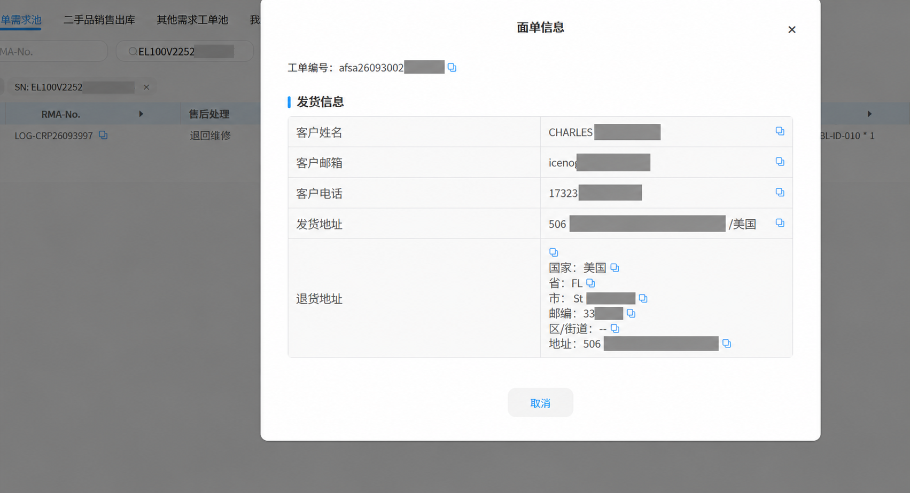

## 6. Rellenar la guía en OMS

### 6.1 Requisitos

- Moneda: **USD / 美元**.
- Unidades: **imperiales**, pulgadas y libras.
- **客户单号** (número de cliente): copiar el identificador correspondiente.
- Destinatario: copiar de la orden after-sales.
- Remitente: cambiar a **发件人信息** y usar **选择地址** a la derecha.
- Peso y dimensiones: consultar [datos por modelo](../sop/attachments/各机型尺寸重量数据.xlsx), Sheet1. Peso en **LB**, dimensiones en **in**, orden largo × ancho × alto. Si falta el modelo, medir y usar unidades imperiales.

Si el cliente no dio teléfono, usar **202-555-0100** como marcador en OMS y anotar internamente “cliente sin teléfono; OMS usa número de marcador”. No es su teléfono real.

**La captura inicial muestra unidades métricas; se deben cambiar a imperiales.**

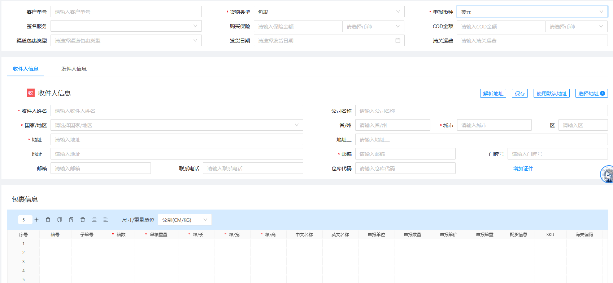

### 6.2 Ejemplo de destinatario y remitente

1. Copiar 客户单号 de after-sales y elegir 美元 como moneda declarada.
2. Completar nombre, país, estado, ciudad, dirección, código postal, correo y teléfono del destinatario con datos completos del sistema.
3. Elegir **英制（INCH/LB）** y completar cajas, peso y dimensiones reales. **1 caja, 21 lb, 16 × 12 × 16 in** es solo el ejemplo, no un valor fijo para otros modelos.
4. Cambiar a 发件人信息, pulsar 选择地址 y elegir el almacén correcto. No poner al cliente como remitente.

Los datos de contacto, dirección y cuenta de estas capturas están ocultos; usar información completa del sistema.

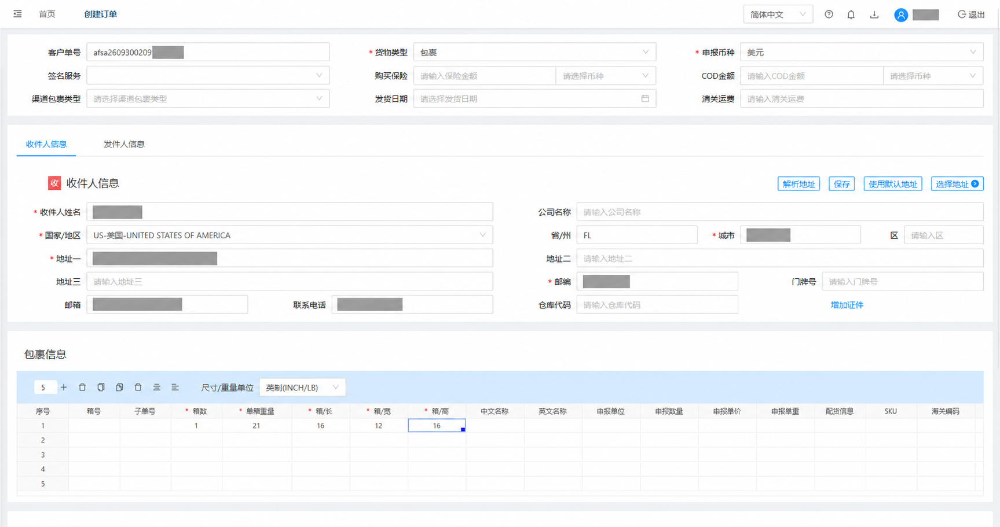

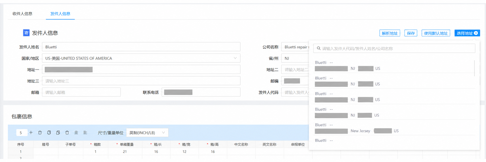

## 7. Pedido OMS, impresión y fotos

### 7.1 Revisar coste y pedir

Continuar con el canal correspondiente. El ejemplo usa **FedEx-美东-NJ**. Abrir detalles de coste, comprobar canal, peso y total estimado, y pulsar **立即下单** (crear pedido).

El ejemplo muestra **13.61 USD** tanto en detalles como al confirmar. Registrar el importe real devuelto por OMS; no tratarlo como tarifa fija. Los detalles muestran 9.525 KG, pero el formulario del paquete sigue usando las unidades imperiales elegidas.

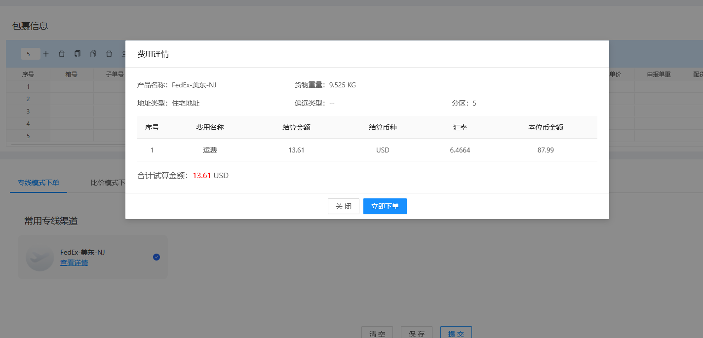

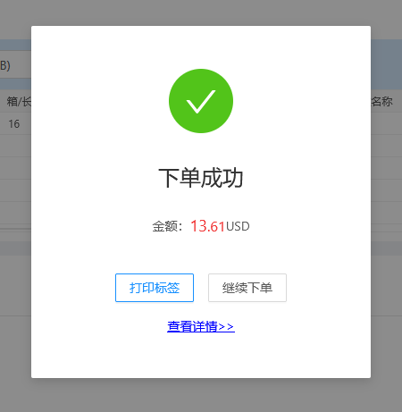

### 7.2 Imprimir y consultar seguimiento

Tras crear el pedido, pulsar **打印标签** (imprimir etiqueta), elegir la impresora real y cantidad y **打印**. El ejemplo usa una copia; elegir equipo según el almacén.

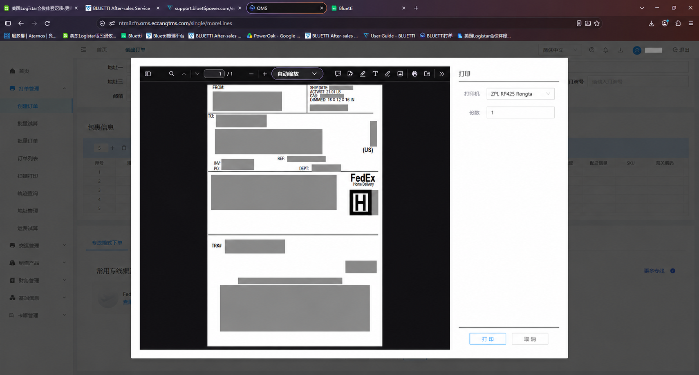

En detalles OMS, consultar **服务商单号** (número del transportista), que debe coincidir con el seguimiento de la guía FedEx. Usarlo en after-sales y DingTalk. No confundirlo con **运单号** interno de OMS ni con 客户单号.

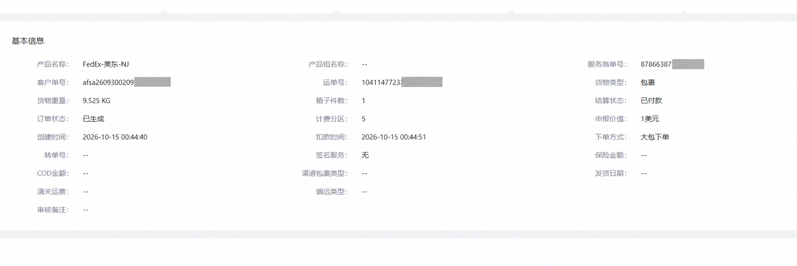

### 7.3 Escribir y conservar fotos

1. Conservar importe OMS y seguimiento FedEx correspondientes a la guía impresa para DingTalk/after-sales.
2. **Escribir a mano SN y RMA en la guía** para evitar confusiones. 客户单号 de OMS es un dato distinto del RMA manuscrito.
3. Fotografiar la guía y los dos QR del equipo **juntos en la misma imagen**.
4. Pasar la foto al ordenador para cargarla al tramitar la salida.

### 7.4 Ejemplos de escritura y foto conjunta

El ejemplo divide modelo y SN en dos líneas para mostrar su ubicación; usar el SN completo correspondiente al equipo y el RMA real.

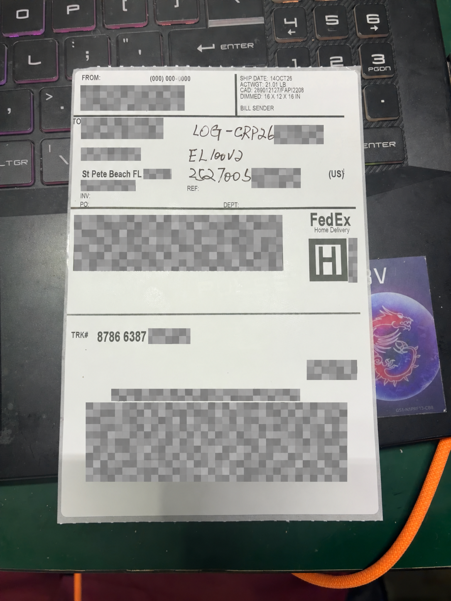

La foto conjunta debe mostrar lo escrito en la guía y la etiqueta correspondiente de dos QR.

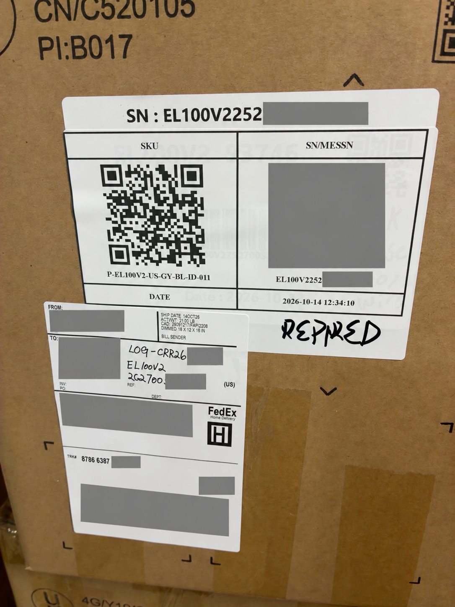

**Las fotos documentales están censuradas. Las fotos reales que se cargan a after-sales deben conservar toda la información; no usar estas imágenes censuradas.** Pasarlas al ordenador para la salida.

## 8. Registro de salida por reparación en DingTalk

Dos etapas: antes de cargar el vehículo, completar todo salvo **承运货箱号** y **确认列**; después, completar 承运货箱号. 确认列 queda fuera de este procedimiento.

### 8.1 Campos

| Campo del sistema | Qué registrar |
| --- | --- |
| 出库日期 | Fecha real de salida; actualizar si termina otro día |
| 设备 SN | SN completo |
| 产品 SKU | SKU correspondiente |
| 产品型号 | Modelo correspondiente |
| 包裹尺寸 | Largo × ancho × alto, pulgadas |
| 包裹重量 | Libras |
| 运费金额 | Importe OMS en USD |
| 承运商及面单号 | Transportista y seguimiento |
| 承运货箱号 | Número del vehículo real; completar después de cargar |
| RMA 编号 | RMA de after-sales |
| 客户单号 | Según definición del sistema, igual al usado en OMS |
| 收件人姓名 | Nombre de la orden |
| 收件人邮箱 | Correo de la orden |
| 收件人电话 | Teléfono de la orden; si falta, indicar marcador usado en OMS |
| 收件地址 | Calle, ciudad, estado, código postal y país completos |
| 确认列 | No rellenar en este procedimiento |

### 8.2 Primer registro y datos posteriores

Antes de crear la guía se pueden registrar fecha conocida, equipo, dimensiones, peso, transportista y RMA. La captura está incompleta: el coste y el seguimiento completo se añaden cuando OMS los devuelva. “Fedex-” solo no es un seguimiento completo.

Esto sigue siendo el primer registro previo a la carga; el número del vehículo se completa en la segunda etapa. SN/RMA están parcialmente ocultos; el registro real lleva datos completos.

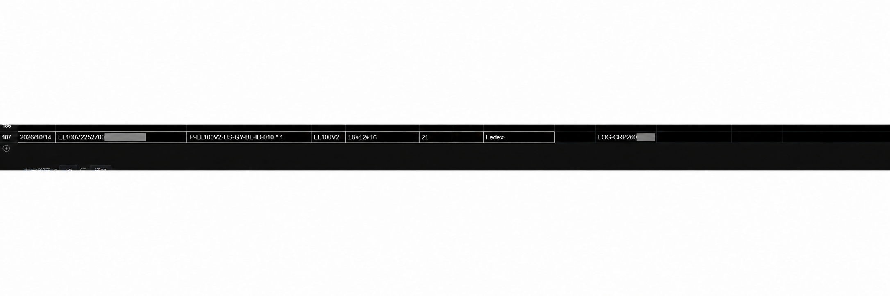

Tras el pedido OMS, completar en **la misma fila** coste y “Fedex-seguimiento completo”, además de número de cliente, destinatario, correo, teléfono y dirección completa. Copiar de after-sales, no de las imágenes censuradas.

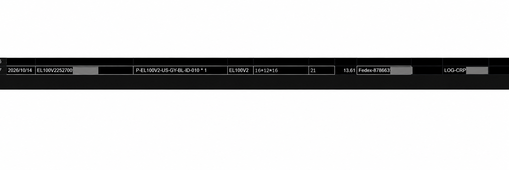

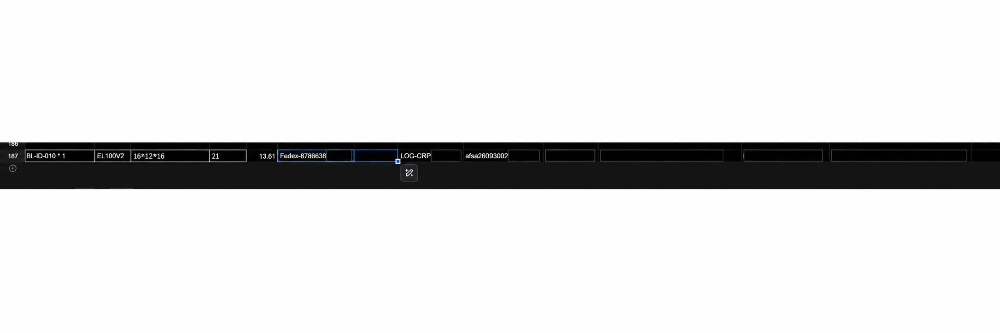

Con importe, seguimiento y destinatario completos termina el primer registro. Completar el vehículo solo después de cargar realmente.

## 9. Tomar la orden y tramitar salida en after-sales

### 9.1 Salida

Preparar seguimiento FedEx y foto conjunta original antes de empezar.

1. Localizar la orden en la bolsa de salida y pulsar **领单发件** (tomar orden y enviar).
2. En **工单发件列表** (lista de envíos), pulsar **出库** (salida) para el equipo.
3. En **出库产品信息**, comprobar SKU/SN actuales y las conversiones normales de 1.3. En **出库物流信息**, elegir **FedEx** en **物流商**, introducir el 服务商单号 de OMS y la fecha/hora real del trámite, coherente con DingTalk.
4. Pulsar **开始出库** (iniciar salida) y avanzar a la pantalla de fotos **出库作业 SOP**. **Este paso cambia el estado y no permite volver directamente al anterior.** Preparar fotos antes de pulsar y procurar terminar sin interrupciones.
5. Pulsar **上传附件** (subir adjunto) y cargar la foto conjunta desde el ordenador: guía con SN/RMA manuscritos y etiqueta de dos QR correspondiente. Confirmar que aparece el adjunto; observaciones según necesidad real.
6. Pulsar **完成出库** (completar salida) abajo. Confirmar éxito del sistema antes de pasar a expedición. **返回工单池** (volver a bolsa) y **发货信息** (información de envío) no completan la salida.

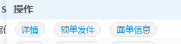

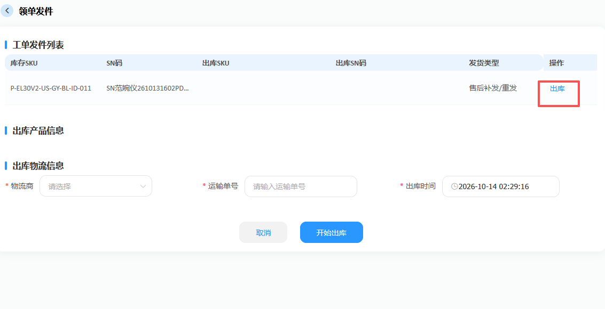

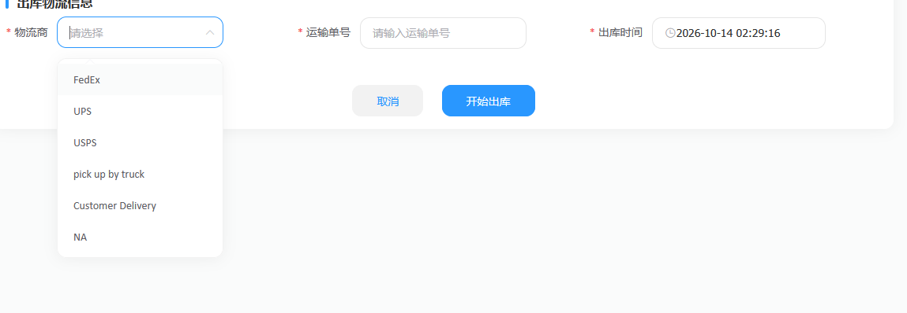

El ejemplo rellenado tiene SN y seguimiento parcialmente ocultos; usar datos completos al operar.

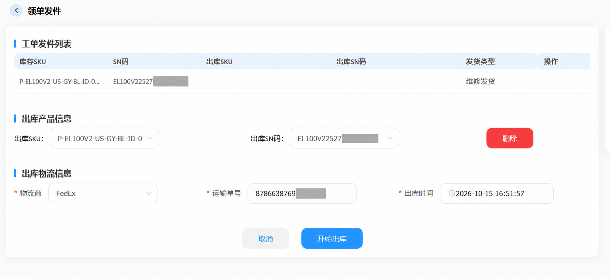

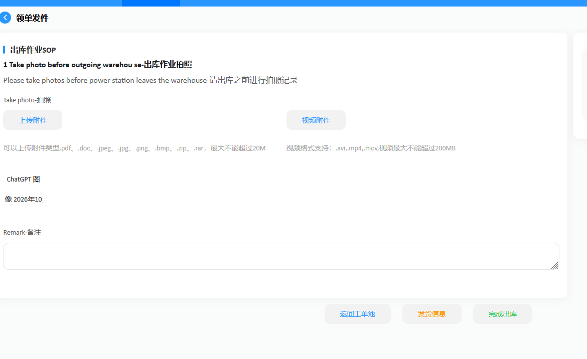

### 9.2 Bloqueo e interrupciones

**La orden queda bloqueada para la cuenta que la toma; otras cuentas no pueden operarla.** Preparar documentación y completar de forma continua.

Si se interrumpe por red u otra causa, volver con **la misma cuenta** y continuar. **解除领取** (liberar asignación) deja registro de operación; evitarlo cuando sea posible.

Si hay que recuperar el estado anterior tras interrumpir la salida, usar **工单退单** a la derecha de esa orden. Este uso de recuperación es distinto de la devolución de orden dentro de la decisión de recepción.

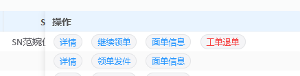

## 10. Cargar y completar número del vehículo

Pegar la guía FedEx en la caja correcta. Tras completar la salida del sistema, llevar el pallet a expedición.

**Todos los días, antes de las 3 de la tarde, llevar los pallets de retorno por reparación al vehículo FedEx Ground.**

Registrar el vehículo real donde se carga el pallet y su número. Después de cargar, completar **承运货箱号** en el registro DingTalk **出库返修记录表** para cerrar el registro.

## 11. Anexos

| Anexo | Uso |
| --- | --- |
| [Dimensiones y pesos por modelo](../sop/attachments/各机型尺寸重量数据.xlsx) | Crear guías |
| [Cables habituales](../sop/attachments/常用线材.xlsx) | Solicitar materiales de reparación |
