# Procedimiento de ubicación en inventario

[中文](../sop/上架SOP.md) | [English](../sop-en/Putaway-SOP.md) | [Español](../sop-es/Ubicacion-SOP.md)

[Volver al índice](README.md) | [Guía multilingüe](Language-Guide.md)

Revisión de traducción/índice: 2026-11-09. Se conserva el estado del proceso; las reglas pendientes siguen sin confirmar.

Estado: en elaboración. Empieza después de la asociación manual/automática, al localizar el equipo mediante su orden.

La revisión del 2026-10-21 confirma que se cubre desde inspección/reacondicionamiento hasta la entrega del pallet preparado **pendiente de confirmación**. **No es un ciclo completo de ubicación.** Faltan responsable de confirmar, momento de carga, ubicación definitiva y entrega. Véase la [revisión de integridad — chino](../上架SOP完备性检查.md). Terminar la sección 11 no acredita ubicación definitiva.

Para verificación previa, estado original de recepción, conversión de SKU y etiquetas, consultar también el [SOP de retorno por reparación](Retorno-Reparacion-SOP.md). Los equipos para ubicación siguen las ramas de inspección/reacondicionamiento de este documento.

## 1. Localizar el equipo mediante la orden

Después de asociar manual o automáticamente, localizar el equipo físico. La caja debe presentar un estado similar al ejemplo.

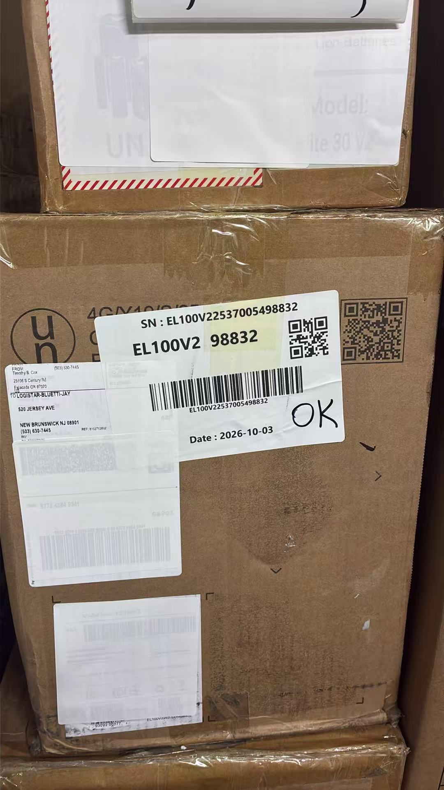

La etiqueta incluye SN completo, modelo, últimos dígitos del SN, QR, código de barras y fecha, con **OK** manuscrito. Las etiquetas antiguas están cubiertas con etiquetas blancas. Comparar SN y modelo de la orden y de la caja. Los identificadores y fechas de las fotos son ejemplos; usar los datos actuales.

## 2. Escanear el SN en la inspección de recepción

Abrir **入库检测** (inspección de recepción) en BLUETTI after-sales y escanear el SN.

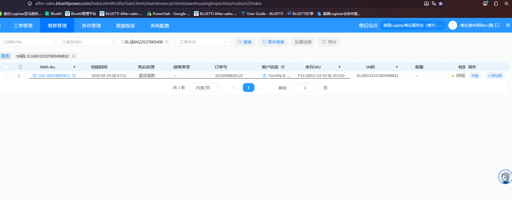

La lista incluye RMA, creación, tratamiento posventa, fallo, pedido, cliente, SKU, SN y estado de inspección. Comprobar el SN. El ejemplo muestra un registro “退货退款” (devolución/reembolso), “待检测” (pendiente de inspección), con “详情” (detalles) e “入库检测”; seguir los resultados reales.

## 3. Rama OK: registrar y completar la inspección

### 3.1 Verificar el significado de OK

Si la etiqueta solo dice OK, buscar la orden por SN. Explicar al técnico el fallo concreto reportado y confirmar quién intervino, si se reprodujo, si se reparó y qué se hizo. Registrar las respuestas en las observaciones de la orden. **OK por sí solo no significa inspección aprobada.**

Usar esta rama únicamente tras confirmar funcionamiento normal respecto al fallo y que no hay reparación ni sustitución que registrar. El cambio exclusivo de caja sigue la sección 4; reparaciones u otras sustituciones deben registrarse según el trabajo real.

### 3.2 Registrar el estado original recibido

Abrir 入库检测. Embalaje, accesorios y aspecto describen **cómo llegó la devolución del cliente**, según registros o confirmación física. Registrar aparte cambios de caja y accesorios posteriores; no sustituir el estado original por el posterior.

| Campo | Selección de ejemplo |
| --- | --- |
| 包装类型 / Tipo de embalaje | 原包装 / Embalaje original |
| 包含配件 / Accesorios incluidos | 标配齐全 / Accesorios completos |
| 裸机外观检查 / Aspecto del equipo | 有轻微划痕 / Arañazos leves |

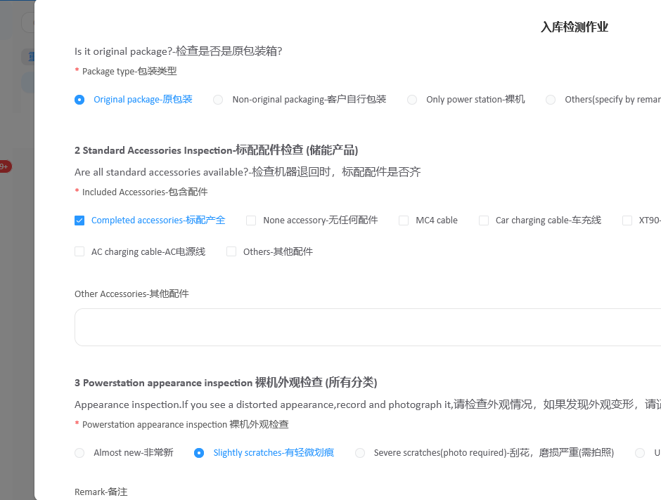

En **入库判定** (decisión de recepción), elegir **检测通过** (inspección aprobada) y **完成检测** (completar inspección).

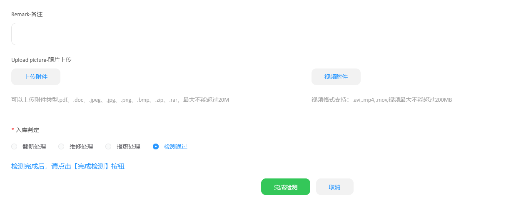

En la confirmación:

1. Elegir **8.5新** en **货品成色** (grado de condición).
2. Verificar **作业时间** (fecha de trabajo): usar la fecha real; en registros tardíos, la original y no la predeterminada del día. 2026-10-14 es solo un ejemplo.
3. Pulsar **确定** (confirmar).

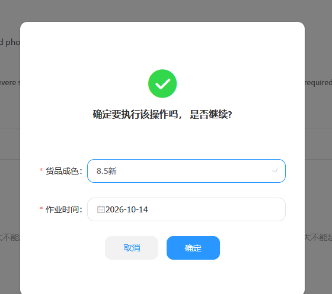

## 4. Reacondicionamiento exclusivo de la caja

Si **solo se reacondicionó la caja**, elegir **翻新处理** (reacondicionamiento) en 入库判定 y pulsar 完成检测.

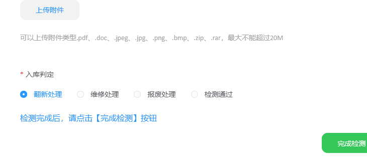

Abrir **产品翻新表** (lista de reacondicionamiento), buscar el SN y entrar por **待翻新** (pendiente de reacondicionar) en 产品翻新作业.

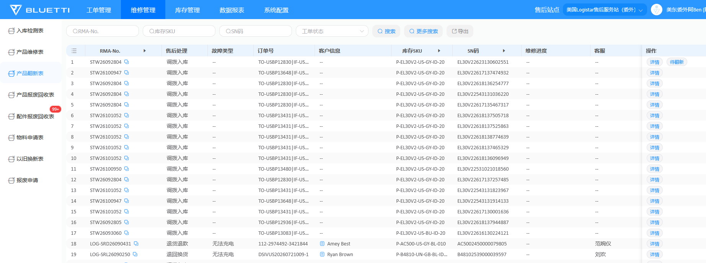

### 4.1 Solicitar el material usado

Verificar SN, pulsar **申领物料** (solicitar material), buscar el embalaje realmente usado, seleccionar SKU de inventario, introducir cantidad real y **保存** (guardar).

**INB** es caja interior; **UNB**, exterior. El ejemplo busca `UNB-EB3A`, selecciona `A-UNB-EB3A-6C06A0`, cantidad 1. No copiar este SKU si no corresponde al modelo/material real.

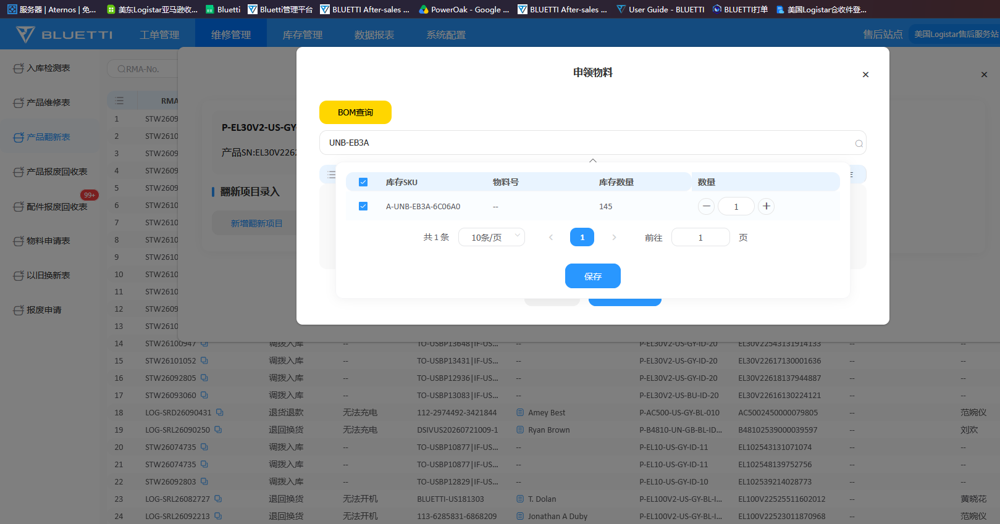

### 4.2 Registrar el trabajo y completar el ingreso

Pulsar **新增翻新项目** (añadir trabajo de reacondicionamiento) y registrar materiales y trabajo reales. Las selecciones deben coincidir con lo realizado y solicitado:

| Campo | Ejemplo |
| --- | --- |
| 是否领料 / Se solicitó material | 是 / Sí |
| 翻新类别 / Categoría | 包装材料（外箱、内箱、珍珠棉） / embalaje (caja exterior/interior, espuma EPE); 辅材配件（说明书、保修卡、塑料袋） / complementos (manual, garantía, bolsa) |
| 功能配件（适配器、线材） / Accesorios funcionales (adaptadores, cables) | Sin marcar |
| 其他（备注说明） / Otros (observaciones) | Sin marcar |

Las observaciones están vacías en la captura. Revisar materiales y registro y pulsar **完成翻新入库** (completar ingreso por reacondicionamiento).

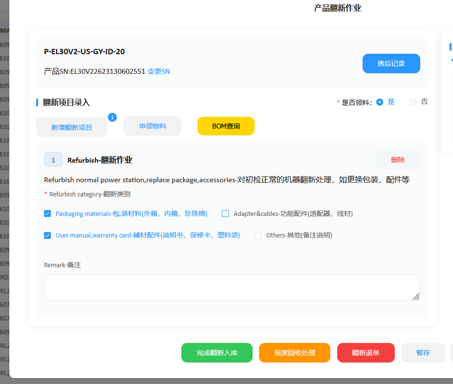

### 4.3 Confirmar y asignar condición

En **是否确认翻新成功** (confirmar reacondicionamiento satisfactorio), asignar 货品成色:

| Situación real | Grado |
| --- | --- |
| Caja sustituida | 9.0新 |
| Caja sin sustituir | 8.2新 |
| Estado muy malo | 8.5新 u 8.0新 según el estado real |

En estado muy malo no aplicar automáticamente el valor normal por cambio de caja. Falta definir la distinción entre 8.5新 y 8.0新.

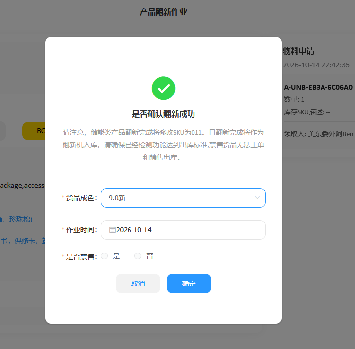

Usar la fecha real de finalización; si se registra después, confirmarla con el operador o registros. Elegir **是否禁售** (venta prohibida) según el caso; faltan criterios detallados. Pulsar 确定. La fecha de la captura es un ejemplo.

La impresión de etiquetas después del reacondicionamiento queda pendiente de documentar.

## 5. Rama OK: imprimir etiqueta de dos QR desde detalles

Tras inspeccionar, abrir **详情**, pulsar **打印** (imprimir) y revisar la vista previa.

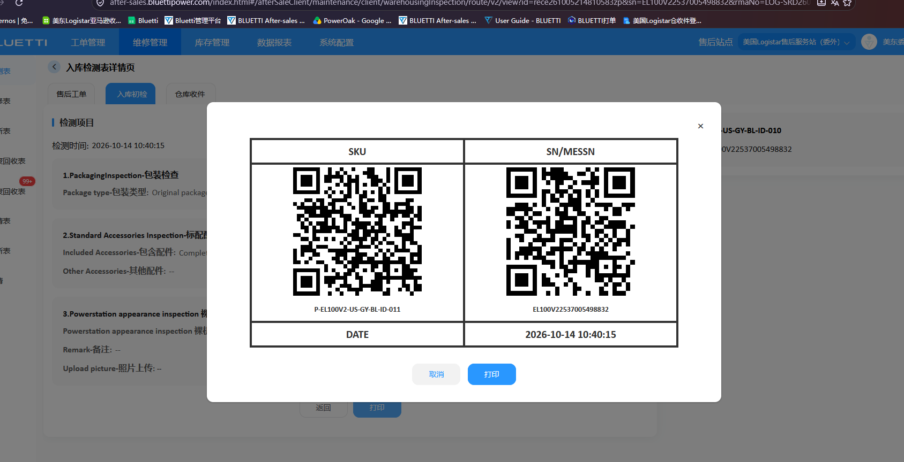

El QR izquierdo contiene **SKU** y el derecho **SN/MESSN**; debajo aparece fecha/hora. Comparar SKU/SN con el equipo actual y pulsar 打印 abajo. Los datos de la captura son ejemplos.

### 5.1 Verificar SKU posterior al tratamiento

`-10` identifica equipos nuevos de fábrica y pasa a `-11` tras inspección aprobada, reacondicionamiento o reparación. `-20` identifica equipos del canal de compras por volumen, normalmente tratados por el flujo de ubicación, y pasa a `-21` tras reacondicionarlos. Pueden mostrarse `-010`, `-011`, `-020`, `-021`.

Usar el **SKU completo actual** del sistema, no el anterior. La conversión normal del sufijo no cambia el SN; comprobarlo siempre.

### 5.2 Pegar etiquetas

Colocar el equipo **“up to top” (parte frontal hacia arriba)**. Entre las caras delantera, trasera, izquierda y derecha de la caja, pegar la etiqueta de dos QR en la **más pequeña y estrecha**, cubriendo la etiqueta de recepción.

**Cubrir también las demás etiquetas antiguas.** Revisar todas las caras y tapar completamente etiquetas antiguas de trabajo/transporte, direcciones, códigos de barras y QR con etiquetas blancas. Mantener la etiqueta actual completa, visible y legible.

## 6. Preparar el pallet

Las secciones 6–11 terminan con **pallet preparado y entregado al área, pendiente de confirmación**.

Secuencia: apilar con etiquetas hacia fuera → escanear SKU izquierdo/SN derecho de cada caja → guardar TXT/importar WPF → introducir pallet e imprimir resumen y dos listas → comprobar/firmar → envolver → fijar lista/resumen → llevar al área y esperar.

Con **más de 10 y menos de 30 equipos (11–29)**, apilar ordenadamente con **etiquetas hacia fuera**. Contar físicamente y verificar cada QR accesible; cubrir etiquetas antiguas según 5.2. No cubrir como etiquetas antiguas las marcas originales de producto, orientación o mercancía peligrosa.

Mercancía, archivo, listas y resumen deben representar siempre el mismo lote. Si se añaden, quitan o cambian equipos después de escanear, actualizar datos, verificar y reimprimir.

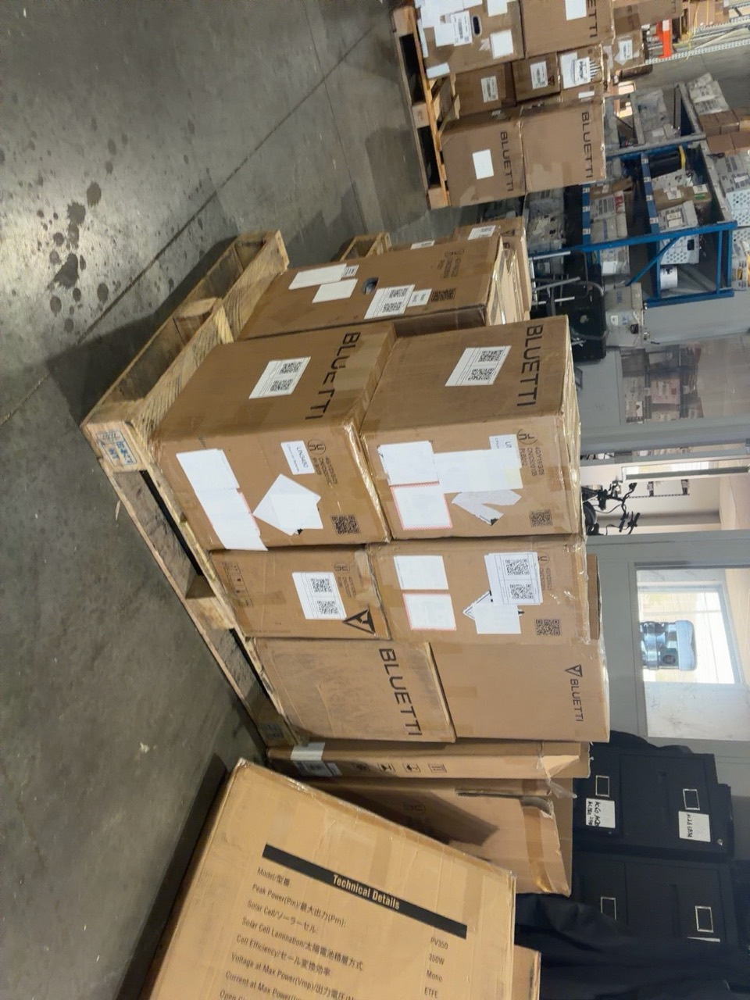

La foto ilustra apilado/etiquetas, no la cantidad obligatoria.

## 7. Escanear SKU y SN caja por caja

1. Escanear el **QR izquierdo: SKU**.
2. Escanear el **QR derecho de la misma caja: SN**.
3. Pasar a la siguiente caja solo después de completar el par, hasta terminar el pallet.

Cada caja genera dos líneas consecutivas: SKU y luego su SN. No escanear primero todos los SKU y después todos los SN.

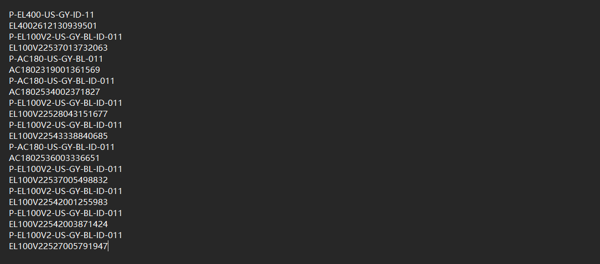

Comprobar pares, cantidad física, omisiones, SN duplicados y desplazamientos de orden. El SKU puede repetirse; cada SN debe corresponder a su equipo. Conservar datos completos reales; la captura es un ejemplo.

Guardar un **TXT independiente para este pallet**, sin mezclar otros. Corregir omisiones/duplicados/orden mediante comprobación física antes de importar; igualdad de totales no prueba exactitud.

## 8. WPF: importar TXT, introducir pallet e imprimir

### 8.1 Importar el archivo verificado

En el área **上架** (ubicación) de WPF, abrir **良品上架** (ubicación de stock apto).

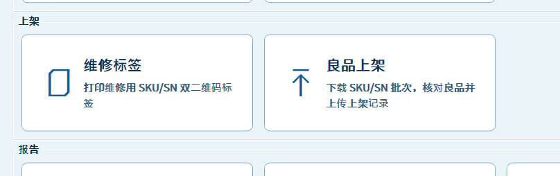

Pulsar **选择 TXT** (seleccionar TXT) e importar el archivo verificado con SKU/SN alternados. Comprobar archivo, detalles, cantidad, tipos de SKU y coincidencias con tabla base.

La captura muestra **11 equipos, 4 SKU, 11 coincidencias y 0 sin asociar**; son ejemplos. Resolver discrepancias antes de imprimir. Encontrar una coincidencia solo significa que existe un registro; comprobar SKU/SN frente a los equipos.

**导入基础表** (importar tabla base) carga la caché compartida de WPF; faltan origen, frecuencia y responsable. **下载批次** (descargar lote) sustituye la lista actual por un lote SKU/SN cargado desde PDA y vuelve a asociar; no actualiza la tabla base. Este flujo TXT no exige descargar de nuevo un lote.

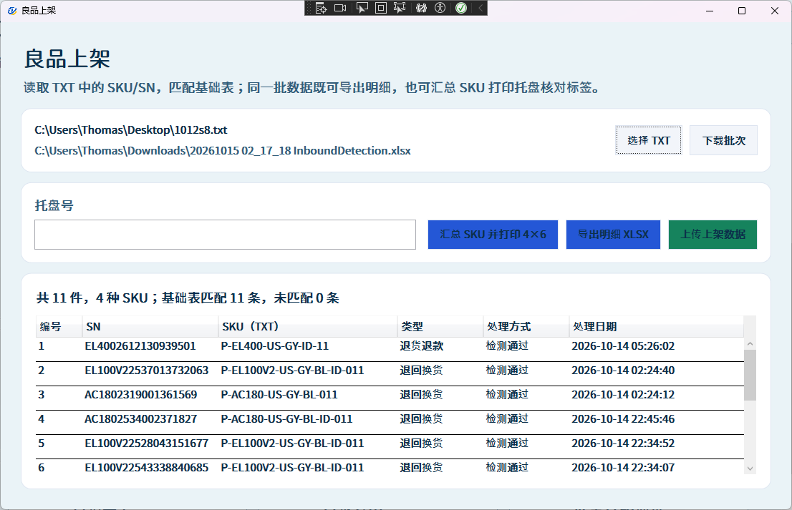

### 8.2 Introducir pallet e imprimir resumen

Introducir el número físico en **托盘号**, verificarlo y pulsar **汇总 SKU 并打印 4×6** (resumir SKU e imprimir 4×6). En la captura está vacío; debe completarse antes de imprimir.

### 8.3 Imprimir dos listas y firmar

Pulsar **导出明细 XLSX** (exportar detalles XLSX), abrir el archivo, comprobar SKU, SN y cantidad e imprimir **dos copias**.

En **ambas**, anotar **库位** (ubicación) real, **签字** (firma personal) y **日期** (fecha real de firma), con contenido idéntico. Antes de firmar, comparar cantidad física, WPF, filas de lista y total del resumen, además de subtotales por SKU. Corregir y reimprimir antes de firmar.

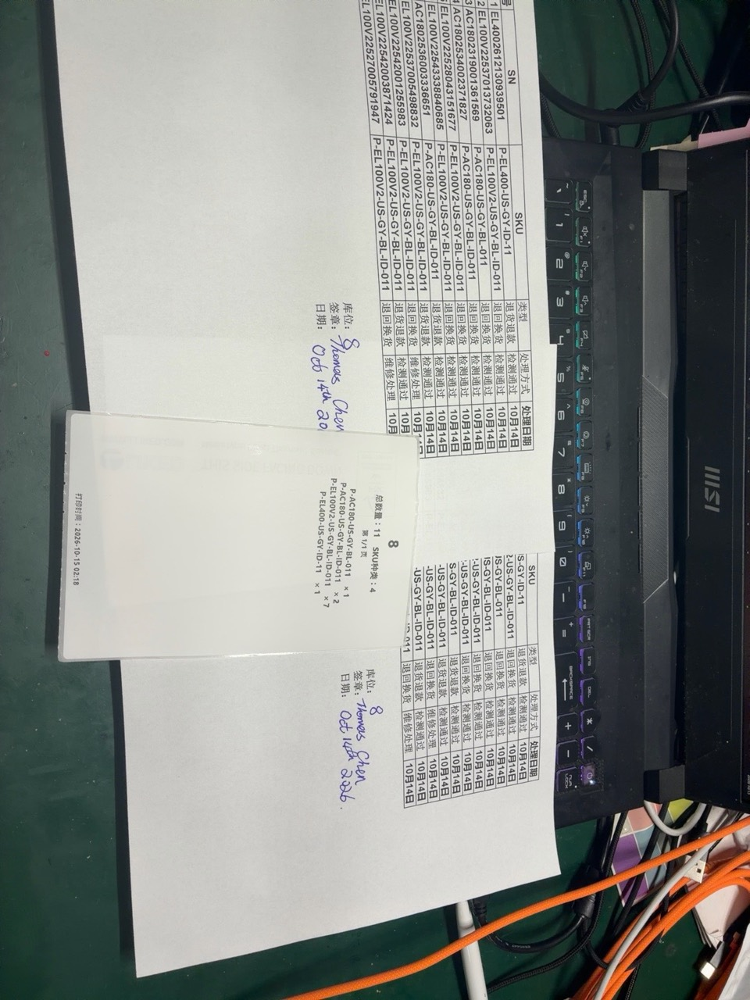

Números, equipos, nombres y fechas de la foto son ejemplos.

## 9. Envolver el pallet completo

Tras imprimir y firmar, sujetar todo con película estirable transparente. Verificar estabilidad y etiquetas de dos QR hacia fuera y legibles. Evitar arrugas/reflejos sobre códigos; las etiquetas antiguas deben seguir cubiertas.

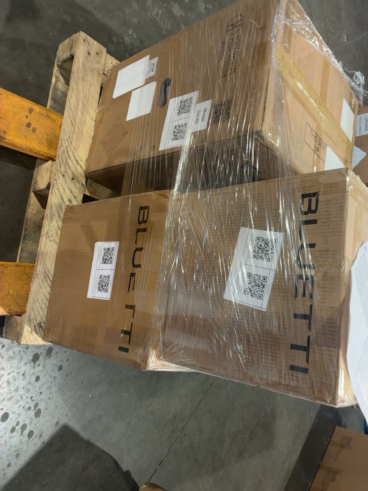

## 10. Colocar lista y resumen

Fijar una lista con ubicación, firma y fecha en el exterior, orientada hacia fuera y sujeta con película transparente. Pegar el **resumen SKU de 4×6** visible en la misma cara, debajo de la lista como en el ejemplo. Comparar pallet, total y cantidades por SKU con lista y mercancía. Mantener legibilidad sin tapar los QR de los equipos.

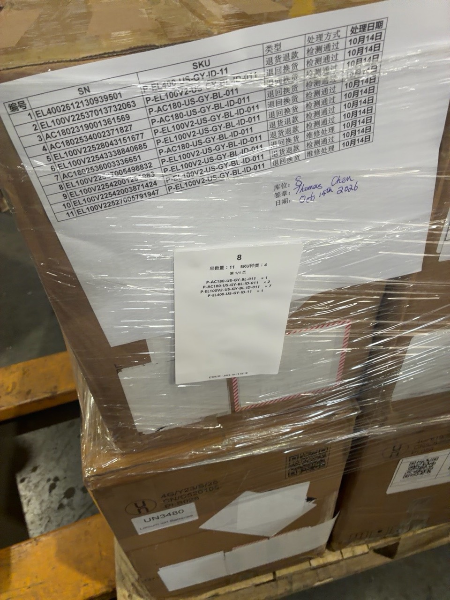

Pallet 8, total 11 y subtotales de la foto son solo ejemplos.

## 11. Llevar al área y esperar confirmación

Llevar el pallet envuelto y documentado al **área de ubicación**, alinearlo ordenadamente y **esperar confirmación**. Orientar etiquetas, lista y resumen hacia el lado de revisión. El estado sigue pendiente.

Comprobar que el traslado no aflojó carga/película, que lista y resumen siguen en el pallet correcto y que el número es visible. Después se requiere el procedimiento de confirmación y ubicación definitiva.

No está definido cuándo usar **上传上架数据** (cargar datos de ubicación) en WPF. Imprimir y entregar aquí no acredita carga ni ubicación definitiva en el sistema.

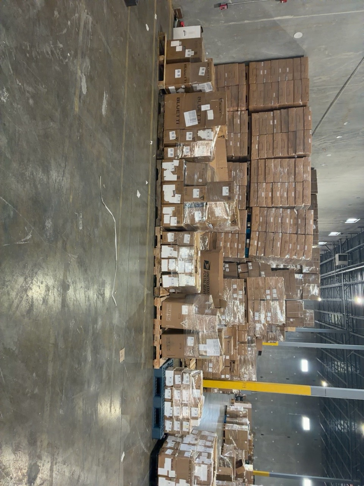

## 12. Cuestiones pendientes

| Tema | Definición necesaria |
| --- | --- |
| Pallet frente a ubicación | Ambos son 8 en el ejemplo; confirmar si coinciden, registrar por separado si no, asignación y prevención de duplicados. |
| Segunda copia | Custodio, destinatario y conservación. |
| Confirmación | Responsable, comprobaciones, evidencia y diferencias. |
| Momento de carga | Antes de entregar, después de confirmar o al ubicar definitivamente; operador y verificación de éxito. |
| Tabla base | Cuándo descargar lotes, origen de tabla y responsable de no asociados. |
| Cantidades/apilado | Casos fuera de 11–29, peso por modelo, apilado y capacidad. La cantidad no sustituye límites reales de carga. |

También faltan criterios 8.5新/8.0新 para mal estado, prohibición de venta, entrada de impresión tras reacondicionar, otras ramas no OK, marcas adicionales y confirmación/ubicación definitiva tras la sección 11. Las suposiciones sin confirmar no son reglas aprobadas.
