# 上架 SOP

状态：整理中。本文承接前置的手动匹配、自动匹配流程，从通过工单找到对应设备开始记录。

2026-10-21 完备性检查：本文已覆盖检测/翻新至整托送达上架区域待确认，**尚不是完整的上架闭环 SOP**。确认人、系统上传时点、正式落位和交接仍待现场明确；详细缺口及代码核对见 [完备性检查](../上架SOP完备性检查.md)。未补齐之前，第 11 节结束只能记录为“待确认”，不能作为正式上架完成依据。

前置核实、入库检测填写、SKU 转换及标签处理要求参考 [退回返修 SOP](退回返修SOP.md) 的补充内容；上架设备仍按本文件对应的检测、翻新分支处理。

## 1. 通过工单找到对应设备

完成手动匹配或自动匹配后，通过工单找到对应的实物设备。找到设备时，外箱应呈现下图所示状态。

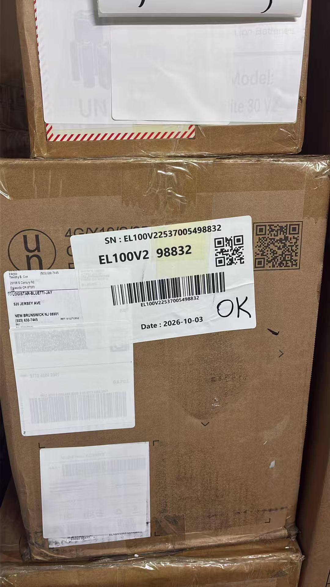

图中外箱贴有设备 label，包含完整 SN、机型、SN 尾号、二维码、条形码和日期，label 上有手写的 **“OK”** 标记。箱上其他旧标签已用白色 label 覆盖。

核对工单与箱上 label 的 SN、机型，确认找到的是对应设备。照片中的机型、SN、尾号和日期仅为示例，实际以当前设备及工单为准。

## 2. 在 after-sales 入库检测中扫描 SN

打开 BLUETTI after-sales 系统的 **“入库检测”** 功能，扫描设备 SN，查询对应记录。查询结果如下图所示。

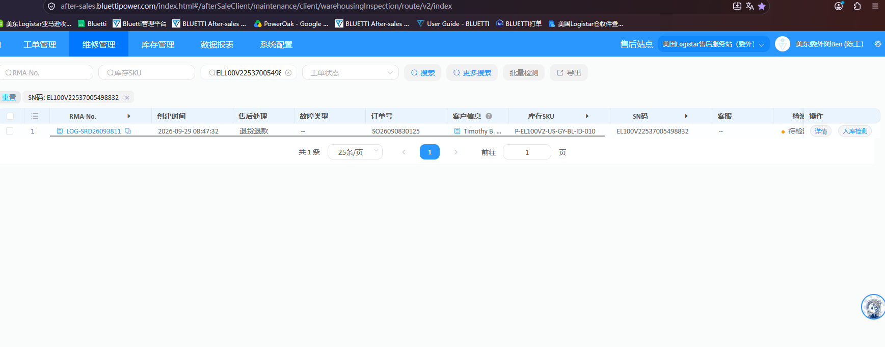

列表显示对应工单的 RMA 编号、创建时间、售后处理、故障类型、订单号、客户信息、库存 SKU、SN 码及检测状态等信息。核对结果中的 SN 与当前设备一致。

本例查到一条记录，售后处理为“退货退款”，检测状态为“待检测”，右侧有 **“详情”** 和 **“入库检测”** 入口。这些内容是截图中该设备的示例，实际以当前查询结果为准。

## 3. OK 情况：填写入库检测并完成检测

### 3.1 核实“OK”标记

label 仅标注“OK”时，先按 SN 查看 after-sales 工单，向维修人员说明工单中的具体故障，核实具体维修人员、故障是否复现、是否实施维修及实际处理内容，将核实结果记录在对应工单备注中。不得仅凭“OK”标记直接判定检测通过。

确认针对工单问题检测正常、无需登记维修或更换配件后，再按本节完成检测通过。只翻新箱子的设备按第 4 节登记；有实际维修或其他配件更换的设备，按实际处理内容完成相应登记，不能套用本节的检测通过分支。

### 3.2 填写原收货情况

点击对应记录右侧的“入库检测”。包装类型、包含配件和裸机外观记录的是**客户退回到仓时的情况**，依据收货记录或现场确认填写。后续换箱、补充配件另记在实际处理记录中，不用处理后的状态覆盖原收货情况。

以下为当前截图的填写示例，其他设备按实际收货情况选择：

| 项目 | 选择 |
| --- | --- |
| 包装类型（Package type） | 原包装（Original package） |
| 包含配件（Included Accessories） | 标配齐全（Completed accessories） |
| 裸机外观检查（Powerstation appearance inspection） | 有轻微划痕（Slightly scratches） |

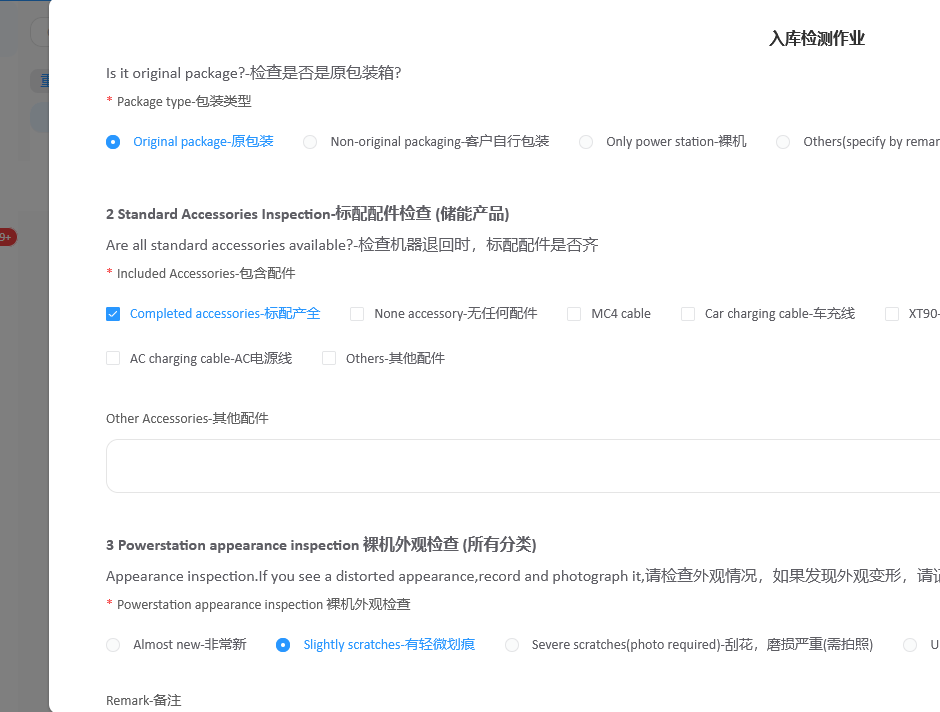

在页面下方的 **“入库判定”** 中选择 **“检测通过”**，然后点击 **“完成检测”**。

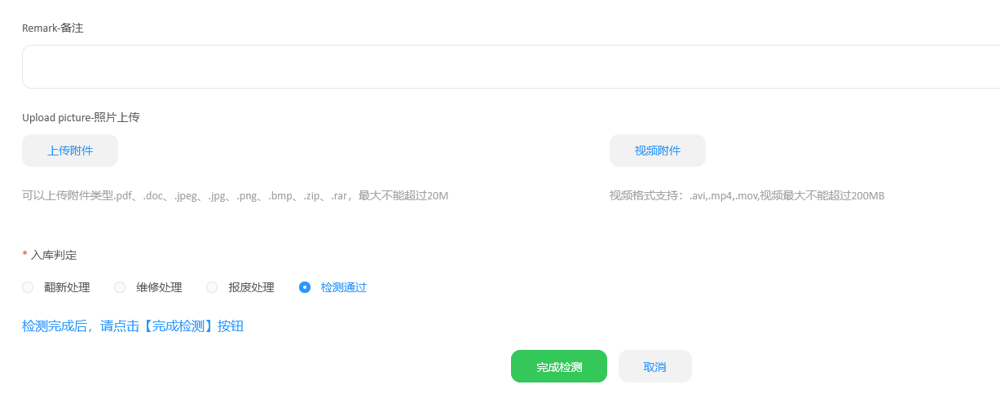

系统弹出确认窗口后：

1. “货品成色”选择 **“8.5新”**。
2. 核对“作业时间”为实际作业日期；补录时填写原作业日期，不直接沿用系统当天默认值。截图中的 2026-10-14 仅为示例。
3. 点击 **“确定”**，提交本次检测。

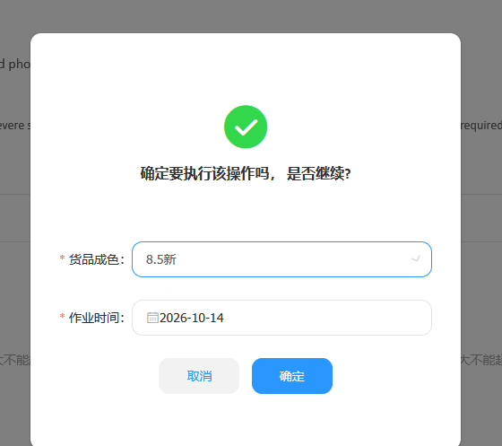

## 4. 只翻新箱子：选择翻新处理

如果 **只翻新了箱子**，在“入库检测作业”的 **“入库判定”** 中选择 **“翻新处理”**，然后点击 **“完成检测”**。

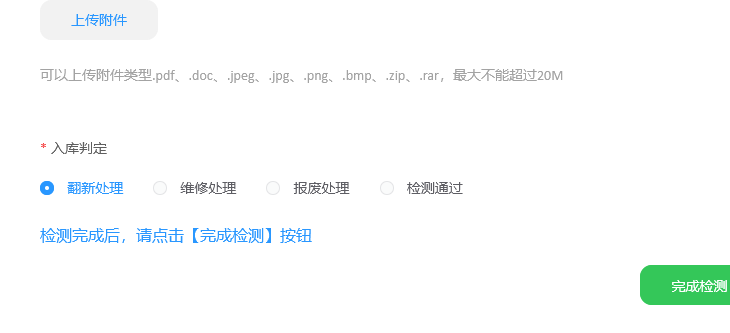

随后到左侧 **“产品翻新表”**，按设备 SN 搜索对应记录，点击该记录的翻新入口（截图中为“待翻新”），进入“产品翻新作业”。

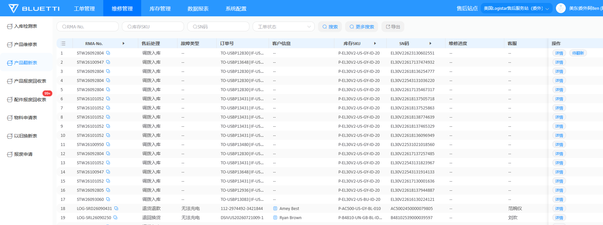

### 4.1 申领实际使用的箱材

在翻新作业中核对产品 SN，点击 **“申领物料”**，搜索实际使用的箱材，勾选对应库存 SKU，填写实际数量，点击 **“保存”**。

内箱为 **INB**，外箱为 **UNB**。截图以搜索 `UNB-EB3A`、选择 `A-UNB-EB3A-6C06A0`、数量 1 为例；实际按当前机型和使用的箱材登记，不照抄示例 SKU。

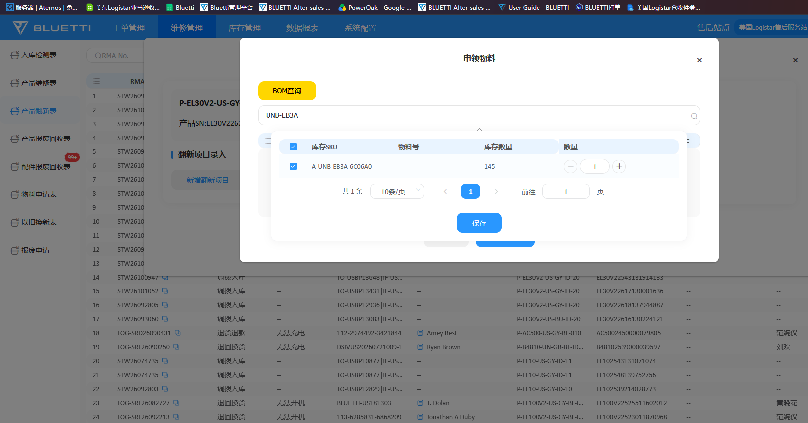

### 4.2 登记翻新项目，完成翻新入库

点击 **“新增翻新项目”**，按实际使用的物料及处理内容登记。以下为截图示例，勾选项目须与实际操作及申领物料一致：

| 项目 | 填写或选择 |
| --- | --- |
| 是否领料 | 是 |
| 翻新类别 | 勾选“包装材料（外箱、内箱、珍珠棉）”和“辅材配件（说明书、保修卡、塑料袋）” |
| 功能配件（适配器、线材） | 不勾选 |
| 其他（备注说明） | 不勾选 |

截图中的备注为空。核对物料及翻新项目登记后，点击 **“完成翻新入库”**。

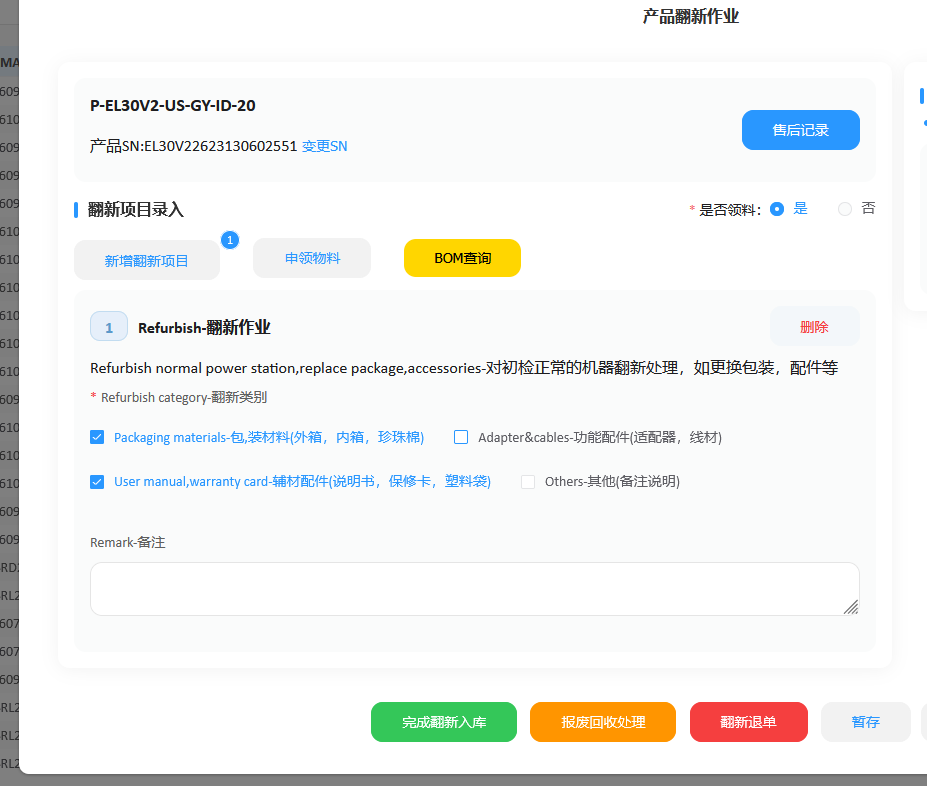

### 4.3 确认翻新完成，设置货品成色

点击“完成翻新入库”后，系统弹出 **“是否确认翻新成功”** 窗口。“货品成色”按以下规则设置：

| 情况 | 货品成色 |
| --- | --- |
| 翻新时更换了箱子 | 9.0新 |
| 未更换箱子 | 8.2新 |
| 状态很差 | 按实际情况设置为 8.5新或 8.0新 |

状态很差时使用对应成色，不直接套用更换箱子或未更换箱子的常规值。8.5新与 8.0新的具体区分标准待补充。

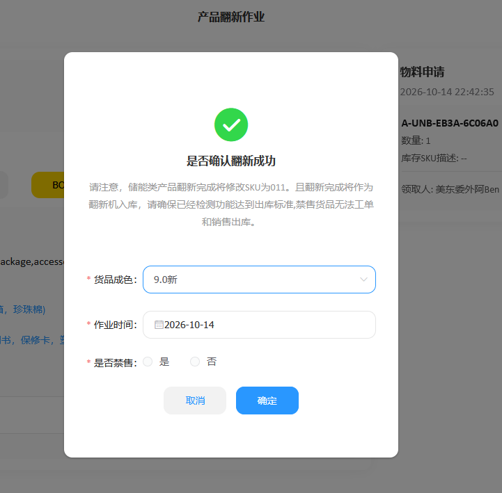

核对“作业时间”为实际翻新完成日期；后续补录时，依据作业人员或记录确认原完成日期，不把补录日期当作翻新日期。“是否禁售”需按实际情况选择，具体判定规则待补充。填写完成后点击 **“确定”**。截图中的日期仅为示例。

翻新完成后的 label 打印操作待继续补充。

## 5. OK 情况：打开详情，打印双二维码 label

完成检测后，打开对应记录的 **“详情”**，点击详情页的 **“打印”**，系统显示双二维码 label 预览。

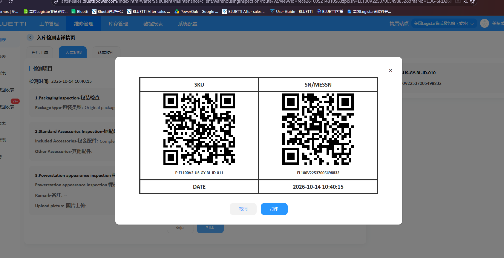

label 左侧为 **SKU** 二维码，右侧为 **SN/MESSN** 二维码，下方显示日期时间。核对预览中的 SKU、SN 与当前设备记录一致，再点击弹窗下方的 **“打印”**。

截图中的 SKU、SN 和日期时间仅为示例，实际使用系统为当前设备生成的 label。

### 5.1 核对处理后的 SKU

参考退回返修 SOP 的系统转换规则：`-10` 为原厂全新机，完成检测通过、翻新或维修后转换为 `-11`；`-20` 为集采渠道设备，通常按上架流程处理，完成翻新后转换为 `-21`。系统也可能显示为 `-010`、`-011`、`-020`、`-021`。

打印时使用对应设备当前系统记录中的完整 SKU，不沿用处理前的旧 SKU。正常尾号转换不表示 SN 改变，核对时仍确认设备 SN 一致。

### 5.2 粘贴标签

参考退回返修 SOP 的贴标要求，将设备按“up to top”（正面向上）方向摆正，把双二维码 label 贴在箱子前、后、左、右四个面中面积最小、最窄的一面，覆盖原收货 label。

**箱上其他旧标签也要覆盖。** 检查箱子各面，用白色空白 label 完整遮住其他旧作业标签、旧运输标签及其地址、条码和二维码，避免残留旧信息造成识别或扫描错误。当前上架使用的双二维码 label 保持完整可见，二维码、SKU 和 SN 清晰可读。

## 6. 托盘码放

第 6～11 节覆盖从打托到送达上架区域的作业，结束状态为**整托准备完成、已送至上架区域待确认**。

作业顺序：整齐打托、标签朝外 → 逐箱扫描左 SKU、右 SN → 保存 TXT 并导入 WPF → 输入托盘号、打印汇总贴纸和两份清单 → 核对并签字 → 整托缠膜 → 放清单、贴汇总贴纸 → 推至上架区域等待确认。

当待上架货物凑成一托盘，数量**大于 10 件、小于 30 件（即 11～29 件）**时，将货物整齐码放在托盘上，**标签朝外**，便于从托盘外侧查看和扫描。

先清点本托盘实际件数，再逐箱检查当前双二维码 label 朝外、可扫描，箱上其他旧作业及旧运输标签已按第 5.2 节覆盖。箱体原有的产品标识、方向标识及危险品标识不属于旧作业或旧运输标签，不按旧标签遮盖。

本托盘实物、扫描文件、明细清单及汇总贴纸应始终对应同一批货物。扫描后如增减或更换货物，须同步更新扫描数据、重新核对并打印对应清单和贴纸，避免实物与纸面记录不一致。

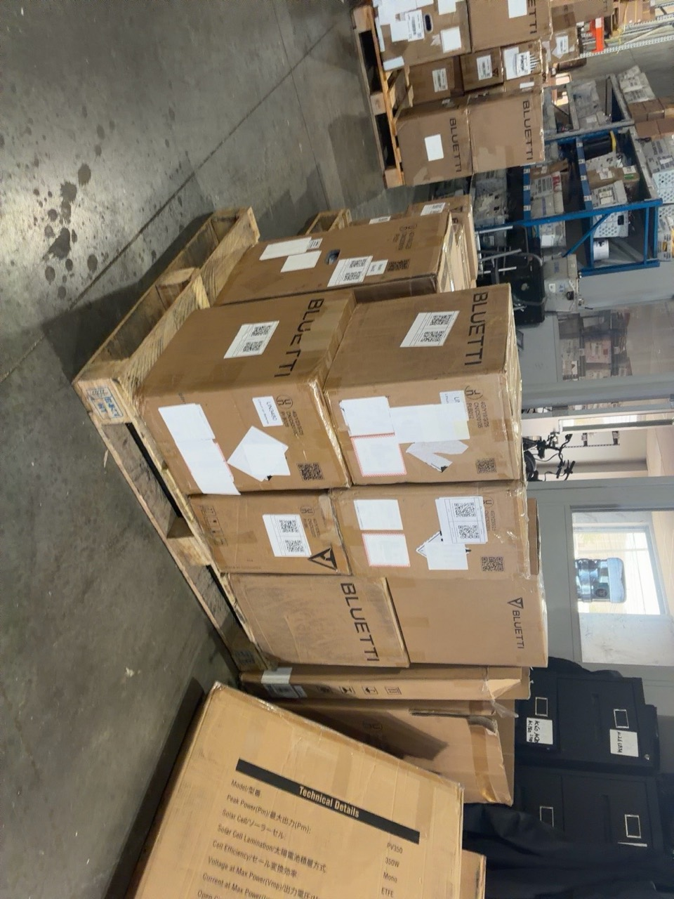

图中展示箱上其他旧标签用白色空白 label 覆盖、当前双二维码 label 保持可见的现场做法；照片仅用于说明码放和标签处理，不作为托盘件数依据。

## 7. 逐箱扫描 SKU 与 SN

托盘码放完成后，扫描托盘上所有货物的双二维码 label。每箱按以下顺序扫描：

1. 先扫描左侧二维码，记录 **SKU**。
2. 再扫描同一箱右侧二维码，记录 **SN**。
3. 完成这一箱的 SKU、SN 扫描后，再扫描下一箱，直到整托盘全部扫描完成。

扫描结果按行排列，每箱对应连续两行：上一行为 SKU，下一行为该设备的 SN；随后继续下一箱的 SKU、SN。不先集中扫描所有 SKU 再扫描所有 SN，以免对应关系错位。

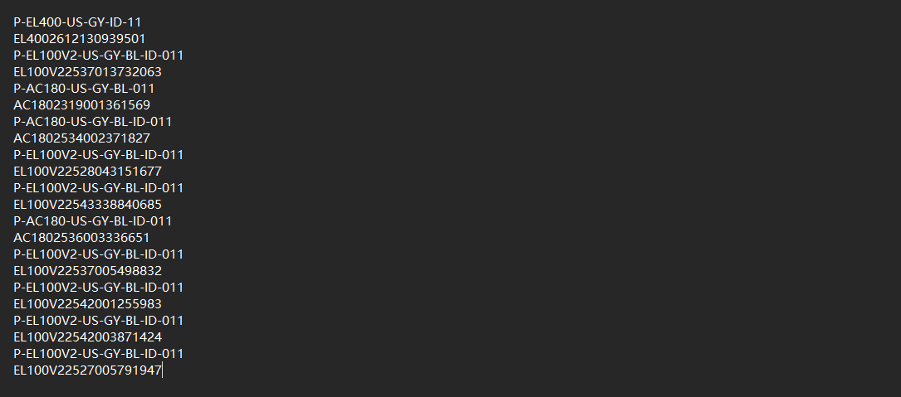

扫描完成后，核对 SKU、SN 成对排列，记录对数与托盘实际货物件数一致，检查是否漏扫、重复扫描或顺序错位。SKU 可因同型号设备重复出现，SN 应逐台对应。截图中的 SKU、SN 仅为示例，实际保留当前托盘设备的完整扫描结果。

将扫描结果保存为本托盘独立的 **TXT 文档**，不要混入其他托盘数据。发现漏扫、重复 SN 或 SKU/SN 顺序错误时，按实物核实并修正对应记录后再导入；不能只根据总件数相同就认为扫描正确。

## 8. WPF 良品上架：导入 TXT、输入托盘号并打印

### 8.1 打开良品上架并导入扫描文件

使用第 7 节已核对并保存的本托盘 TXT 文档，保持 SKU、SN 逐箱交替排列。

在 WPF 的“上架”区域点击 **“良品上架”**。

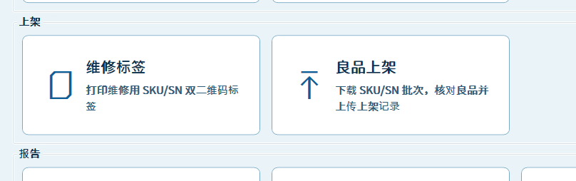

进入页面后，点击 **“选择 TXT”**，导入刚才保存的本托盘扫描文件。核对页面显示的文件及明细属于当前托盘，并检查总件数、SKU 种类数及基础表匹配结果。

截图示例为 **共 11 件、4 种 SKU，基础表匹配 11 条、未匹配 0 条**，不是每托盘的固定数量。实际按当前扫描结果核对；如出现未匹配记录，先核实扫描数据与基础表匹配情况，再继续打印。

基础表匹配成功只说明已找到对应记录，仍需核对导入明细的 SKU、SN 与本托盘设备一致。基础表通过 WPF 的“导入基础表”入口载入共享缓存，具体来源、更新频率及责任人待明确。“下载批次”用于选择 PDA 已上传的 SKU/SN 批次，以该批次替换当前列表并重新匹配，不是更新基础表；已使用 TXT 的本流程不要求再次下载批次。

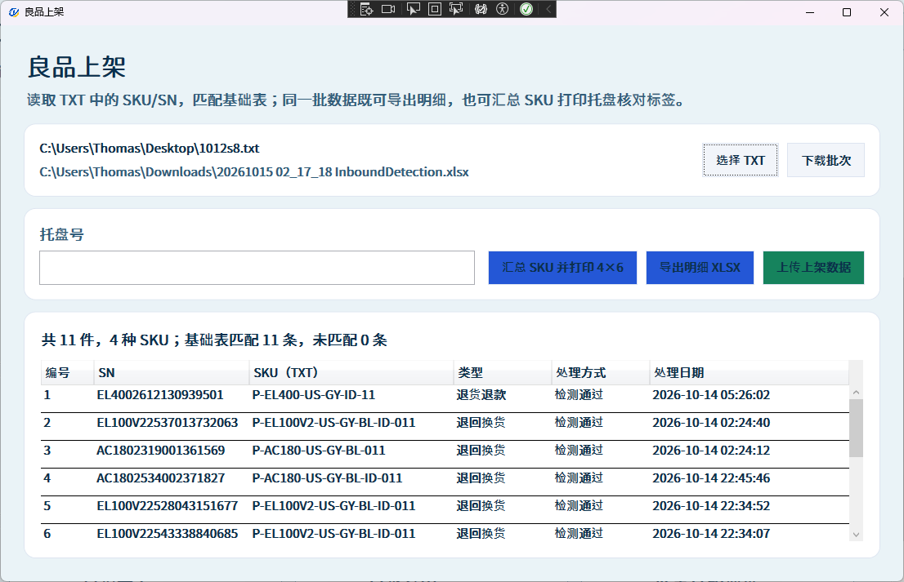

### 8.2 输入托盘号并打印托盘标签

在 **“托盘号”** 输入框填写本托盘实际编号，核对无误后点击 **“汇总 SKU 并打印 4×6”**，打印本托盘的 SKU 汇总核对标签。截图中的托盘号尚未填写，实际操作须填写后再打印。

### 8.3 清单一式两份，打印并签字

点击 **“导出明细 XLSX”**，导出同一批扫描数据的明细清单。打开导出的文件，核对清单中的 SKU、SN 及总件数与当前托盘一致，将清单**打印一式两份**。

两份清单均填写对应的**库位、签字和日期**，核对两份内容一致。库位按实际情况填写，签字由本次作业人员本人完成，日期填写实际签字日期。

签字前核对实物件数、WPF 导入件数、清单行数及汇总贴纸总数量一致，各 SKU 汇总数量与清单一致。发现错误时先修正数据并重新打印，再签字。

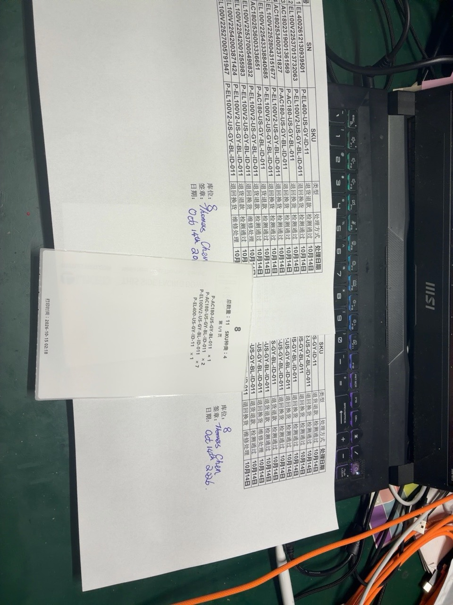

照片展示两份明细清单均已填写库位、签字和日期，以及对应的托盘 SKU 汇总标签。照片中的编号、设备信息、姓名及日期仅为示例，实际按本托盘信息填写。

## 9. 整托缠膜固定

完成托盘标签及清单打印、签字后，用透明缠绕膜将托盘上的货物整托缠绕固定。

缠膜后检查货物码放稳固，双二维码 label 仍朝外、清晰可见。避免膜层褶皱或反光影响二维码读取，箱上其他旧标签保持覆盖。

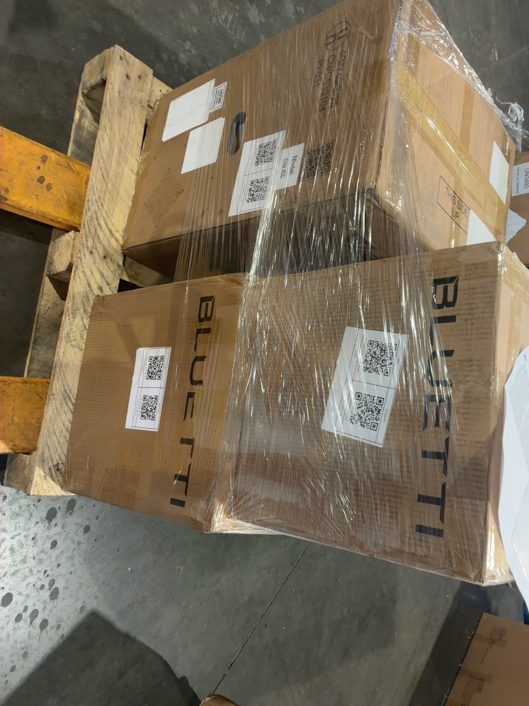

照片展示整托货物使用透明缠绕膜固定、双二维码 label 朝外可见的状态。

## 10. 放置清单，粘贴托盘汇总贴纸

整托缠膜后，将一份已填写库位、签字和日期的明细清单放在托盘货物外侧，用透明缠绕膜固定，使清单内容朝外可查看。

将第 8.2 节打印的 **4×6 托盘 SKU 汇总贴纸**贴在同一侧的醒目位置，按现场示例放在清单下方。核对贴纸上的托盘号、总数量及各 SKU 数量与清单和本托盘货物一致，保持清单与贴纸内容清晰可读，不遮挡设备的双二维码 label。

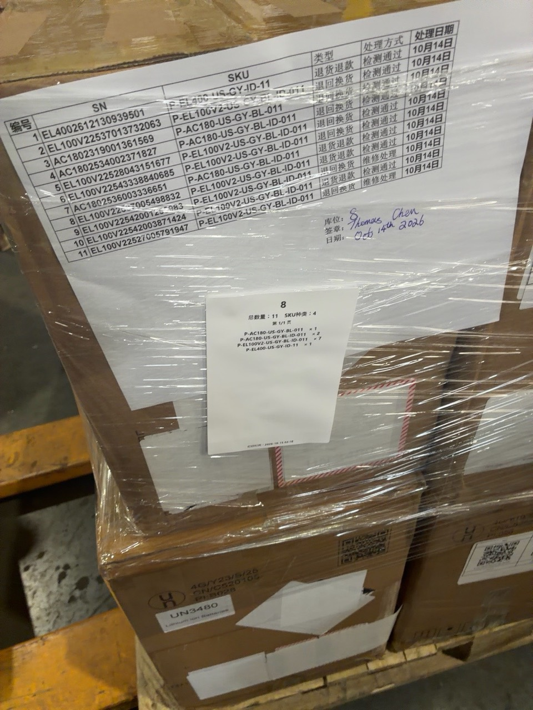

照片中的托盘号“8”、总数量“11”及 SKU 汇总仅为本次示例，实际使用当前托盘对应的清单和贴纸。

## 11. 推至上架区域，等待确认

完成整托缠膜、放置签字清单及粘贴托盘汇总贴纸后，将托盘推到**上架区域**，整齐排成一排，**等待确认**。

摆放后保持设备标签、清单及托盘汇总贴纸朝向便于查看的一侧，供后续核对。此时为待确认状态。

送达后检查缠膜与货物未因移动松动，清单及汇总贴纸仍固定在本托盘上，托盘号清晰可见。至此，本段作业完成，后续接续确认及正式上架流程。

WPF 页面上的“上传上架数据”尚未明确执行时点。本段的打印和送达待确认操作，不作为已上传数据或已完成系统上架的依据。

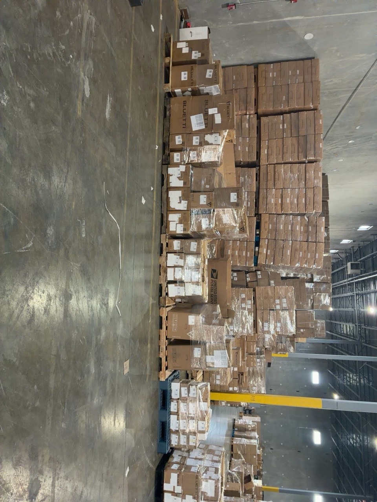

## 12. 本段待明确的问题

以下事项未由现有操作说明明确，保留为流程问题，不将推测写成已确认规则。

| 问题 | 需要明确的内容 |
| --- | --- |
| 托盘号与库位的关系 | 示例中两者均为“8”，需明确是否为同一编号；若不同，应分别填写。还需明确托盘号的分配及防重复规则。 |
| 两份清单的去向 | 一份随托盘固定，另一份由谁保管、交给谁及如何留存。 |
| 等待谁确认 | 确认人员、核对内容、确认记录，以及发现差异后的处理方式。 |
| 系统上传时点 | “上传上架数据”在送达前、确认后还是正式上架时执行，由谁操作、如何确认成功。 |
| 基础表更新 | “下载批次”的使用时点、基础表来源及未匹配记录的处理责任人。 |
| 托盘数量及码放限制 | 11～29 件之外如何处理；不同机型的重量、堆叠及托盘容量要求。件数范围不能替代实际承载与码放限制。 |

## 其他待继续补充

前置流程仍需补充：状态很差时 8.5新与 8.0新的区分标准、是否禁售的判定、翻新完成后的打印入口、其他非 OK 情况的处理，以及上架标签是否需额外标记。第 11 节之后的确认与正式上架流程另行补充。
