# 退回返修 SOP

本文用于 BLUETTI 电池、电源产品的返修收货和维修后寄回。当前返修货物通过 FedEx 到仓。

流程管理人员指经理、助理。收货用 WPF，售后工单处理用 BLUETTI after-sales，创建运输面单用 OMS，我方留痕用钉钉表格。

操作顺序：确认维修记录 → 完成系统检测与维修登记 → 打印双二维码 label 并贴好 → 创建 FedEx 面单 → 手写并同框拍照 → 补齐钉钉首次登记 → after-sales 出库 → 装车并回填车辆编号。收货识别作为前置说明保留。

## 1. 收货，贴好维修 label

收货时，在 WPF 预报系统中通过“工单导入”识别返修产品。返修产品打印出的 label 带有“维修”字样，机器和箱子上都要贴。

这项 WPF 功能目前有 bug，后续处理；以后可能接入接口。

## 2. 看维修记录，确定走哪条流程

维修人员完成维修后，会在 label 上写维修、翻新的内容或代码，例如 U2、M2。

维修时按实际操作记录更换的配件及编号。板件包括 U 板、M 板、BMS 板、A 板，编号为 1～8；其他配件包括保险（Fuse）、屏幕（Screen）、线材（Wire）、箱子（Box）。具体配件名称和编号查阅配件记录，SOP 不展开各板件的功能。

**当前要求：EB3A、EL100 系列强制更换保险（Fuse）。** EL100 是系列名称，目前绝大多数为 EL100V2；V2 表示 Version 2（第二版）。登记具体机型时仍以设备 label 为准。管理人员应记录实际更换情况，不能仅因有此要求就认定已经更换。

维修后打包时，维修、打包人员已完成需要的换箱，并把换箱情况写在 label 上。经理、助理根据 label 记录即可：**INB 为内箱，UNB 为外箱**。

### 正常维修流程示例

下图设备的 label 写有“OK”，同时列出了 **Fuse、Box、Wire**。它属于有具体维修内容的正常维修流程，不是“仅写 OK”的情况。

管理人员按实际维修内容申领材料、填写维修操作记录，然后从维修界面的详情打印双二维码 label，继续后续出库流程。Box 的内箱、外箱代号按实际换箱情况记录，不凭照片推定。

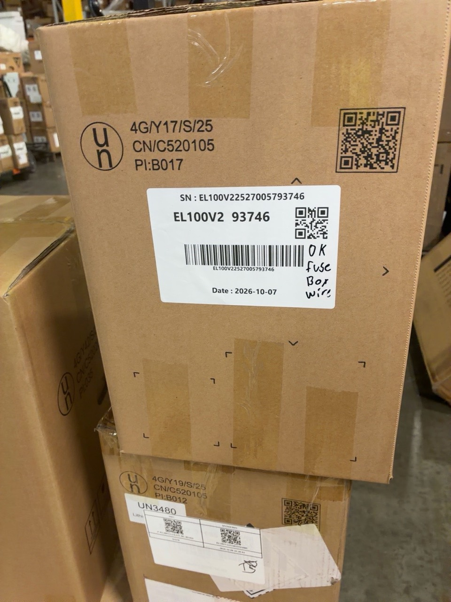

按该设备 SN 在 after-sales 查找对应工单，确认“售后处理”为“退回维修”，“故障类型”为“无法开机”。本例中，label 记录的更换保险（Fuse）与工单故障相符，因此继续走正常维修处理流程，登记 Fuse、Box、Wire 的实际处理内容。

这里是核对本台设备的工单与维修记录，不代表所有“无法开机”都只需换保险，也不代替维修后的检测。

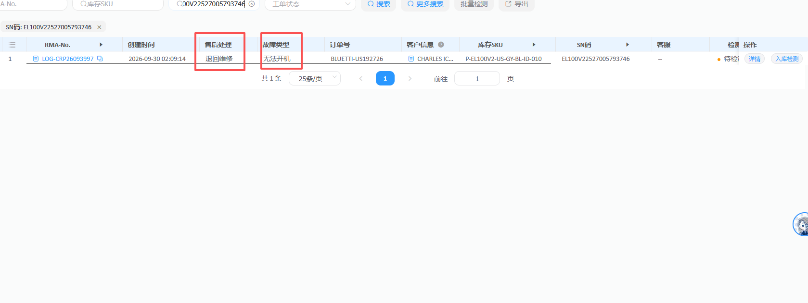

### label 仅写“OK”时

如果只写了“OK”，先找维修人员问清楚：

- 是谁修的？
- 有没有复现 after-sales 工单里描述的问题？
- 有没有进行维修？

把核实结果写进对应工单的备注，留下维修人、故障复现情况和维修情况。这个情况比较少，但不能只看见“OK”就直接通过。

核实时，先按设备 SN 查看 after-sales 工单，向维修人员说明工单中的具体故障，再确认“OK”是否针对该故障。例如，工单写的是“蓝牙连接故障”，就要确认该问题是否复现、是否维修，以及目前蓝牙连接是否正常。

### 现场沟通示例

下面这张照片用来说明本次现场沟通时，经理向维修人员说了什么：**“这台设备的工单是退回维修，客户报告的问题是蓝牙连接故障。”** 文档无法直接呈现当时的沟通过程，因此借助照片中贴出的三语故障描述，把这段说明展示出来。

**照片中的三语贴纸是本次沟通内容的展示，不是 SOP 要求的操作步骤，也不代表维修或检测结果。** 说明工单情况后，仍需询问维修人员并记录核实答复。

核实后选择对应流程：

- **检测通过**：确认设备针对工单问题检测正常、无需登记维修操作或更换配件时，选择“检测通过”，再从检测详情打印。
- **维修处理**：实际进行了维修、更换配件或补充包装、配件，需要登记这些内容时，选择“维修处理”，在产品维修表填写实际记录、完成维修入库，再从维修工单详情打印。即使 label 也写有“OK”，仍按实际维修内容走这一分支。

仅有“OK”且尚未核实清楚时，先问清楚并写备注，不直接选择检测通过。

在入库判定中，经理、助理只操作“维修处理”和“检测通过”。“工单退单”由客服、运营使用，“报废处理”由维修人员使用。出库过程中断时返回状态的“工单退单”入口，见第 8 步。

### 正常维修例子的入库检测填写

在对应工单中点击“入库检测”，包装类型、退回配件和裸机外观记录的是**客户退回到仓时的情况**，依据收货记录或现场确认填写。维修后换箱、补充线材、说明书及填充材料另记在维修记录中，不用维修后的状态覆盖原收货情况。本次示例选择了：

- 包装类型：客户自行包装。
- 包含配件：标配齐全。
- 裸机外观：有轻微划痕。

这些是本次设备的填写情况，不是其他设备的固定选项。

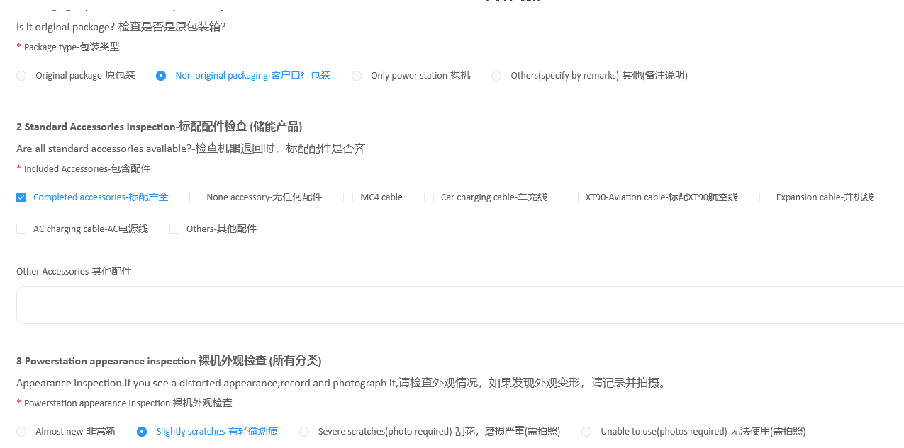

“入库判定”选择“维修处理”，然后点击“完成检测”。

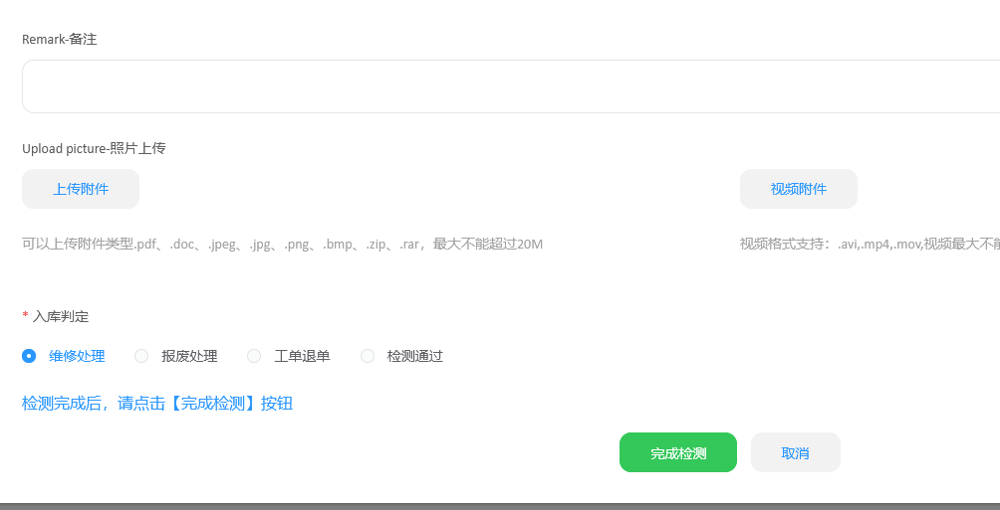

系统弹出确认框后，核对“作业时间”的日期，再点击“确定”。填写实际进行这项入库检测的日期；补录时使用原作业日期，不直接沿用系统当天默认值。截图中的日期只是本次示例。

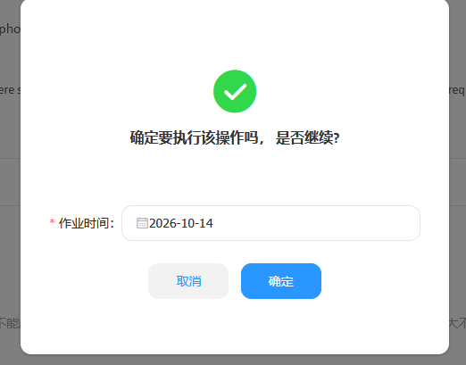

## 3. 打印双二维码 label，写上“维修”

**如果是检测通过：** 打开对应记录的“详情”，点击“打印”，打印双二维码 label。

**如果是维修处理：** 到左侧“产品维修表”，按 SN 找到设备。根据实际维修内容申领材料、填写维修操作记录，然后在维修界面的“详情”里打印 label。

在“维修管理” → “产品维修表”找到对应 SN 的记录，点击右侧“待维修”，进入维修页面后点击“申领材料”（页面按钮也可能显示“申领物料”）。

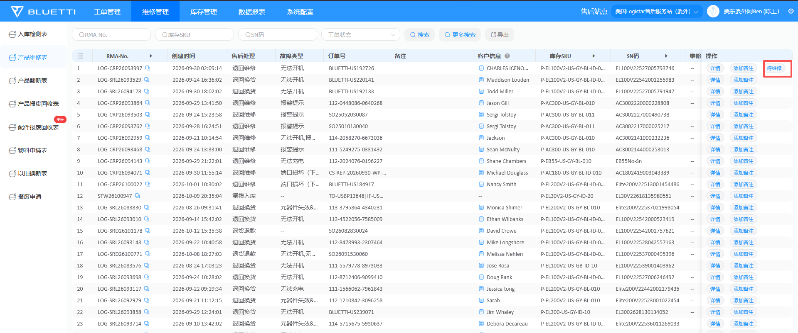

申领时根据实际使用的配件和包装材料勾选对应项目、填写数量，再点击“保存”。本次示例涉及的代号如下：

| 代号 | 材料 |
| --- | --- |
| UNB | 外箱 |
| T（示例 SKU 中为 TEPE） | 顶部泡沫塑料填充 |
| B（示例 SKU 中为 BEPE） | 底部泡沫塑料填充 |
| UMN | 说明书（UserMenu） |

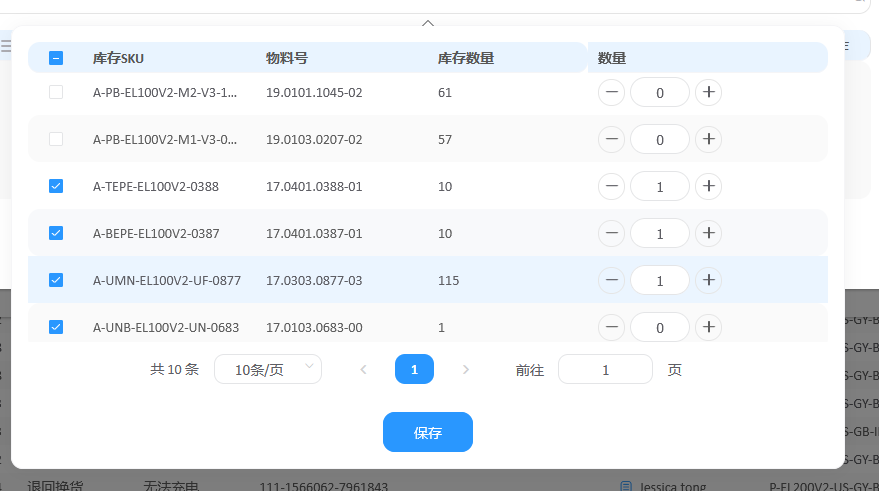

截图中顶部泡沫、底部泡沫、说明书各填写 1，UNB 已勾选但数量仍为 0，属于填写过程中的画面。保存前按实际使用情况补齐数量，不将勾选本身视为已完成申领。维修 label 中的 Fuse、Wire 等也应根据实际使用情况登记、申领，不仅记录截图中可见的包装材料。

申领材料时查阅配件记录；线材也可参考附件 [常用线材](attachments/常用线材.xlsx)。按实际维修内容填写配件和维修操作记录。

### 填写本次维修记录

在维修页面新增维修项目，按实际故障和处理内容填写。本次示例的故障类别为“开关机故障”，故障现象为“无法开机”，维修动作勾选“更换”。

“维修说明”可填写：

> 工单报告无法开机。更换保险（Fuse）、外箱（UNB），补充配线（Wire）及说明书（UMN），更换顶部和底部泡沫填充材料（T、B）。

说明内容应与实际维修、补充配件和申领材料对应。“责任归属”按实际确认结果选择；不能仅凭“无法开机”或“更换保险”认定为客户使用原因。没有确认的故障原因、维修后测试结果不写入记录。

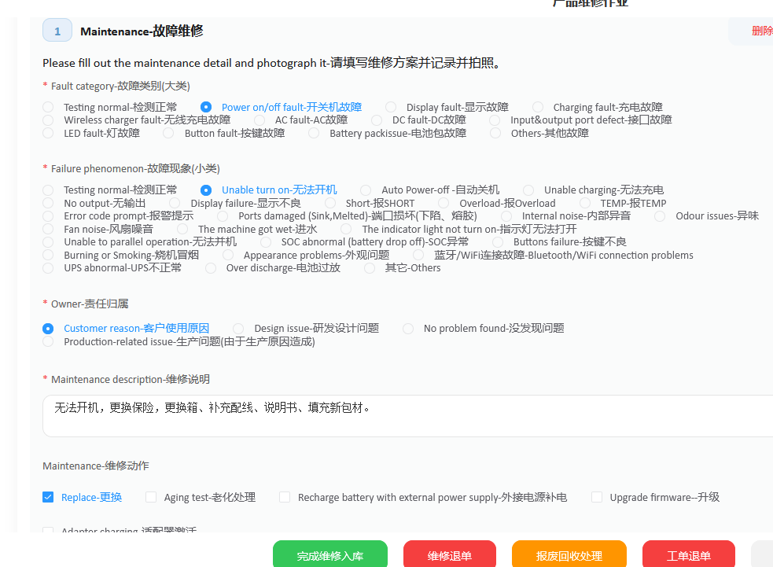

### 完成维修入库，再打印 label

1. 维修内容填写完毕后，点击“完成维修入库”。
2. 在“是否确认维修完成”弹框中核对作业日期，填写实际维修完成日期，再点击“确定”。经理后续补录时，按维修人员或维修记录确认的日期填写，不把补录日期当作维修日期。
3. 回到“产品维修表”，找到该设备的记录并点击“详情”。
4. 在详情页选择“维修工单”，确认对应维修记录显示“完成维修翻新”、入库状态为“已入库”，点击该记录右侧的“打印”，打印双二维码 label。

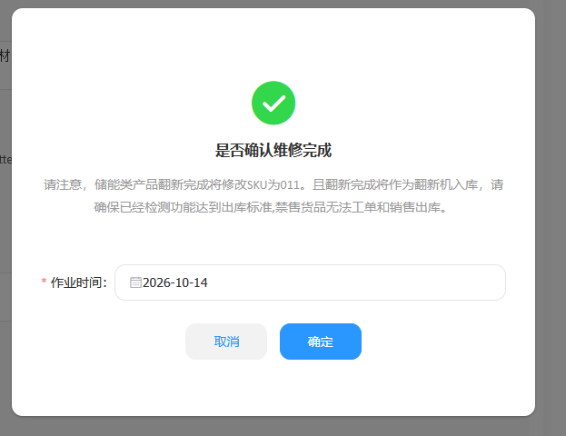

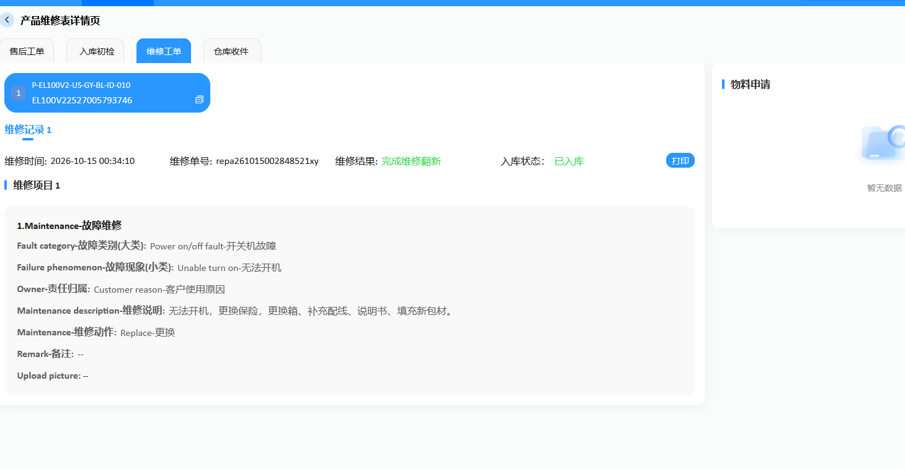

此处使用的是维修工单中的打印入口，仍须遵守下方提醒，不返回原入库检测界面打印。

**维修处理后一定要在维修界面打印。返回之前的入库检测界面，会打印出错误的单。** after-sales 是客户提供的系统，我方无法修改，操作时要注意入口。

打印后，在 label 下方手写“维修”标记，现场示例使用英文 **REPAIRED**。以后可能改成盖章，目前仍是手写。

### 贴好双二维码 label

设备按“up to top”（正面向上）方向摆正，将双二维码 label 贴在箱子前、后、左、右四个面中面积最小、最窄的一面，覆盖原有收货 label。

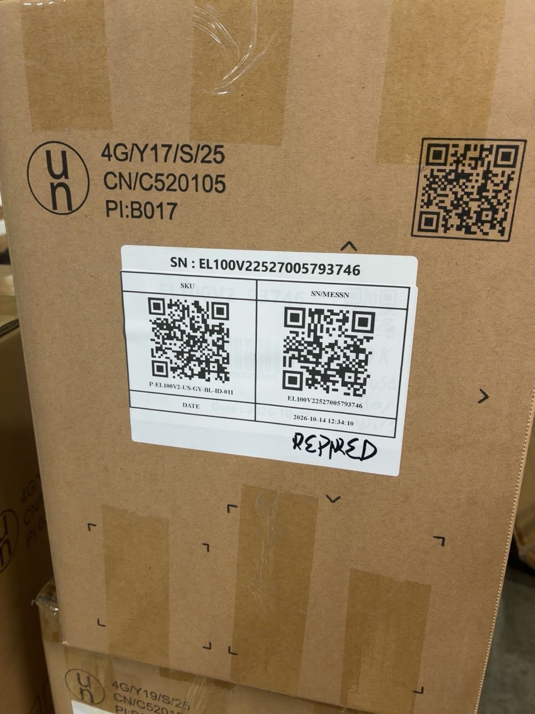

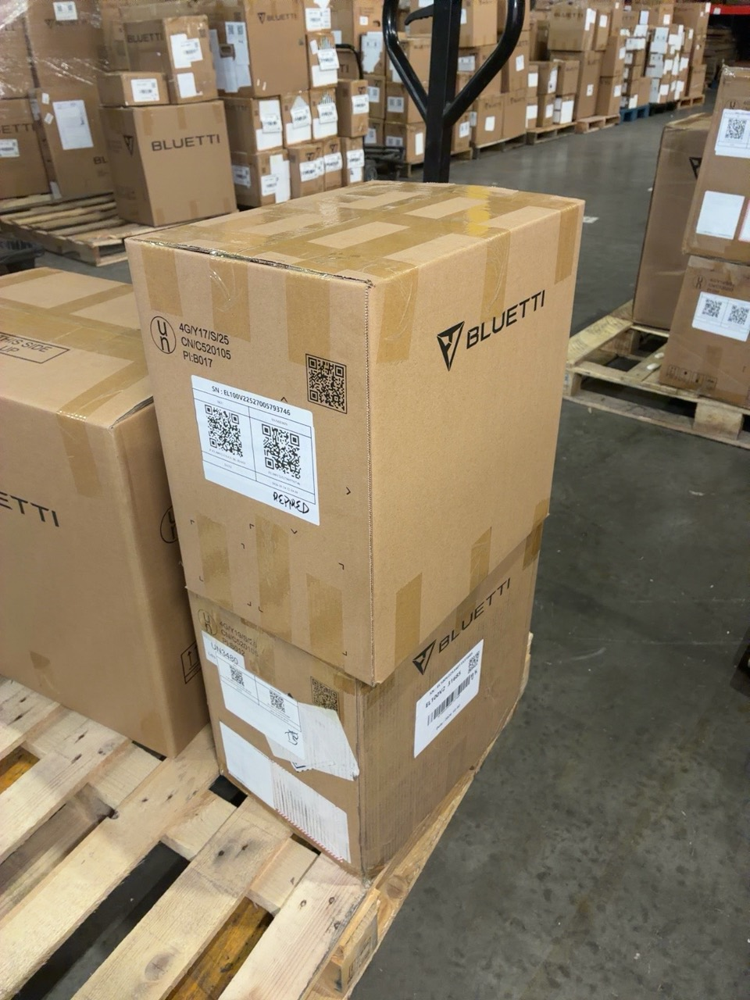

用白色空白 label 遮住箱子上残留的旧运输标签，包括旧地址、旧运单条码及二维码，避免误送。新双二维码 label 的二维码、SKU 和 SN 保持清晰可读。

## 4. 找寄回信息，准备包装

能继续使用的原箱，维修后仍用原箱寄回。不能使用的原箱已在维修后打包时更换；管理人员按 label 上的 INB、UNB 记录换箱情况。

进入 after-sales：**库存管理 → 出库作业执行 → 出库工单需求池**。按 SN 搜索设备，点击该记录右侧的“面单信息”。

后面创建面单需要的客户单号、收件人信息和寄回地址，都从对应工单获取。收件信息由客服录入，after-sales 已有校验。

### 本次出库操作示例

下面展示本次按 SN 查找对应设备、打开“面单信息”的实际操作。

以下截图中的客户信息及编号已局部打码，仅用于说明查找位置和字段。实际创建面单时，从系统复制完整信息，不使用截图中的局部信息填写。

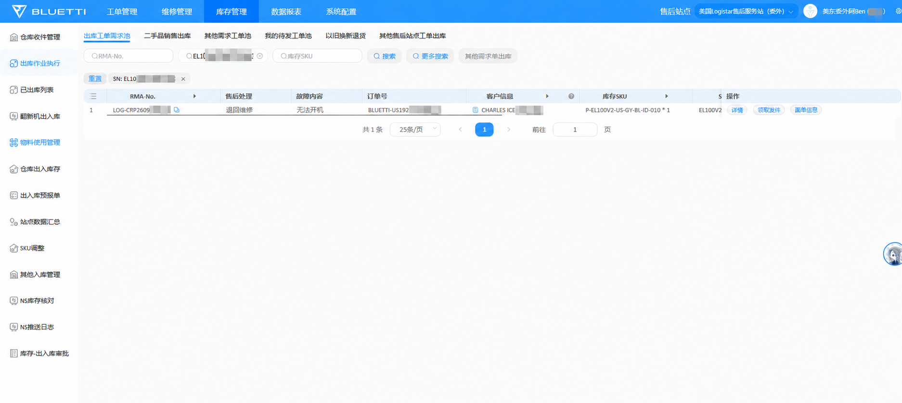

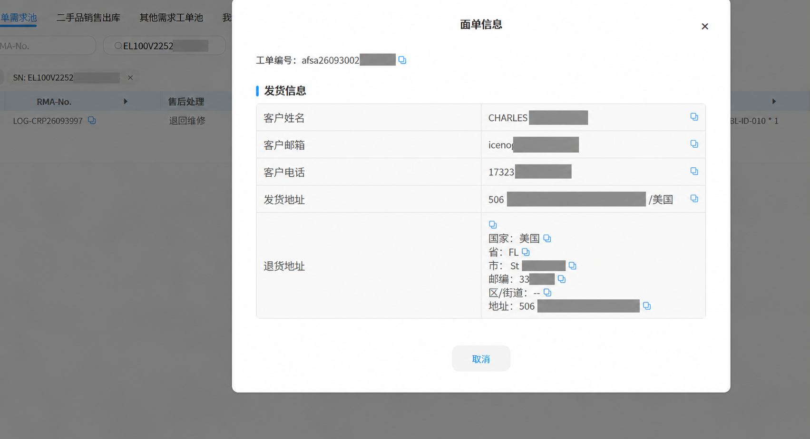

## 5. 在 OMS 创建 FedEx 面单

按下面要求填写：

- 币种：美元。
- 尺寸/重量单位：英制，尺寸用英寸，重量用磅。
- 客户单号：复制对应编号填写。
- 收件人信息：按 after-sales 对应工单填写。
- 发件人信息：切换到“发件人信息”，通过右侧“选择地址”按钮选择。
- 包裹重量、长宽高：打开附件 [各机型尺寸重量数据](attachments/各机型尺寸重量数据.xlsx)，在 Sheet1 按型号查询。表中重量单位为 LB（磅），尺寸单位为 in（英寸），顺序为长 × 宽 × 高。查不到就实际测量，按英制填写。

如果客户没有提供电话，OMS 电话栏使用占位号码 **202-555-0100**，内部记录注明“客户未提供电话，OMS 使用占位号码”。这不是客户的真实电话。

注意：下面截图里的单位是公制，实际操作要切换成英制。

### 本次 OMS 填写示例

1. 从 after-sales 的“面单信息”复制客户单号，填入 OMS 的“客户单号”。申报币种选择“美元”。
2. 在“收件人信息”中填写对应的姓名、国家、州、城市、地址、邮编、邮箱和联系电话，以系统中的完整信息为准。
3. 在包裹信息中选择“英制（INCH/LB）”，填写实际箱数、重量和长宽高。本次示例为 **1 箱、21 磅、16 × 12 × 16 英寸**，不是其他机型的固定数据。
4. 切换到“发件人信息”，点击右侧“选择地址”，从地址列表选择对应仓库的发件地址。不要把客户地址填到发件人信息中。

以下截图中的客户联系方式、地址及账户信息已遮蔽；实际填写仍从系统复制完整数据。

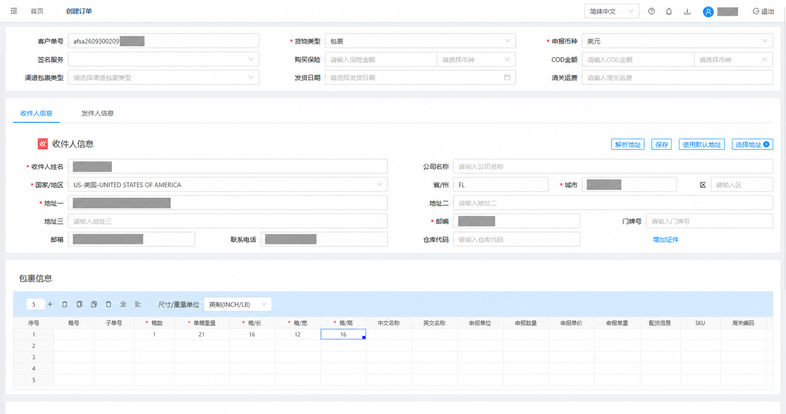

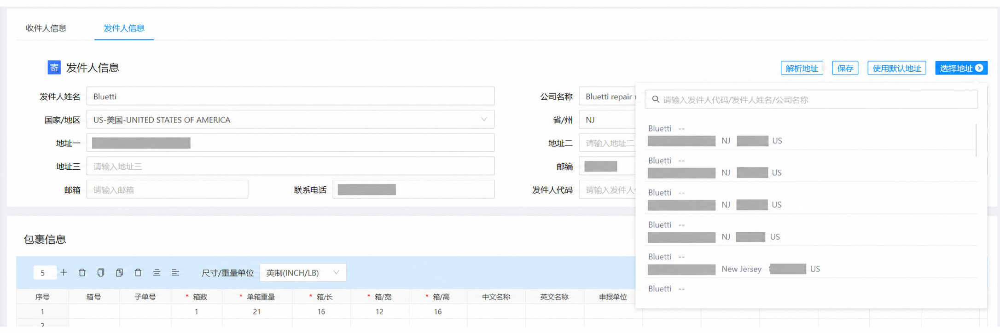

## 6. 记金额和单号，打印、手写、拍照

### 核对费用并下单

填写 OMS 信息后，按对应发货渠道继续下单。本次示例选择“FedEx-美东-NJ”，打开费用详情，核对渠道、货物重量及合计试算金额，再点击“立即下单”。

本次费用详情显示 **13.61 USD**，下单成功弹框也显示 **13.61 USD**。记录本次系统返回的美元金额，不能把截图金额当作以后每单的固定运费。费用详情中的重量显示为 9.525 KG，填写包裹时仍使用此前选择的英制单位。

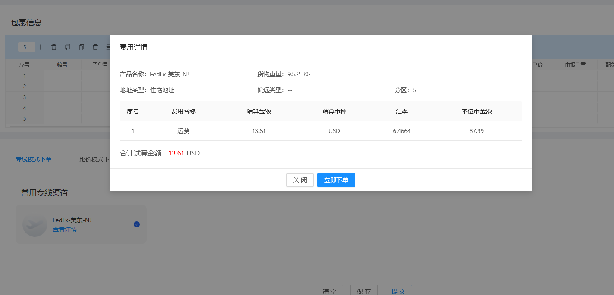

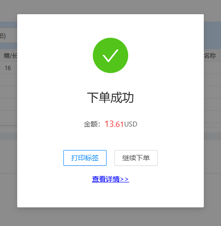

### 打印面单，取得承运商单号

下单成功后点击“打印标签”，在打印窗口选择实际使用的标签打印机、填写打印份数，再点击“打印”。本次示例为 1 份，打印机按现场设备选择。

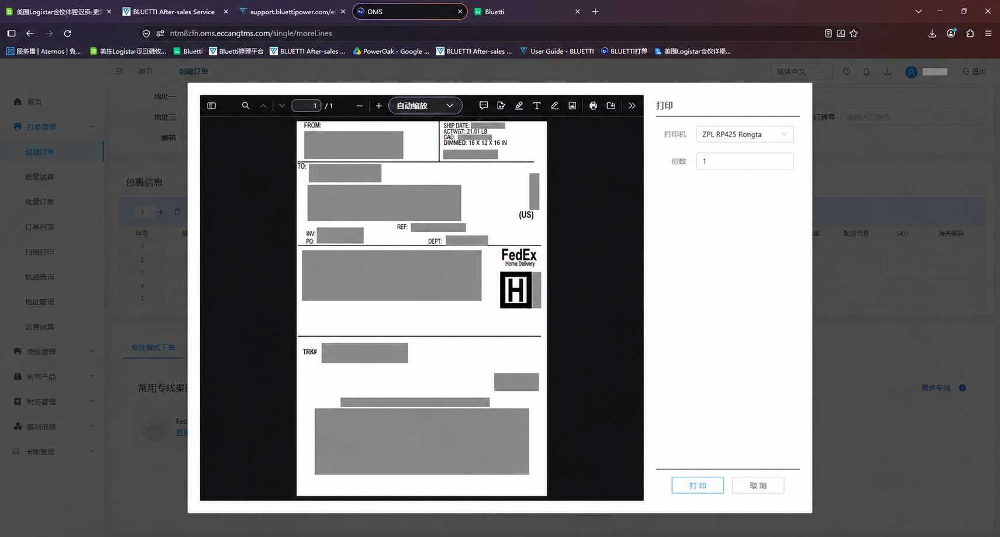

在 OMS 订单详情中查看“服务商单号”，该编号应与 FedEx 面单上的追踪号一致。后续填写 after-sales 运单号和钉钉承运商及面单号时，使用这个 FedEx 单号，不能误用 OMS 内部的“运单号”或客户单号。

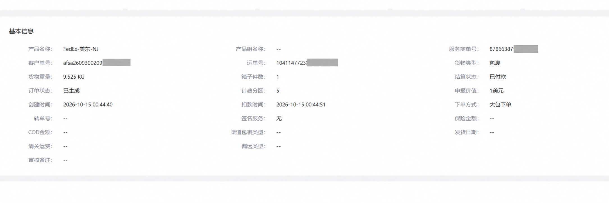

### 打印后的手写与照片留存

1. 留存 OMS 返回的金额和 FedEx 服务商单号，确保与已打印面单对应，供钉钉登记及 after-sales 出库使用。
2. 在面单上**手写设备 SN 和 RMA 编号**，防止串单、记错。OMS 的“客户单号”按系统定义填写，与这里手写的 RMA 编号分开记录。
3. 把这张面单和对应的双二维码 label 放在一起，拍在同一张照片里。
4. 把照片传到电脑上，后面需要上传到 after-sales。

### 本次手写面单及同框照片示例

面单打印后，手写设备 SN 和 RMA。本次现场把型号与 SN 分开写成两行，用于说明手写位置；实际记录须能与设备的完整 SN 对应。

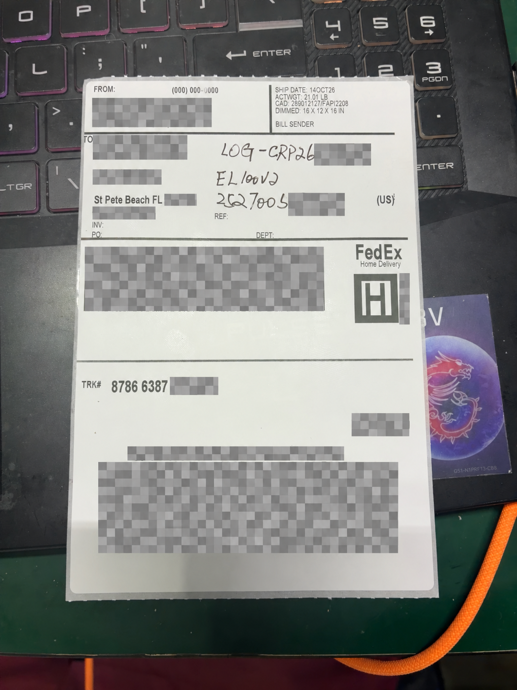

再把面单与对应设备的双二维码 label 放在一起拍照，确保面单上的手写信息和设备 label 都在同一张照片内。下面展示的是本次实际同框拍照的效果。

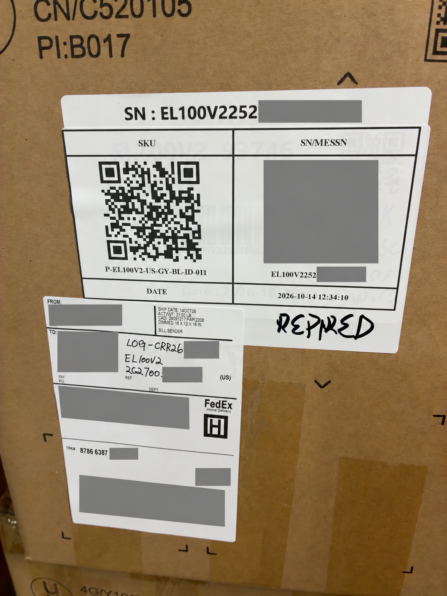

**文档中的示例照片已打码；实际上传 after-sales 的作业照片保留完整信息，不使用文档里的打码图。** 拍照后将照片传到电脑，用于后续领单出库时上传。

## 7. 填钉钉“出库返修记录表”

表格分两次填写：现在先填写除“承运货箱号”和“确认列”以外的信息，装车后再补“承运货箱号”；确认列无需操作。以下顺序按现有示例整理，不包含具体客户或设备信息。

| 字段 | 填什么 |
| --- | --- |
| 出库日期 | 实际出库日期；跨日完成时按实际出库日更新 |
| 设备 SN | 这台设备的 SN |
| 产品 SKU | 对应 SKU |
| 产品型号 | 对应型号 |
| 包裹尺寸 | 长 × 宽 × 高，英寸 |
| 包裹重量 | 重量，磅 |
| 运费金额 | OMS 返回金额，美元 |
| 承运商及面单号 | 承运商和面单号 |
| 承运货箱号 | 装车后，回填实际承运车辆的编号 |
| RMA 编号 | after-sales 对应的 RMA 编号 |
| 客户单号 | 按系统定义填写，与 OMS 使用的客户单号一致 |
| 收件人姓名 | 工单中的姓名 |
| 收件人邮箱 | 工单中的邮箱 |
| 收件人电话 | 工单中的电话；缺失时注明 OMS 使用占位号码 |
| 收件地址 | 完整街道、城市、州、邮编、国家 |
| 确认列 | 本流程无需填写 |

### 本次登记示例

创建 OMS 面单前，可先登记已知的出库日期、设备信息、尺寸、重量、承运商和 RMA。下图为本次记录尚未填完的状态，运费、完整运单号等仍需在 OMS 返回结果后补齐，不能将只有“Fedex-”的内容当作完整运单号。

这仍属于装车前的首次登记；装车后再第二次回填承运货箱号。截图中的设备 SN、RMA 已局部打码，实际表格填写完整信息。

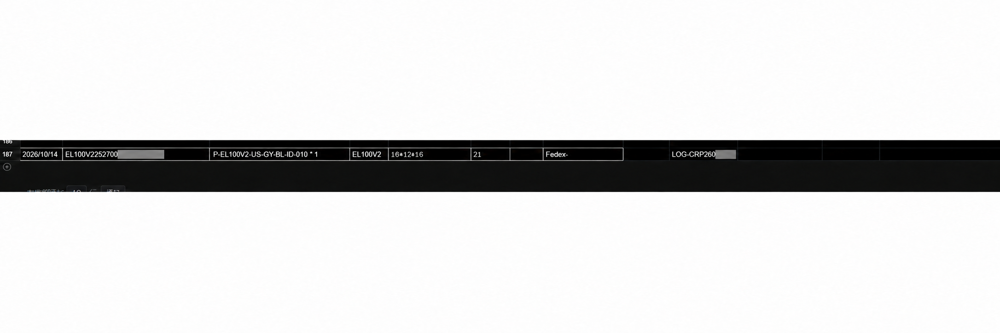

OMS 下单成功后，在同一条钉钉记录中补入返回的运费金额和“Fedex-完整服务商单号”，再补齐客户单号、收件人姓名、邮箱、电话及完整地址。这些收件信息仍从对应 after-sales 工单复制，不根据打码图片填写。

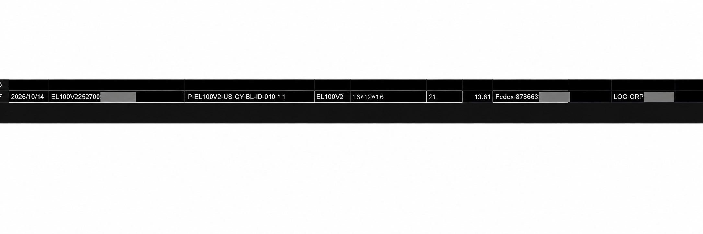

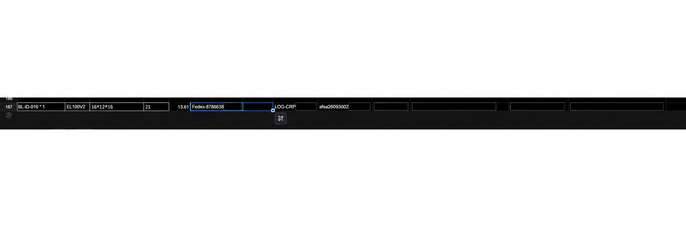

金额、运单及收件信息补齐后，完成装车前的首次登记；承运货箱号在实际装车后再回填。

## 8. 回 after-sales 领单、办理出库

运单号和照片准备好后，再回 after-sales 操作：

1. 在出库工单需求池找到对应工单，点击右侧“领单发件”，进入领单发件界面。
2. 在“工单发件列表”中，点击对应设备右侧的“出库”。
3. 在“出库产品信息”中核对对应的出库 SKU、出库 SN。在“出库物流信息”中，将“物流商”选择为 **FedEx**，输入 OMS 的 FedEx 服务商单号，出库时间填写本次实际办理出库的时间，与钉钉出库日期保持一致。
4. 点击“开始出库”，按页面提示继续到“出库作业 SOP”的照片上传页面。**推进到这一步会改变工单状态，不能直接返回此前状态；点击前先准备好照片，尽量连续完成。**
5. 点击“上传附件”，上传此前传到电脑上的同框照片。照片中要同时有手写 SN、RMA 编号的面单，以及对应双二维码 label。确认附件已显示，备注按实际需要填写。
6. 点击页面下方的 **“完成出库”**，确认系统提交成功后，再将货物推出去发货。“返回工单池”和“发货信息”不是完成出库按钮。

以下为本次填写完成后的界面，SN 和运输单号已局部打码。实际操作使用完整信息：

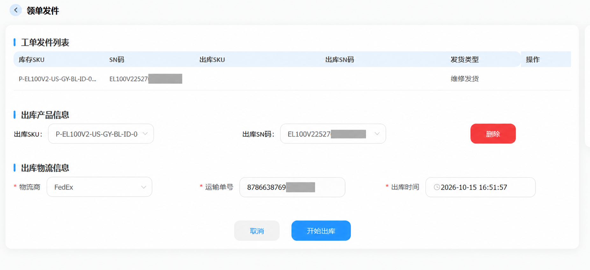

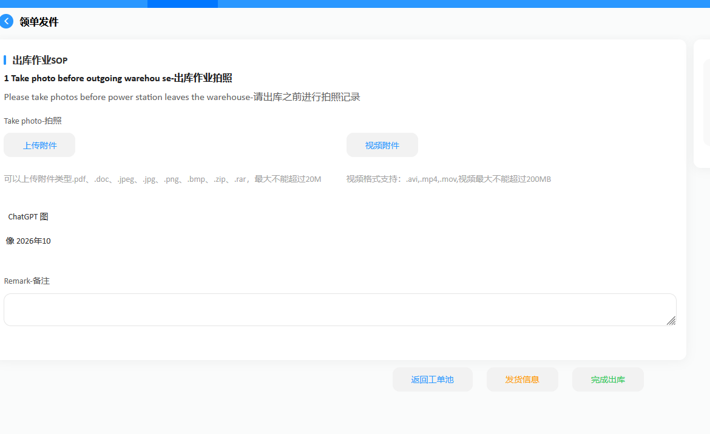

**领单后，工单会锁定到领取账户，其他账户不能操作，尽量一气呵成做完。**

如果断网等原因导致中断，用同一个账户回到这个页面继续即可。页面上有“解除领取”，但尽量不要用，因为会产生记录。

如果在出库这一步中断，需要返回此前状态，可使用对应工单右侧的“工单退单”入口。这里用于出库中断后的状态恢复，与入库判定中的退单操作分开理解。

## 9. 装车发货，回填车辆编号

把 FedEx 面单贴在对应箱子上。上述出库操作做完，就把返修货物托盘推出去发货。

**每天下午 3 点之前，将返修货物托盘运到 FedEx Ground 车上。**

装车时，记下托盘实际装到哪辆车上及该车的编号。装车后，把这个编号补填到钉钉“出库返修记录表”的“承运货箱号”列，完成本次出库记录。

## 附件

- [各机型尺寸重量数据](attachments/各机型尺寸重量数据.xlsx)：创建面单时查重量、尺寸。
- [常用线材](attachments/常用线材.xlsx)：申领维修物料时参考。
