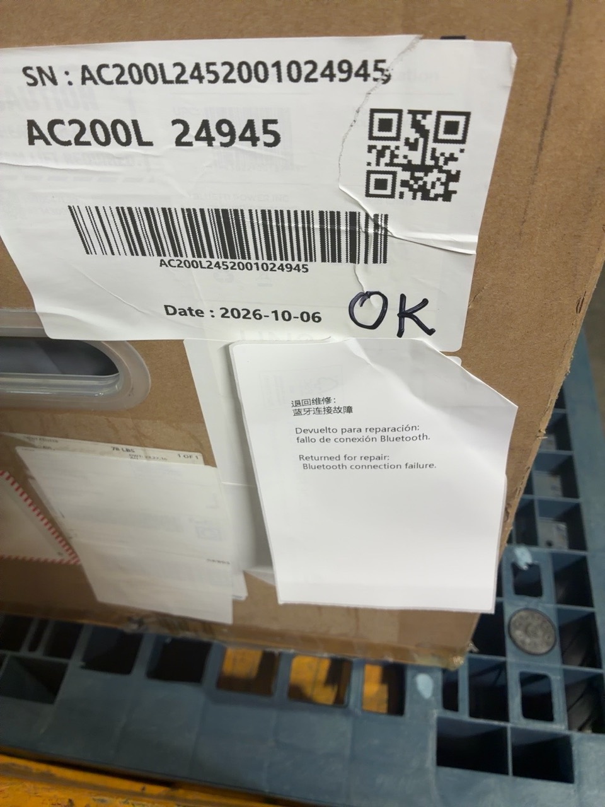
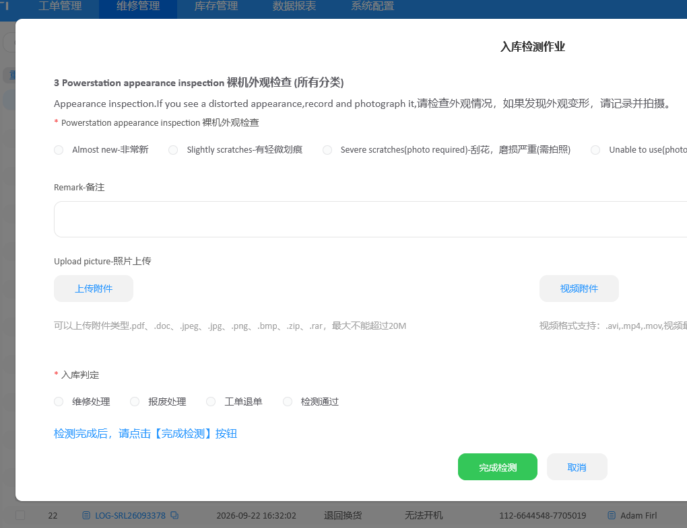
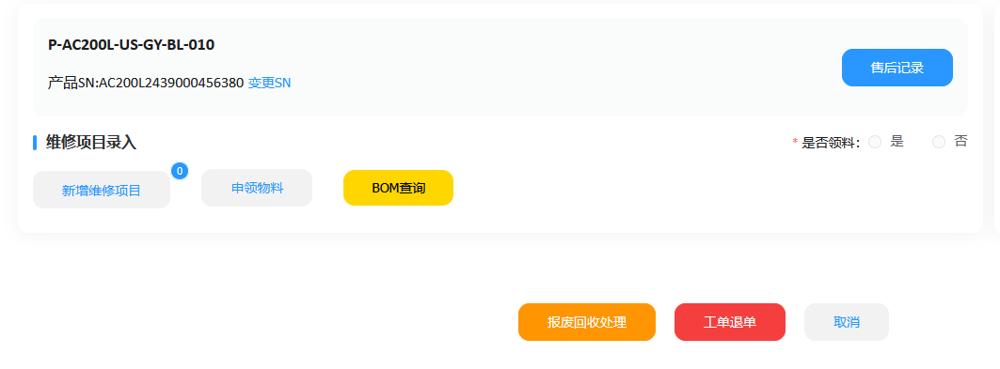
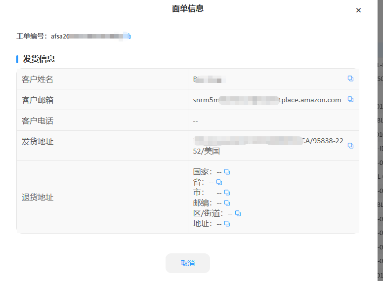
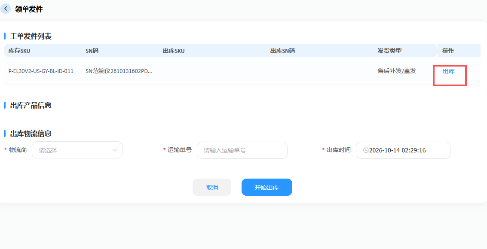
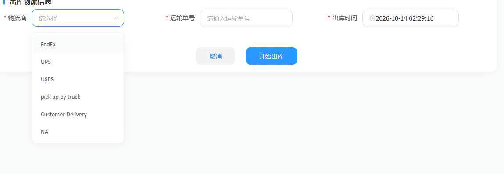
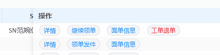

# 退回返修 SOP

本文用于 BLUETTI 电池、电源产品的返修收货和维修后寄回。当前返修货物通过 FedEx 到仓。

流程管理人员指经理、助理。收货用 WPF，售后工单处理用 BLUETTI after-sales，创建运输面单用 OMS，我方留痕用钉钉表格。

操作顺序：收货贴 label → 确认维修记录 → 打印双二维码 label → 创建 FedEx 面单 → 手写并拍照 → 首次填钉钉表格 → after-sales 出库 → 装车并回填车辆编号。

## 1. 收货，贴好维修 label

收货时，在 WPF 预报系统中通过“工单导入”识别返修产品。返修产品打印出的 label 带有“维修”字样，机器和箱子上都要贴。

这项 WPF 功能目前有 bug，后续处理；以后可能接入接口。

## 2. 看维修记录，确定走哪条流程

维修人员完成维修后，会在 label 上写维修、翻新的内容或代码，例如 U2、M2。

维修时按实际操作记录更换的配件及编号。板件包括 U 板、M 板、BMS 板、A 板，编号为 1～8；其他配件包括保险（Fuse）、屏幕（Screen）、线材（Wire）、箱子（Box）。具体配件名称和编号查阅配件记录，SOP 不展开各板件的功能。

维修后打包时，维修、打包人员已完成需要的换箱，并把换箱情况写在 label 上。经理、助理根据 label 记录即可：**INB 为内箱，UNB 为外箱**。

如果只写了“OK”，先找维修人员问清楚：

- 是谁修的？
- 有没有复现 after-sales 工单里描述的问题？
- 有没有进行维修？

把核实结果写进对应工单的备注，留下维修人、故障复现情况和维修情况。这个情况比较少，但不能只看见“OK”就直接通过。

核实时，先按设备 SN 查看 after-sales 工单，向维修人员说明工单中的具体故障，再确认“OK”是否针对该故障。例如，工单写的是“蓝牙连接故障”，就要确认该问题是否复现、是否维修，以及目前蓝牙连接是否正常。

### 现场沟通示例

下面这张照片用来说明本次现场沟通时，经理向维修人员说了什么：**“这台设备的工单是退回维修，客户报告的问题是蓝牙连接故障。”** 文档无法直接呈现当时的沟通过程，因此借助照片中贴出的三语故障描述，把这段说明展示出来。

**照片中的三语贴纸是本次沟通内容的展示，不是 SOP 要求的操作步骤，也不代表维修或检测结果。** 说明工单情况后，仍需询问维修人员并记录核实答复。

在 after-sales 的“入库检测作业”中，按核实后的实际情况选择“检测通过”或“维修处理”，再点击“完成检测”。

在入库判定中，经理、助理只操作“维修处理”和“检测通过”。“工单退单”由客服、运营使用，“报废处理”由维修人员使用。出库过程中断时返回状态的“工单退单”入口，见第 8 步。

## 3. 打印双二维码 label，写上“维修”

**如果是检测通过：** 打开对应记录的“详情”，点击“打印”，打印双二维码 label。

**如果是维修处理：** 到左侧“产品维修表”，按 SN 找到设备。根据实际维修内容申领材料、填写维修操作记录，然后在维修界面的“详情”里打印 label。

申领材料时查阅配件记录；线材也可参考附件 [常用线材](attachments/常用线材.xlsx)。按实际维修内容填写配件和维修操作记录。

**维修处理后一定要在维修界面打印。返回之前的入库检测界面，会打印出错误的单。** after-sales 是客户提供的系统，我方无法修改，操作时要注意入口。

打印后，在 label 下方手写“维修”。以后可能改成盖章，目前仍是手写。

## 4. 找寄回信息，准备包装

能继续使用的原箱，维修后仍用原箱寄回。不能使用的原箱已在维修后打包时更换；管理人员按 label 上的 INB、UNB 记录换箱情况。

进入 after-sales：**库存管理 → 出库作业执行 → 出库工单需求池**。按 SN 搜索设备，点击该记录右侧的“面单详情”。

后面创建面单需要的客户单号、收件人信息和寄回地址，都从对应工单获取。收件信息由客服录入，after-sales 已有校验。

## 5. 在 OMS 创建 FedEx 面单

按下面要求填写：

- 币种：美元。
- 尺寸/重量单位：英制，尺寸用英寸，重量用磅。
- 客户单号：复制对应编号填写。
- 收件人信息：按 after-sales 对应工单填写。
- 发件人信息：切换到“发件人信息”，通过右侧“选择地址”按钮选择。
- 包裹重量、长宽高：打开附件 [各机型尺寸重量数据](attachments/各机型尺寸重量数据.xlsx)，在 Sheet1 按型号查询。表中重量单位为 LB（磅），尺寸单位为 in（英寸），顺序为长 × 宽 × 高。查不到就实际测量，按英制填写。

如果客户没有提供电话，OMS 电话栏使用占位号码 **202-555-0100**，内部记录注明“客户未提供电话，OMS 使用占位号码”。这不是客户的真实电话。

注意：下面截图里的单位是公制，实际操作要切换成英制。

## 6. 记金额和单号，打印、手写、拍照

1. 记录 OMS 返回的金额和面单号，并打印面单。
2. 在面单上**手写设备 SN 和 RMA 编号**，防止串单、记错。OMS 的“客户单号”按系统定义填写，与这里手写的 RMA 编号分开记录。
3. 把这张面单和对应的双二维码 label 放在一起，拍在同一张照片里。
4. 把照片传到电脑上，后面需要上传到 after-sales。

## 7. 填钉钉“出库返修记录表”

表格分两次填写：现在先填写除“承运货箱号”和“确认列”以外的信息，装车后再补“承运货箱号”；确认列无需操作。以下顺序按现有示例整理，不包含具体客户或设备信息。

| 字段 | 填什么 |
| --- | --- |
| 出库日期 | 实际出库日期 |
| 设备 SN | 这台设备的 SN |
| 产品 SKU | 对应 SKU |
| 产品型号 | 对应型号 |
| 包裹尺寸 | 长 × 宽 × 高，英寸 |
| 包裹重量 | 重量，磅 |
| 运费金额 | OMS 返回金额，美元 |
| 承运商及面单号 | 承运商和面单号 |
| 承运货箱号 | 装车后，回填实际承运车辆的编号 |
| RMA 编号 | after-sales 对应的 RMA 编号 |
| 客户单号 | 按系统定义填写，与 OMS 使用的客户单号一致 |
| 收件人姓名 | 工单中的姓名 |
| 收件人邮箱 | 工单中的邮箱 |
| 收件人电话 | 工单中的电话；缺失时注明 OMS 使用占位号码 |
| 收件地址 | 完整街道、城市、州、邮编、国家 |
| 确认列 | 本流程无需填写 |

## 8. 回 after-sales 领单、办理出库

运单号和照片准备好后，再回 after-sales 操作：

1. 在出库工单需求池找到对应工单，点击右侧“领单发件”，进入领单发件界面。
2. 在“工单发件列表”中，点击对应设备右侧的“出库”。
3. 在“出库物流信息”中，将“物流商”选择为 **FedEx**，输入 OMS 创建的运输单号，并核对出库时间。
4. 点击“开始出库”，在后续页面点击“下一步”，进入上传图片的页面。**点击“下一步”会改变该单状态，不能直接回到此前状态；点击前先准备好照片，尽量连续完成。**
5. 上传此前准备的照片。照片中要同时有手写 SN、RMA 编号的面单，以及对应双二维码 label。
6. 按页面提示完成出库操作，确认系统提示成功后，再将货物推出去发货。

**领单后，工单会锁定到领取账户，其他账户不能操作，尽量一气呵成做完。**

如果断网等原因导致中断，用同一个账户回到这个页面继续即可。页面上有“解除领取”，但尽量不要用，因为会产生记录。

如果在出库这一步中断，需要返回此前状态，可使用对应工单右侧的“工单退单”入口。这里用于出库中断后的状态恢复，与入库判定中的退单操作分开理解。

## 9. 贴面单，推出去发货

设备按“up to top”方向摆正后，将双二维码 label 贴在箱子前、后、左、右四个面中面积最小的一面。

贴 label 时，用空白的白色 label 覆盖箱子上可能残留的旧运单等运输标识，避免货物被错误寄送。

把 FedEx 面单贴在对应箱子上。上述出库操作做完，就把返修货物托盘推出去发货。

**每天下午 3 点之前，将返修货物托盘运到 FedEx Ground 车上。**

装车时，记下托盘实际装到哪辆车上及该车的编号。装车后，把这个编号补填到钉钉“出库返修记录表”的“承运货箱号”列，完成本次出库记录。

## 附件

- [各机型尺寸重量数据](attachments/各机型尺寸重量数据.xlsx)：创建面单时查重量、尺寸。
- [常用线材](attachments/常用线材.xlsx)：申领维修物料时参考。

## 尚未确认的细节

以下内容尚未提供，操作时向负责人员确认，不自行猜填：

- after-sales 上传照片后的最终按钮名称和出库成功状态（本次未实际演示）。
