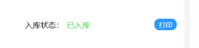
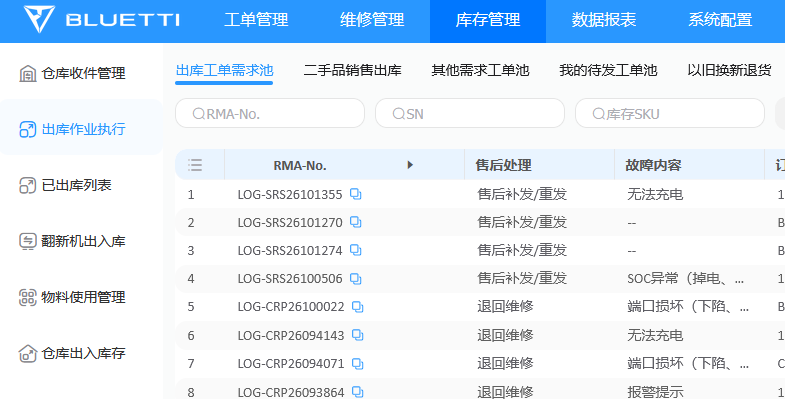
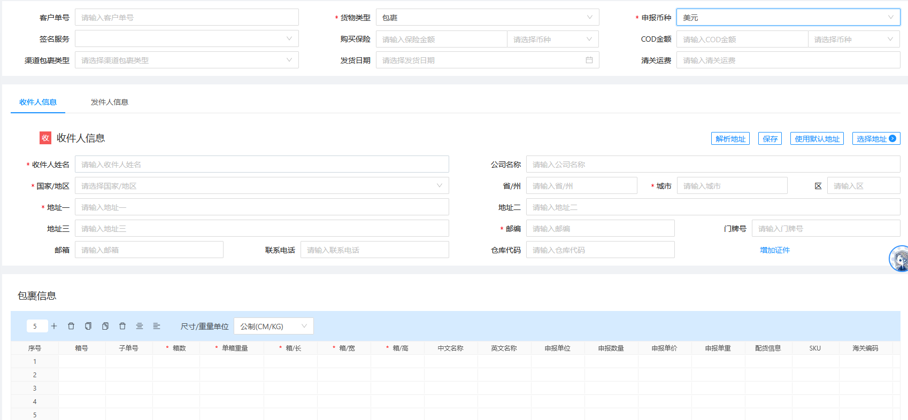

# 退回返修 SOP

本文用于 BLUETTI 电池、电源产品的返修收货和维修后寄回。当前返修货物通过 FedEx 到仓。

流程管理人员指经理、助理。日常会用到三个系统：WPF 用于收货识别和打印，BLUETTI after-sales 用于售后工单处理，OMS 用于创建运输面单；钉钉表格用于我方留痕。

## 1. 收货，贴好维修 label

收货时，在 WPF 预报系统中通过“工单导入”识别返修产品。返修产品打印出的 label 带有“维修”字样，机器和箱子上都要贴。

这项 WPF 功能目前有 bug，后续处理；以后可能接入接口。

## 2. 看维修记录，确定走哪条流程

维修人员完成维修后，会在 label 上写维修、翻新的内容或代码，例如 U2、M2。

如果只写了“OK”，先找维修人员问清楚：

- 是谁修的？
- 有没有复现 after-sales 工单里描述的问题？
- 有没有进行维修？

把核实结果写进对应工单的备注，留下维修人、故障复现情况和维修情况。这个情况比较少，但不能只看见“OK”就直接通过。

在 after-sales 的“入库检测作业”中，按核实后的实际情况选择“检测通过”或“维修处理”，再点击“完成检测”。

经理、助理只操作“维修处理”和“检测通过”。“工单退单”由客服、运营使用，“报废处理”由维修人员使用。

## 3. 打印双二维码 label，写上“维修”

**如果是检测通过：**打开对应记录的“详情”，点击“打印”，打印双二维码 label。

**如果是维修处理：**到左侧“产品维修表”，按 SN 找到设备。根据实际维修内容申领材料、填写维修操作记录，然后在维修界面的“详情”里打印 label。

**维修处理后一定要在维修界面打印。返回之前的入库检测界面，会打印出错误的单。** after-sales 是客户提供的系统，我方无法修改，操作时要注意入口。

打印后，在 label 下方手写“维修”。以后可能改成盖章，目前仍是手写。

## 4. 找寄回信息，准备包装

能继续使用的原箱，维修后仍用原箱寄回。

进入 after-sales：**库存管理 → 出库作业执行 → 出库工单需求池**。按 SN 搜索设备，点击该记录右侧的“面单详情”。

后面创建面单需要的客户单号、收件人信息和寄回地址，都从对应工单获取。收件信息由客服录入，after-sales 已有校验。

## 5. 在 OMS 创建 FedEx 面单

按下面要求填写：

- 币种：美元。
- 尺寸/重量单位：英制，尺寸用英寸，重量用磅。
- 客户单号：复制对应编号填写。
- 收件人信息：按 after-sales 对应工单填写。
- 发件人信息：切换到“发件人信息”，通过右侧“选择地址”按钮选择。
- 包裹重量、长宽高：查附件 Excel；查不到就实际测量，按英制填写。

如果客户没有提供电话，OMS 电话栏使用占位号码 **202-555-0100**，内部记录注明“客户未提供电话，OMS 使用占位号码”。这不是客户的真实电话。

注意：下面截图里的单位是公制，实际操作要切换成英制。

## 6. 记金额和单号，打印、手写、拍照

1. 记录 OMS 返回的金额和面单号，并打印面单。
2. 在面单上**手写设备 SN 和工单号**，防止串单、记错。
3. 把这张面单和对应的双二维码 label 放在一起，拍在同一张照片里。
4. 把照片传到电脑上，后面需要上传到 after-sales。

## 7. 填钉钉“出库返修记录表”

把本次出库的信息全部记进表格。以下顺序按现有示例整理，不包含具体客户或设备信息。

| 字段 | 填什么 |
| --- | --- |
| 出库日期 | 实际出库日期 |
| 设备 SN | 这台设备的 SN |
| 产品 SKU | 对应 SKU |
| 产品型号 | 对应型号 |
| 包裹尺寸 | 长 × 宽 × 高，英寸 |
| 包裹重量 | 重量，磅 |
| 运费金额 | OMS 返回金额，美元 |
| 承运商及面单号 | 承运商和面单号 |
| 承运货箱号 | 本次对应的承运货箱号 |
| RMA 编号 | after-sales 对应的 RMA 编号 |
| 工单号／客户单号 | 对应编号，以实际表格列名为准 |
| 收件人姓名 | 工单中的姓名 |
| 收件人邮箱 | 工单中的邮箱 |
| 收件人电话 | 工单中的电话；缺失时注明 OMS 使用占位号码 |
| 收件地址 | 完整街道、城市、州、邮编、国家 |
| 末尾空白列 | 用途待确认 |

## 8. 回 after-sales 领单、办理出库

运单号和照片准备好后，再回 after-sales 操作：

1. 找到对应工单，点击“领单”。
2. 选择“出库”，选择供应商，输入运单号。
3. 到第二个页面，上传刚才的照片。照片中要同时有手写 SN、工单号的面单，以及对应双二维码 label。

**领单后，工单会锁定到领取账户，其他账户不能操作，尽量一气呵成做完。**

如果断网等原因导致中断，用同一个账户回到这个页面继续即可。页面上有“解除领取”，但尽量不要用，因为会产生记录。

## 9. 贴面单，推出去发货

把 FedEx 面单贴在对应箱子上。上述出库操作做完，就把返修货物托盘推出去发货。

**每天下午 3 点之前，将返修货物托盘运到 FedEx Ground 车上。**

## 还需要补充的资料

- 重量、尺寸 Excel 附件。
- U2、M2 等代码的含义。
- 原箱不能继续使用时怎么处理。
- 钉钉表格最后一列的用途。
